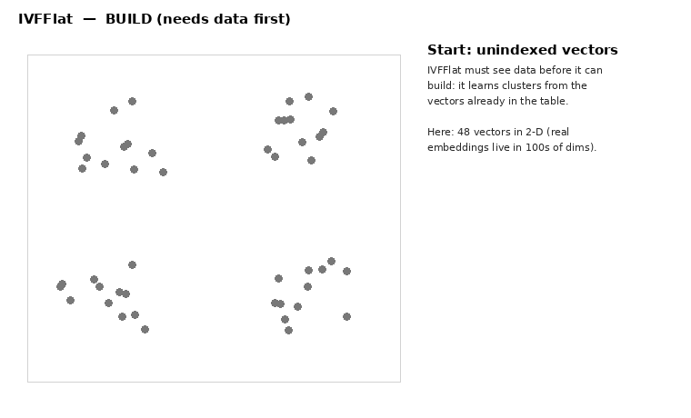
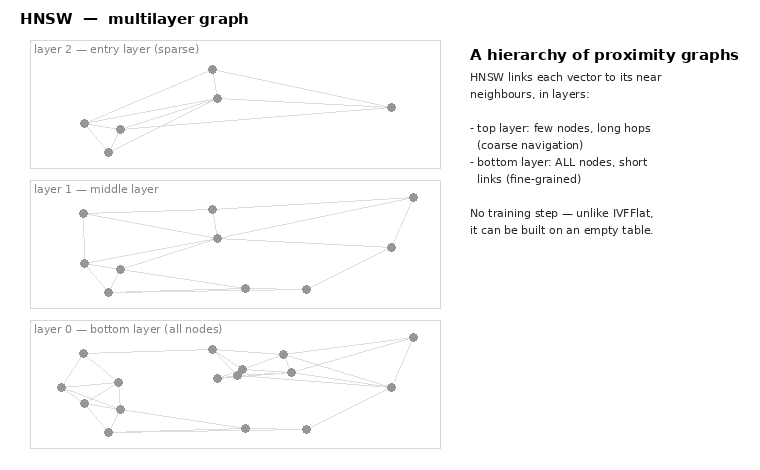

# pgvector index animations

Animated GIFs that visualize how pgvector's two approximate-nearest-neighbor
(ANN) index types — **IVFFlat** and **HNSW** — build and query, plus the
pure-Python (Pillow only) scripts that generate them.

| Animation | What it shows |
|-----------|---------------|
|  | IVFFlat: k-means clusters the vectors into `lists` cells, each with a center; a query compares only to the centers and scans the `probes` nearest list(s), **skipping** the rest. Approximate — the true neighbor may sit in a skipped list. |
|  | HNSW: a multilayer proximity graph (sparse top layer → all-nodes bottom layer); a query does a **greedy descent** from the top entry point, hopping to the closest neighbor layer by layer until the bottom layer yields the top-k. No training step. |

The two side by side capture the core difference:

- **IVFFlat** — *partition then probe*: divide the space into lists, scan a few.
  Cheap to build, needs data first, recall tuned by `probes`.
- **HNSW** — *navigate a graph*: follow near-neighbor links down the hierarchy.
  Better speed/recall, slower/heavier to build, recall tuned by `ef_search`.

See the detailed doc: [../pgvector-indexes.md](../pgvector-indexes.md).

## Regenerating

Requires only Python 3 with Pillow (no matplotlib / ffmpeg):

```sh
python3 make_ivfflat_gif.py    # writes ivfflat.gif
python3 make_hnsw_gif.py       # writes hnsw.gif
```

Each script contains a small, real implementation of the structure — an actual
k-means over 2-D points for IVFFlat, and a real multilayer kNN graph with a
computed greedy search path for HNSW — so the pictures reflect the actual
algorithm, not hand-drawn mock-ups. Edit the data constants at the top of each
script to change the example.
