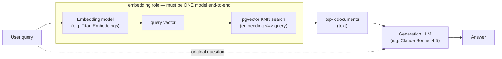

# Understanding Embeddings & Vector Similarity in pgvector

For most PostgreSQL developers and DBAs, "vectors" and "embeddings" are new. This
guide explains, from the ground up and with runnable examples:

1. what an **embedding** is,
2. how **pgvector** stores and compares them,
3. what `normalize_embeddings` does and why it matters,
4. how the similarity measures — **cosine**, **L2 (Euclidean)**, **inner
   product** — actually work.

Everything was verified on PostgreSQL 18.6 + pgvector 0.8.7, with embeddings from
the local MiniLM model (see [local-embeddings-minilm.md](local-embeddings-minilm.md)).

---

## 1. What is an embedding?

An **embedding** is a list of numbers (a *vector*) that represents the *meaning*
of something — a sentence, a document, an image — as a point in a
high-dimensional space. A model is trained so that **things with similar meaning
land close together** and unrelated things land far apart.

Think of it as a lossy translation from "text a computer can't compare
semantically" to "coordinates a computer *can* compare with arithmetic."

Concretely, encoding three sentences with MiniLM (384 dimensions) gives, for the
first one:

```
text: "The cat sits on the mat."
embedding (first 6 of 384 dims): [0.1342, -0.0329, -0.0248, 0.0414, -0.0363, 0.0418, ...]
```

The individual numbers are not human-meaningful. What matters is the *geometry* —
how close two embeddings are. Measured pairwise cosine similarity (1 = identical
meaning, 0 = unrelated):

| Pair | Cosine similarity |
|------|-------------------|
| "The cat sits on the mat." vs "A kitten rests on the rug." | **0.6556** |
| "The cat sits on the mat." vs "PostgreSQL is a database." | −0.0142 |
| "A kitten rests on the rug." vs "PostgreSQL is a database." | 0.0243 |

The two animal sentences share almost no *words* ("cat/kitten", "mat/rug"), yet
their embeddings are close (0.66), while either is ~0 to the database sentence.
That semantic closeness — not keyword overlap — is the entire point. This is why
embeddings power semantic search, recommendations, clustering, and RAG.

> A model always outputs a **fixed** number of dimensions (MiniLM = 384,
> OpenAI `text-embedding-3-small` = 1536, etc.). All embeddings you compare must
> come from the **same model** — vectors from different models are not comparable.

### Can embeddings from one model search data embedded by another?

**No — in general they are not compatible, and you should never mix them.** This
is the single most common and most damaging mistake when adopting pgvector.

Two independent reasons:

1. **Different dimensions → it won't even run.** A `vector(384)` column physically
   cannot be compared to a 1536-dim query; pgvector raises
   `different vector dimensions`. Verified:

   ```sql
   SELECT '[1,2,3]'::vector <=> '[1,2]'::vector;
   -- ERROR:  different vector dimensions 3 and 2
   ```

2. **Same dimension → it runs, but the results are meaningless.** Even if two
   models both output 384 dims, each model learned its *own* coordinate space
   during its own training. Dimension 7 in MiniLM has nothing to do with
   dimension 7 in another 384-dim model; the axes are unrelated. Comparing them
   produces numbers, but the "nearest neighbors" are noise. There is no shared
   frame of reference — it's like comparing GPS coordinates to chess-board
   coordinates because both are pairs of numbers.

So **compatibility requires the *same model* (same architecture *and* same
weights/version)** for both the stored vectors and the query vector. A model
*upgrade* (e.g. `text-embedding-ada-002` → `-3-small`) is a different model: its
vectors live in a different space, so you must **re-embed the entire corpus** with
the new model and replace the stored vectors. You cannot migrate incrementally by
mixing old and new vectors in the same column.

Practical rules:

- Store **which model + version** produced each embedding (a column or per-table
  convention). This makes an accidental mix detectable.
- Keep a given `vector(N)` column to **one model**. If you support two models,
  use two columns/tables and query each with its own vectors.
- Re-embedding is the only correct way to change models. Plan for it (it's a full
  recompute of the corpus).

### Upgrading the embedding model at scale — a real, costly problem

This is a genuine operational constraint, not a theoretical one: **you cannot
simply "upgrade to a newer, better embedding model."** Because the new model
produces vectors in a different space, every stored vector must be **recomputed**.
At billions of vectors that means a very real bill — embedding compute or API
calls for the whole corpus, plus the time and the migration itself. There is **no
correctness-preserving shortcut** that avoids recomputing; a half-migrated column
(old + new vectors mixed) returns garbage.

So treat a model change as a **corpus migration project**, and decide with
cost/benefit in mind: a better model raises recall/relevance, weighed against the
re-embedding cost and effort.

**The migration itself is manageable with zero downtime** using a dual-column
(or dual-table) pattern — the expense is the compute, not the mechanism:

1. **Add a second column** for the new model's vectors (dimensions may differ):
   ```sql
   ALTER TABLE documents ADD COLUMN embedding_v2 vector(1536);  -- new model dim
   ```
2. **Backfill in batches**, re-embedding rows with the new model and writing
   `embedding_v2`. Throttle to control cost/load; this is the long, expensive
   part. Track progress (e.g. a `migrated_at`/model column) so it's resumable.
3. **Dual-write** during the backfill: new inserts/updates populate *both* the old
   and new columns, so the new column catches up and stays current.
4. **Build the ANN index (HNSW or IVFFlat)** on the new column once it is fully
   populated.
5. **Cut over** reads to `embedding_v2` (embedding queries with the new model);
   verify recall/quality.
6. **Drop the old column and index** after the cutover is confirmed.

Cost-control levers worth knowing:

- **Only re-embed what changed/matters** — if parts of the corpus are stale or
  rarely queried, you may re-embed lazily (on access) or never, *as long as each
  column stays single-model*. Never mix models within a column to "save" work.
- **Smaller/cheaper vectors** — pair the migration with `halfvec` (2-byte floats)
  or fewer dimensions (if the new model supports Matryoshka truncation) to cut
  storage and index memory going forward.
- **Batch/off-peak backfill** to smooth API spend and avoid saturating the DB.
- **Budget it explicitly**: embedding cost ≈ (corpus tokens) × (model price); at
  billions of rows this is the dominant number — estimate it before committing.

> Bottom line: the "same embedding model" rule means model upgrades are a planned,
> budgeted re-embedding migration — one of the main reasons to choose an embedding
> model (and its dimension) carefully up front, and to store the model+version per
> embedding so you always know what a migration must cover.

> "Matryoshka" embeddings (e.g. OpenAI `-3-*`) are a narrow exception: they are
> *designed* so you can **truncate** a vector from the *same* model to fewer
> dimensions and still compare — but only against other vectors from *that same
> model*, truncated to the *same* length. It is not cross-*model* compatibility.

> **"Same model" means the same *embedding* model — not the same vendor, and not
> your chat LLM.** An embedding model (Amazon Titan Embeddings, OpenAI
> `text-embedding-3`, Cohere Embed, MiniLM) turns text into the vectors you store
> and query. A generation LLM (Claude Sonnet, GPT-4, Titan Text) only consumes/
> produces *text* and never touches your vectors. So mixing vendors *across roles*
> is fine and normal — e.g. embed with **Titan Embeddings** and generate answers
> with **Claude Sonnet** in the same RAG app, because they do different jobs. The
> rule constrains only the embedding side: the vectors you **store** and the
> vector you **search with** must come from the **same embedding model** (store
> Titan → query with Titan, never query Titan-indexed data with OpenAI vectors).

The two roles in a typical RAG pipeline — the **embedding model** fills and
queries the vector store; the **generation LLM** only sees retrieved *text*:



The query must be embedded by the **same** model that produced the stored
document vectors (the dashed "embedding role" box). The generation LLM is a
separate stage with no such constraint — different vendor is fine.

---

## 2. How pgvector stores embeddings

pgvector adds a `vector(N)` column type — an array of `N` 4-byte floats, where
`N` is your model's dimension. You store one embedding per row alongside the
original data:

```sql
CREATE EXTENSION IF NOT EXISTS vector;

CREATE TABLE documents (
    id        bigserial PRIMARY KEY,
    content   text,
    embedding vector(384)          -- 384 = MiniLM's output dimension
);
```

A vector literal is just bracketed numbers; insert the model's output as text:

```sql
INSERT INTO documents (content, embedding)
VALUES ('The cat sits on the mat.', '[0.1342,-0.0329, ... 384 numbers ...]');
```

To **search**, you embed the query with the *same* model and ask for the rows
whose vectors are closest, using a distance operator in `ORDER BY`:

```sql
-- :q is the query text embedded as a vector(384)
SELECT content
FROM documents
ORDER BY embedding <=> :q      -- <=> = cosine distance; nearest first
LIMIT 5;
```

That `ORDER BY embedding <=> :q LIMIT k` is the canonical **k-nearest-neighbor
(KNN)** query — "give me the k most similar rows." Without an index it scans
every row (exact); with an HNSW/IVFFlat index it is approximate but fast (see
[pgvector-indexes.md](pgvector-indexes.md)).

---

## 3. The distance operators

pgvector exposes three distance operators. Each has a matching index operator
class (used in the next doc):

| Operator | Meaning | Returns | Index opclass |
|----------|---------|---------|---------------|
| `<->` | **L2** (Euclidean) distance | `0` = identical, grows with distance | `vector_l2_ops` |
| `<=>` | **cosine** distance | `1 − cosine_similarity` (0…2) | `vector_cosine_ops` |
| `<#>` | **negative inner product** | `−(a·b)` | `vector_ip_ops` |

They are *distances*: **smaller = more similar**, so you always `ORDER BY` them
ascending. Verified behavior on real vectors:

```sql
SELECT '[1,2,3]'::vector <-> '[1,2,3]' AS l2_same,       -- 0        (identical)
       '[1,2,3]'::vector <-> '[4,5,6]' AS l2_diff,       -- 5.196    (far)
       '[1,0]'::vector   <=> '[1,0]'   AS cos_identical, -- 0        (same direction)
       '[1,0]'::vector   <=> '[0,1]'   AS cos_orthogonal,-- 1        (unrelated)
       '[1,0]'::vector   <=> '[-1,0]'  AS cos_opposite;  -- 2        (opposite)
```

### Cosine vs L2 — the key difference

**Cosine measures the *angle* (direction); L2 measures the straight-line
*distance* (which includes magnitude).** This matters:

```sql
-- same DIRECTION, different LENGTH:
SELECT '[1,1]'::vector <=> '[2,2]' AS cosine,   -- 0        (identical direction!)
       '[1,1]'::vector <-> '[2,2]' AS l2,       -- 1.4142   (they ARE apart)
       '[1,1]'::vector <#> '[2,2]' AS neg_ip;   -- -4       (inner product = 4)
```

`[1,1]` and `[2,2]` point the same way, so **cosine distance is 0** — they are
"identical" in meaning. But L2 sees them 1.41 apart because one is longer. For
text embeddings we almost always care about *direction* (meaning), not magnitude,
which is why **cosine is the usual choice** — and which leads directly to
normalization.

---

## 4. What `normalize_embeddings` does

`normalize_embeddings=True` (in `model.encode(...)`) scales every vector to
**length 1** (a *unit vector*) without changing its direction. Geometrically, all
points are pushed onto the surface of a unit sphere.

`l2_normalize` in SQL does the same thing — divide by the vector's length
(`vector_norm`):

```sql
SELECT l2_normalize('[3,4]'::vector) AS unit,     -- [0.6,0.8]
       vector_norm('[3,4]'::vector)  AS length;   -- 5   (sqrt(3²+4²))
```

`[3,4]` has length 5; dividing by 5 gives `[0.6,0.8]`, which has length 1 and the
exact same direction.

### Why normalize?

1. **Cosine becomes a plain dot product.** For unit vectors,
   `cosine_similarity(a,b) = a · b`. That's why, with normalized embeddings, you
   can use the faster inner-product operator and get cosine results — the MiniLM
   examples above used `normalize_embeddings=True`, so their dot products (0.6556,
   etc.) *are* cosine similarities.
2. **L2 and cosine rankings agree.** Once all vectors are unit-length, ordering by
   L2 distance and ordering by cosine distance produce the **same** nearest
   neighbors. So you can build an `vector_l2_ops` or `vector_cosine_ops` index and
   get consistent results.
3. **Consistency / numerical stability.** Equal-length vectors remove magnitude as
   a confounding factor, so similarity reflects meaning only.

A unit vector confirmed:

```python
e = model.encode("The cat sits on the mat.", normalize_embeddings=True)
np.linalg.norm(e)      # 1.0
```

<details>
<summary><strong>The math behind claims 1 and 2</strong> (why they hold for unit vectors)</summary>

Definitions, for vectors **a**, **b**:

- dot product `a·b = Σ aᵢbᵢ`
- norm (length) `‖a‖ = √(a·a)`
- cosine similarity `cos θ = (a·b) / (‖a‖·‖b‖)`
- L2 distance `‖a−b‖ = √(Σ (aᵢ−bᵢ)²)`

A **unit vector** has `‖a‖ = 1` — exactly what normalization produces.

**Claim 1 — cosine similarity = dot product.** Put `‖a‖ = ‖b‖ = 1` into the
cosine definition:

```
cos θ = (a·b) / (‖a‖·‖b‖) = (a·b) / (1·1) = a·b
```

The denominator normalizes out magnitude; when the vectors are already length 1
it is just 1 and vanishes. So cosine distance (`<=>`) needs a dot product **plus**
two norms + a division, but on pre-normalized data the norms are known to be 1,
so only the dot product remains — which is what the inner-product operator (`<#>`)
computes. (pgvector's `<#>` returns `−(a·b)` so it still sorts ascending.)

**Claim 2 — L2 and cosine rank identically.** Expand squared L2 distance:

```
‖a−b‖² = (a−b)·(a−b) = ‖a‖² − 2(a·b) + ‖b‖²
```

With `‖a‖² = ‖b‖² = 1`:

```
‖a−b‖² = 1 − 2(a·b) + 1 = 2 − 2(a·b) = 2(1 − cos θ) = 2 × cosine_distance
```

So **L2² = 2 × cosine_distance** — L2 is a strictly increasing (monotonic)
function of cosine distance. Monotonic transforms preserve order, so the row with
the smallest cosine distance also has the smallest L2 distance: **same nearest
neighbors, same order.** (Only true for unit vectors — unnormalized, the `‖a‖²`
and `‖b‖²` terms don't cancel and the rankings can differ.)

Verified on pgvector (two vectors normalized with `l2_normalize`):

| Quantity | Value |
|----------|-------|
| `−(a <#> b)` → `a·b` | 0.537326 |
| `1 − (a <=> b)` → cosine similarity | 0.537326 |
| `a <-> b` squared (L2²) | 0.925349 |
| `2 × (a <=> b)` | 0.925349 |

The pairs match exactly: dot = cosine, and L2² = 2 × cosine distance.

</details>

> Many embedding models (including MiniLM) are *trained* for cosine similarity, so
> normalizing and comparing by direction is the intended usage. If you do **not**
> normalize, prefer `<=>` (cosine) so magnitude differences don't distort results,
> or `<->` (L2) only if magnitude is meaningful for your data.

---

## 5. Putting it together — a semantic search

```sql
-- documents.embedding is vector(384), filled from MiniLM with normalize=True
-- :q is the user query embedded the same way

SELECT content,
       1 - (embedding <=> :q) AS cosine_similarity   -- convert distance back to similarity
FROM documents
ORDER BY embedding <=> :q                             -- nearest (smallest cosine distance) first
LIMIT 5;
```

- Embed the query with the **same model** that produced the stored vectors.
- `embedding <=> :q` ranks by cosine distance (smaller = closer).
- `1 - distance` turns it back into a 0…1 similarity for display.

### Why `1 -` in the SELECT but not in the ORDER BY?

Because `<=>` returns a **distance**, not a similarity, and the two are inverses:

```
cosine_distance = 1 − cosine_similarity        (so: similarity = 1 − distance)
```

- **`ORDER BY embedding <=> :q`** — you want the *most similar* rows first.
  Most similar = **smallest distance**, and `ORDER BY ... ASC` (the default)
  already puts the smallest first. The raw distance is exactly the right sort key,
  so **no `1 -` is needed** — adding it would just flip to `ORDER BY (1 - distance)`,
  i.e. *descending* distance, which you'd then have to write `DESC`. Sorting by the
  distance directly is simpler and is what the index is built to do.
- **`SELECT 1 - (embedding <=> :q)`** — here the number is shown to a human, and
  people expect a *similarity* where **bigger = more alike** (1.0 = identical,
  0 = unrelated). The raw distance reads backwards (0 = identical, larger = less
  alike), so `1 - distance` converts it to the intuitive 0…1 similarity.

In short: **ordering cares only about the sort order** (distance already orders
correctly, so leave it raw), while **display cares about the human-friendly scale**
(so convert distance → similarity with `1 -`). Converting before `ORDER BY` would
be wasted work and would force a `DESC`.

> This `distance = 1 − similarity` identity is specific to **cosine** (`<=>`). For
> L2 (`<->`) there is no fixed 0…1 similarity to convert to — smaller is just
> closer. For negative inner product (`<#>`), the stored value is `−(a·b)`, so a
> similarity for display is `-(embedding <#> :q)`.

For large tables, add an **HNSW** or **IVFFlat** index so this KNN query doesn't
scan every row — covered next in
[pgvector-indexes.md](pgvector-indexes.md).

---

## Summary

1. An **embedding** is a fixed-length vector encoding *meaning*; similar things
   are geometrically close. Always compare vectors from the **same model**.
2. pgvector stores them as `vector(N)` and finds nearest neighbors with
   `ORDER BY embedding <distance> :query LIMIT k`.
3. Operators: `<->` L2 distance, `<=>` cosine distance, `<#>` negative inner
   product; **smaller = more similar**.
4. **Cosine = angle/direction; L2 = distance incl. magnitude.** For text, direction
   (meaning) is what matters, so cosine is the usual pick.
5. **`normalize_embeddings` / `l2_normalize`** scales vectors to length 1; then
   cosine equals the dot product and L2/cosine rankings agree — the standard
   setup for semantic search.
