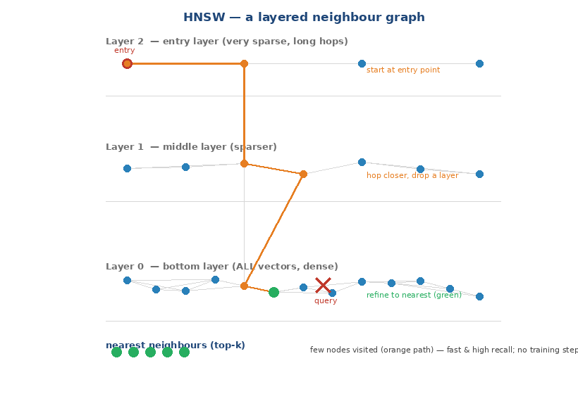

# pgvector HNSW Index

**HNSW (Hierarchical Navigable Small World)** is pgvector's graph-based
approximate-nearest-neighbor (ANN) index. It is the **recommended default** for
most vector search: best speed/recall tradeoff, no training step, and it handles
ongoing inserts well. The trade-offs are slower, memory-hungrier builds and a
larger index.

This is the HNSW deep dive. For IVFFlat see
[pgvector-ivfflat.md](pgvector-ivfflat.md); for the comparison, data modeling, and
transactional-update design see [pgvector-indexes.md](pgvector-indexes.md).
Internals verified against the pgvector 0.8.7 source (`../pgvector/src/hnsw*.c`,
`hnsw.h`) and behavior on PostgreSQL 18.6.

---

## The idea: a layered map of neighbors


At a glance (static view):



Think of finding one house in a huge city. Searching every street is hopeless, so
you use a layered map:

- **Top layer** — a sparse highway network linking a few far-apart hubs. Good for
  covering big distances in a few hops.
- **Middle layers** — progressively denser roads linking neighborhoods.
- **Bottom layer** — every vector (house), each linked to its nearest neighbors by
  short local roads.

A query does a **greedy descent**: start at the top entry point, repeatedly hop to
the neighbor closest to the query, and when you can't get closer on this layer,
drop down a layer and continue — until the bottom layer yields the k nearest
neighbors. Only a handful of nodes are ever visited, which is why it's fast even
over millions of vectors.

Each node keeps up to `m` links per layer; higher layers are exponentially
sparser (`src/hnswbuild.c`). There is **no training/clustering step** — the graph
is built incrementally as rows are inserted, so an HNSW index can even be created
on an empty table and grow with the data.

---

## Creating the index

```sql
CREATE INDEX ON items USING hnsw (embedding vector_cosine_ops)
  WITH (m = 16, ef_construction = 64);
```

- The **operator class** must match your distance (`vector_cosine_ops` for `<=>`,
  `vector_l2_ops` for `<->`, `vector_ip_ops` for `<#>`, `vector_l1_ops` for `<+>`).
- An index built for one distance does not serve queries using another.

---

## Build parameters: `m` and `ef_construction`

From `src/hnsw.h` — defaults `m = 16`, `ef_construction = 64`.

### `m` — links per node (default 16)

How many neighbor connections each vector keeps per layer.

- **Low `m`** (e.g. 4–8): smaller index, faster build, less memory — but a
  sparser graph that can miss good paths, lowering recall.
- **High `m`** (e.g. 24–48): denser graph, higher recall — but bigger index,
  slower build, more memory.
- **Guidance:** start at the default 16; raise to 24/32/48 for higher-dimensional
  data or when you need more recall and can pay the memory/build cost.

### `ef_construction` — build-time search effort (default 64)

How hard the builder works to find good neighbors when inserting each node.

- **Low** (e.g. 32–64): fast build, lower-quality graph (some suboptimal links).
- **High** (e.g. 100–400): slower build, higher-quality graph → better query
  recall later.
- **Guidance:** 64 is fine for experiments; for a production index favor a higher
  value (100–400) and let the build take its time — the quality is baked in once
  and every later query benefits.

```sql
-- a higher-quality production build
CREATE INDEX ON items USING hnsw (embedding vector_cosine_ops)
  WITH (m = 24, ef_construction = 200);
```

---

## Query parameter: `ef_search` (default 40)

How many candidates the greedy search keeps in flight. It is the **recall knob at
query time** and is set per session/transaction:

```sql
SET hnsw.ef_search = 100;          -- session
-- or, scoped to one transaction:
BEGIN;
SET LOCAL hnsw.ef_search = 100;
SELECT id FROM items ORDER BY embedding <=> :q LIMIT 10;
COMMIT;
```

- **Low `ef_search`** → faster, lower recall.
- **High `ef_search`** → slower, higher recall.
- **Guidance:** start at 40; raise until recall meets your target, then stop
  (higher only costs latency). Unlike `m`/`ef_construction`, this needs **no
  rebuild** — tune it live per query.

Measured (20k clustered vectors, recall@10 vs exact): HNSW returned the full
10/10 even at `ef_search = 10` on easy data — HNSW tends to reach high recall at
modest settings, which is its headline strength. (Harder, higher-dimensional data
needs larger `ef_search`; always measure — see
[pgvector-indexes.md](pgvector-indexes.md) for the recall method.) Reproduce with
the included script:

```sh
psql -d ai_demo -f demo-hnsw.sql     # builds the index, prints recall@10 at ef_search 10/40/100
```

The query itself is the ordinary KNN form; the index serves the `ORDER BY`:

```sql
EXPLAIN (COSTS OFF)
SELECT id FROM items ORDER BY embedding <=> :q LIMIT 5;
--  Limit
--    ->  Index Scan using items_embedding_idx on items
--          Order By: (embedding <=> :q)
```

---

## Operating HNSW at large scale

- **Build memory.** The graph should fit in `maintenance_work_mem` during build;
  if it spills, the build is far slower. Raise it for the build session:
  ```sql
  SET maintenance_work_mem = '8GB';   -- size to data / RAM
  ```
- **Parallel builds** shorten wall-clock time:
  ```sql
  SET max_parallel_maintenance_workers = 7;
  ```
- **Load then index.** Bulk-load the rows first and build the index afterward —
  far faster than inserting row-by-row into a live graph (though HNSW *supports*
  incremental inserts, which is why it suits dynamic data).
- **Query memory.** HNSW speed assumes the index is cached in RAM; if it is much
  larger than available memory, latency degrades as it pages from disk. Size
  `shared_buffers`/OS cache to keep the hot index resident, or shard/partition.
- **`halfvec`** (2-byte floats) roughly halves index size and memory for a small
  recall cost — valuable at scale.
- **Maintenance.** HNSW `VACUUM` can be slow; `REINDEX` is often faster for a
  heavily churned index and also restores recall that degrades with heavy
  update/delete churn.
- **Filtered queries** apply the `WHERE` after the graph scan; a selective,
  uncorrelated filter can under-return. Use iterative scans / partial indexes —
  see [pgvector-indexes.md](pgvector-indexes.md) and
  [hybrid-search.md](hybrid-search.md).

---

## When to choose HNSW

- **Real-time, latency-sensitive search** (semantic search, chatbots,
  recommendations) where users wait on the response.
- **Dynamic / frequently updated** data — HNSW tolerates ongoing inserts and its
  recall degrades less with churn than IVFFlat, needing full rebuilds less often.
- **Highest recall** at a given latency, and a **safe default** when you don't
  want to tune much (you mainly adjust `ef_search`).

Choose **IVFFlat** instead when build time, index size, or memory are the binding
constraints and you can tune `probes` — see
[pgvector-ivfflat.md](pgvector-ivfflat.md) and the side-by-side in
[pgvector-indexes.md](pgvector-indexes.md).

---

## Summary

1. HNSW is a multilayer neighbor graph; queries greedily descend from a sparse top
   layer to the dense bottom layer. No training step.
2. **Build:** `m` (links/node, default 16) and `ef_construction` (build effort,
   default 64) — raise both for higher recall at the cost of build time/memory.
3. **Query:** `ef_search` (default 40) trades recall for speed, tunable live with
   no rebuild.
4. **At scale:** raise `maintenance_work_mem`, use parallel builds, load-then-index,
   keep the index in RAM, consider `halfvec`, and `REINDEX` after churn.
5. **Default to HNSW** for production/real-time/dynamic workloads needing high
   recall.
