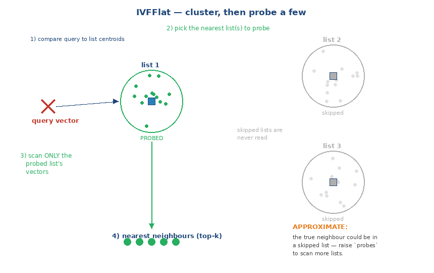

# pgvector IVFFlat Index

**IVFFlat (Inverted File with Flat compression)** is pgvector's cluster-based
approximate-nearest-neighbor (ANN) index. It builds **faster**, uses **less
memory**, and produces a **smaller** index than HNSW — at the cost of lower
recall-per-latency and more tuning. It requires existing data to build, and
suits large, relatively static datasets.

This is the IVFFlat deep dive. For HNSW see
[pgvector-hnsw.md](pgvector-hnsw.md); for the comparison, data modeling, and
transactional-update design see [pgvector-indexes.md](pgvector-indexes.md).
Internals verified against the pgvector 0.8.7 source (`../pgvector/src/ivf*.c`,
`ivfflat.h`) and behavior on PostgreSQL 18.6.

---

## The idea: cluster into aisles, then search a few


At a glance (static view):



Think of a warehouse where products are grouped into labeled aisles. To find one
item you don't walk every aisle — you go to the most relevant aisle(s) and search
only those.

IVFFlat does exactly this:

- **Build (clustering):** k-means groups all stored vectors into `lists` clusters.
  Each cluster has a **center** (centroid) and holds the vectors assigned to it.
- **Query (probing):** compare the query to the `lists` **centers** only, pick the
  `probes` nearest clusters, and scan just those — skipping all other clusters.

Because it ignores most clusters, it's much faster than a full scan. It's
**approximate**: the true nearest neighbor might sit in a cluster you didn't
probe, which is the recall cost you tune with `probes`.

Crucially, **IVFFlat needs data before you build it** — k-means has to learn the
centers from existing rows. Building on an empty or tiny table yields poor
clusters (pgvector warns). The workflow is always **load data → build index**.

---

## Creating the index

```sql
CREATE INDEX ON items USING ivfflat (embedding vector_cosine_ops)
  WITH (lists = 100);
```

- The **operator class** must match your distance (`vector_cosine_ops` for `<=>`,
  `vector_l2_ops` for `<->`, `vector_ip_ops` for `<#>`, `vector_l1_ops` for `<+>`).
- Build it **after** the table is populated.

---

## Build parameter: `lists` (default 100)

The number of clusters/aisles (`src/ivfflat.h`, default 100). This is the main
build-time knob and it's a Goldilocks choice:

- **Too few lists** (e.g. 10 on a huge table): each cluster is enormous, so
  probing one still scans a large fraction of rows — slow.
- **Too many lists** (e.g. 100000): clusters are tiny, but just *finding* the
  right ones (and needing more probes to keep recall) gets expensive, and small
  clusters hurt recall.
- **Rule of thumb:** start at **`rows / 1000`** for up to ~1M rows, and
  **`sqrt(rows)`** beyond ~1M. (e.g. 1M rows → ~1000 lists.)

```sql
-- ~1M rows
CREATE INDEX ON items USING ivfflat (embedding vector_cosine_ops)
  WITH (lists = 1000);
```

Changing `lists` requires a **rebuild** (it redefines the clustering).

---

## Query parameter: `probes` (default 1)

How many of the nearest clusters to actually scan — the **recall knob at query
time**, set per session/transaction:

```sql
SET ivfflat.probes = 10;           -- session
-- or scoped to one transaction:
BEGIN;
SET LOCAL ivfflat.probes = 10;
SELECT id FROM items ORDER BY embedding <=> :q LIMIT 10;
COMMIT;
```

- **`probes = 1`** (default): scan only the single nearest cluster — fastest, but
  misses neighbors that fall in adjacent clusters.
- **Higher `probes`:** scan more clusters → higher recall, slower.
- **Rule of thumb:** start near **`sqrt(lists)`**; raise until recall meets your
  target. Setting `probes = lists` scans everything (exact, but then the index
  gives no speedup).

### The default is often too low — measured
On 20,000 clustered vectors (recall@10 vs the exact top-10) — one example run
(exact numbers vary per run since the data is random, but the **trend** is
consistent):

| Setting | recall@10 (example) |
|---------|-----------|
| **`probes = 1` (default)** | **4–8 / 10** |
| `probes = 5` | 10/10 |
| `probes = 20` | 10/10 |

At the default `probes = 1`, IVFFlat often misses true neighbors — they sit in
neighboring clusters it never scanned. Raising `probes` (to ~5 here) recovers
full recall. **Always tune `probes` and measure recall**; don't ship the default
assuming it's correct.

Reproduce it yourself with the included script — it builds the index and prints
recall@10 at `probes` = 1 / 5 / 20:

```sh
psql -d ai_demo -f demo-ivfflat.sql
```

(Recall-measurement method also in
[pgvector-indexes.md](pgvector-indexes.md).)

The query is the ordinary KNN form; the index serves the `ORDER BY`:

```sql
EXPLAIN (COSTS OFF)
SELECT id FROM items ORDER BY embedding <=> :q LIMIT 5;
--  Limit
--    ->  Index Scan using items_embedding_idx on items
--          Order By: (embedding <=> :q)
```

---

## Operating IVFFlat at large scale

- **Fast, light builds** are IVFFlat's advantage — much cheaper in time and memory
  than HNSW, so it fits very large collections you can occasionally rebuild.
- **Load then index**, always: k-means needs the data. For incremental growth,
  new rows are assigned to existing clusters; they are *not* re-clustered.
- **Rebuild on drift.** If the data distribution shifts or the table grows a lot
  after the initial build, the original centroids no longer fit well and recall
  drops — `REINDEX` (or recreate with updated `lists`) to recluster.
- **Parallel builds** apply here too (`max_parallel_maintenance_workers`).
- **`halfvec`** reduces size/memory further for a small recall cost.
- **Tune `lists` for scale:** `sqrt(rows)` past ~1M; too-few lists is the common
  cause of slow IVFFlat queries on big tables.
- **Filtered queries** apply the `WHERE` after the probe; raise `probes` or use
  iterative scans / partial indexes so filtered results still fill `LIMIT`
  (see [hybrid-search.md](hybrid-search.md)).

---

## When to choose IVFFlat

- **Very large, mostly static** datasets where build speed, index size, and memory
  matter more than squeezing out the last of recall.
- **Batch / offline** workloads (periodic analytics, segment scoring) that are
  less latency-sensitive and tolerate tuning `probes`.
- **Resource-constrained** environments where HNSW's build cost/memory is too high.

Choose **HNSW** instead for real-time, high-recall, or frequently-updated
workloads — see [pgvector-hnsw.md](pgvector-hnsw.md) and the side-by-side in
[pgvector-indexes.md](pgvector-indexes.md).

---

## Summary

1. IVFFlat clusters vectors into `lists` cells with k-means; a query probes the
   `probes` nearest clusters and skips the rest. **Needs data before building.**
2. **Build:** `lists` (default 100) — use `rows/1000` up to ~1M, `sqrt(rows)`
   beyond; changing it requires a rebuild.
3. **Query:** `probes` (default 1) trades recall for speed; the default is often
   too low (can miss several of the true top-10) — start near `sqrt(lists)` and
   measure (run `demo-ivfflat.sql`).
4. **At scale:** cheap/fast builds, load-then-index, `REINDEX` on distribution
   drift, tune `lists`, consider `halfvec`.
5. **Choose IVFFlat** for large, static, batch, or resource-constrained workloads;
   otherwise prefer HNSW.
