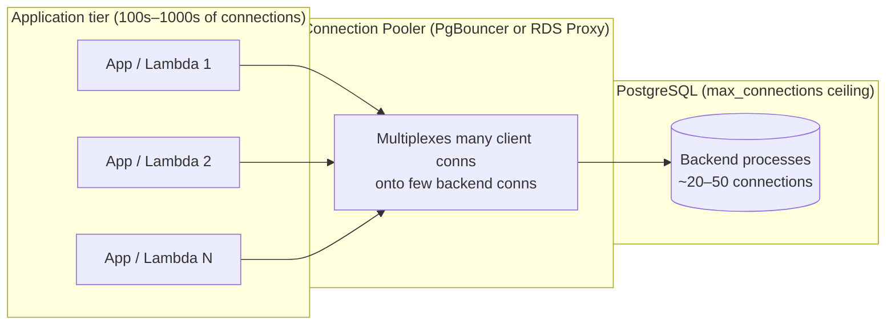
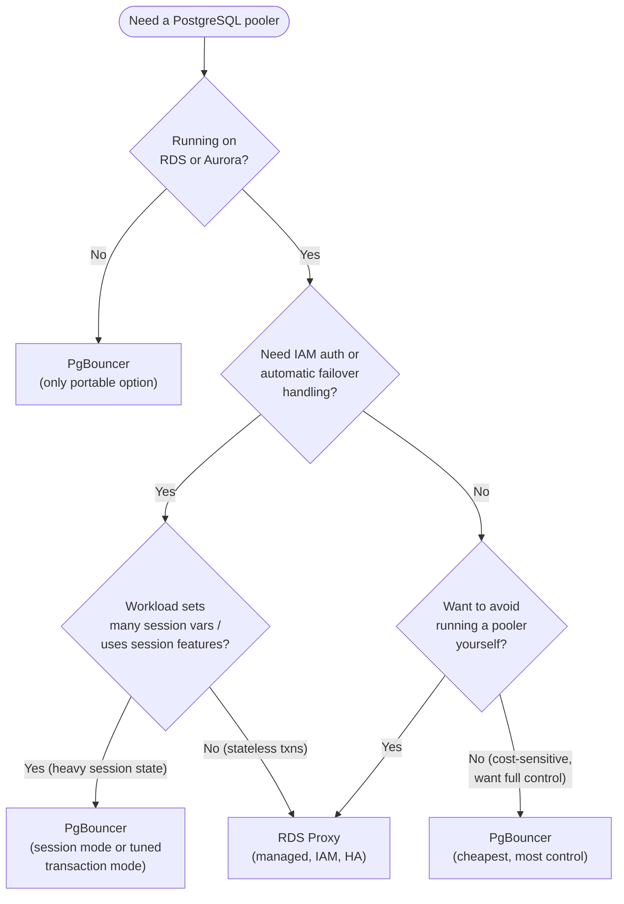
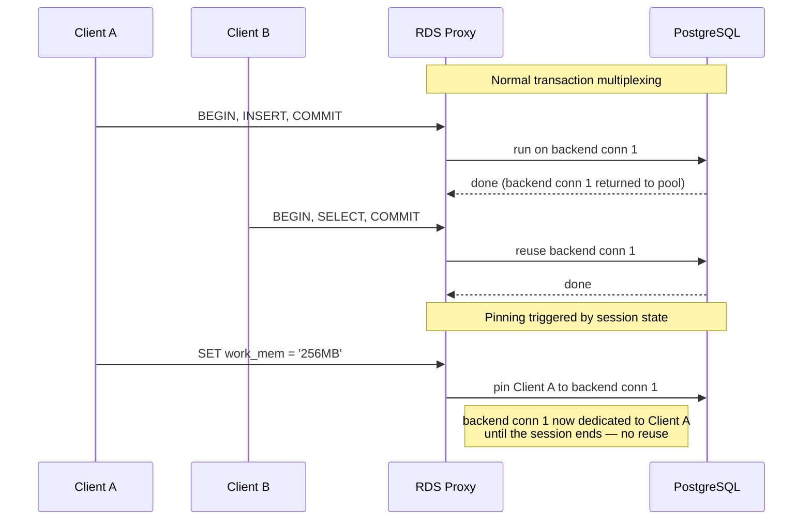
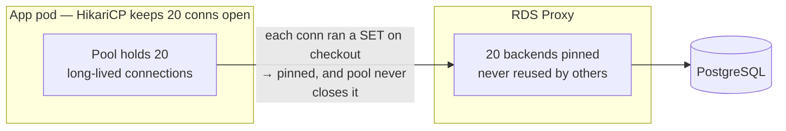
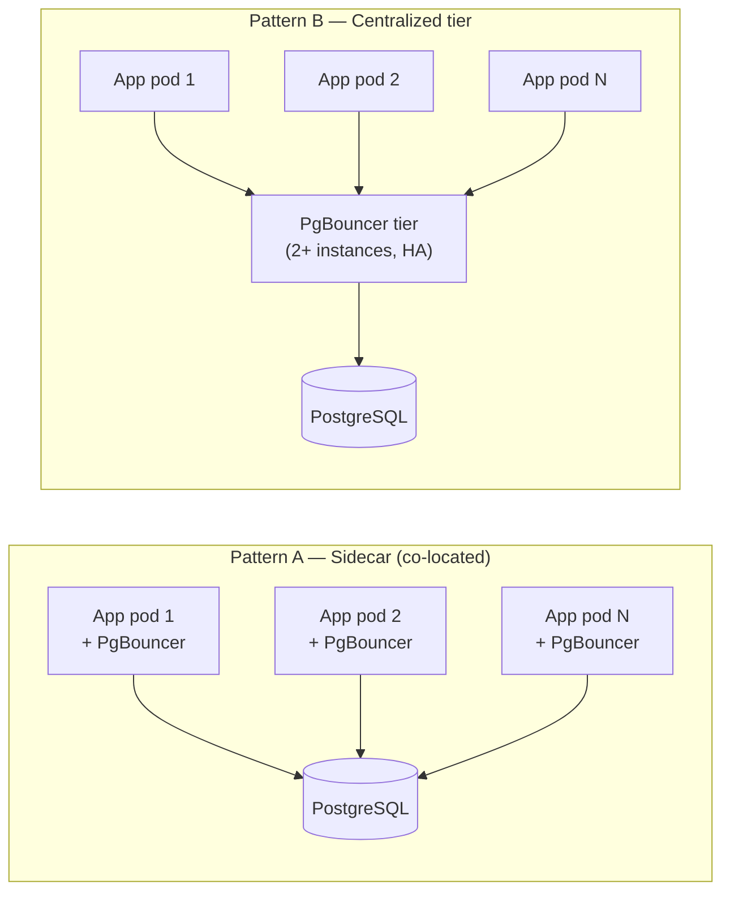
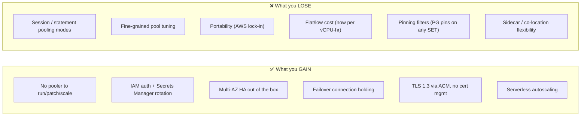

# PgBouncer vs Amazon RDS Proxy

A practical comparison of the two most common connection poolers for PostgreSQL:
the self-hosted **PgBouncer** and the managed **Amazon RDS Proxy**. This guide
answers four questions people ask most often:

1. [What problem are they both solving?](#1-what-problem-are-they-both-solving)
2. [How are they different?](#2-how-are-they-different)
3. [When should I choose each one?](#3-when-should-i-choose-each-one)
4. [If I move from PgBouncer to RDS Proxy, what do I gain and what do I lose?](#4-migrating-from-pgbouncer-to-rds-proxy)

> **TL;DR** — Both multiplex many client connections onto a few backend
> connections. PgBouncer gives you the **most control and the lowest cost** at
> the price of **running it yourself**. RDS Proxy is **fully managed** with
> **IAM auth and automatic failover handling** built in, but it is **AWS-only**,
> **metered per vCPU**, and **pins on PostgreSQL on any runtime session `SET`**
> (the init query covers uniform startup `SET`s, but not dynamic/per-client ones).

---

## 1. What problem are they both solving?

PostgreSQL forks **one OS process per connection** and each connection carries
real memory and CPU overhead (work memory, catalog caches, scheduling). So even
when the configured ceiling is high, driving thousands of concurrent *active*
connections wastes resources and degrades throughput. `max_connections` is the
hard ceiling, and once you hit it you get the classic error:

```
FATAL: sorry, too many clients already
```

**How high is the ceiling?** It depends on where you run PostgreSQL:

- **Community PostgreSQL** ships with `max_connections = 100` by default; operators commonly raise it to a few hundred.
- **Amazon RDS / Aurora for PostgreSQL** set it dynamically from instance memory using the default parameter-group formula:

  ```
  max_connections = LEAST({DBInstanceClassMemory / 9531392}, 5000)
  ```

  So it scales with the instance class and is **capped at 5,000** by default — and it's **adjustable**: you can override `max_connections` in a custom DB parameter group (subject to the instance having enough memory to back those connections).

The ceiling being high (even 5,000) doesn't make pooling unnecessary. Thousands
of mostly-idle backends still consume memory and add scheduling/CPU overhead,
and serverless or scaled-out fleets can still exhaust the limit in bursts. A
pooler lets you keep a modest number of *busy* backend connections regardless of
how many clients connect.

A pooler sits between the application and PostgreSQL, keeping a **small set of
long-lived backend connections** and lending them out to a **large number of
client connections**.



Both tools solve this the same way. The differences are in **how they are
operated, secured, priced, and how aggressively they can reuse a backend
connection**.

---

## 2. How are they different?

### 2.1 Side-by-side comparison

| Dimension | PgBouncer | Amazon RDS Proxy |
|---|---|---|
| **Type** | Self-hosted open-source daemon | Fully managed AWS service |
| **Where it runs** | EC2 / container / sidecar you operate | Serverless, managed by AWS (multi-AZ) |
| **Supported databases** | Any PostgreSQL, anywhere | RDS & Aurora (PostgreSQL/MySQL/MariaDB/SQL Server) only |
| **Pooling modes** | `session`, `transaction`, `statement` | Transaction-level multiplexing only (with pinning fallback) |
| **Multiplexing control** | You choose the mode and tune it | Automatic; you cannot pick "session mode" |
| **High availability** | You build it (multiple instances + LB/keepalived) | Built in across multiple AZs |
| **Autoscaling** | Manual (size the host, run more instances) | Serverless, scales with workload automatically |
| **Failover handling** | Clients see dropped connections | Holds client connections and routes to new writer; reduces failover time |
| **Authentication** | md5/scram, `userlist.txt`, `auth_query` | DB credentials via Secrets Manager, **IAM auth**, end-to-end IAM |
| **TLS** | You configure it | TLS 1.3 to the proxy via ACM certs, no cert management |
| **Prepared statements (txn mode)** | Supported via `max_prepared_statements` (1.21+) | Named prepared statements cause pinning on PostgreSQL |
| **Cost model** | Infra cost of the host(s) only | Per **vCPU-hour** of the underlying DB instance |
| **Operational burden** | High — you patch, monitor, scale, HA it | Low — AWS runs it |
| **Portability** | Runs on any cloud / on-prem | Locked to AWS |
| **Quotas** | None (your hardware) | 20 proxies per account by default (soft limit) |

### 2.2 Decision flow



### 2.3 Pooling modes & multiplexing — the core difference

The single most important technical difference is **how a backend connection is
reused**.

**PgBouncer** lets you choose the mode:

| Mode | Backend connection returned when… | Safe for session state? | Reuse efficiency |
|---|---|---|---|
| `session` | the client disconnects | ✅ Yes — full session semantics | ❌ Low |
| `transaction` | the transaction `COMMIT`/`ROLLBACK`s | ⚠️ No — breaks cross-txn state | ✅ High |
| `statement` | each statement completes | ❌ No — no multi-statement txns | ✅ Highest |

**RDS Proxy** is effectively **transaction multiplexing only**. When it detects
session state it cannot safely share, it falls back to **pinning**: the client
is bound to one backend connection until the session ends, and no other client
can reuse that connection. Pinning silently reduces pooling efficiency.



### 2.4 What triggers pinning on RDS Proxy for PostgreSQL

This matters a lot because, **for PostgreSQL, RDS Proxy pins on any session
variable change** — unlike MySQL, there is no "session pinning filter" to exempt
specific `SET`s. Common pinning triggers:

- Setting a session variable or configuration parameter with `SET` (not `SET LOCAL`).
- Using named/protocol-level prepared statements.
- Creating temporary tables.
- Holding cursors (`WITH HOLD`), advisory locks held across transactions.
- Any single statement larger than 16 KB (all engines).

### 2.5 Does the initialization query fix the `SET` problem?

**Partly — it fixes one specific case, not `SET` in general.** RDS Proxy lets you
define an **initialization query**: one or more SQL statements (semicolon
separated) that the proxy runs **once when it creates each backend connection**.
Per the AWS docs:

> If you use `SET` statements to perform identical initialization for each client
> connection, you can do so while preserving transaction-level multiplexing. [Move]
> the statements that set up the initial session state into the initialization
> query used by a proxy... Then, RDS Proxy applies those settings whenever it sets
> up a new connection. You can remove the corresponding `SET` statements from your
> application code, so that they don't interfere with transaction-level multiplexing.

The reason this preserves multiplexing: every pooled backend is initialized with
the **same** settings, so all backends are interchangeable and the app no longer
issues those `SET`s at runtime. It only works when the settings are **uniform
across all connections and applied at startup**. It does **not** help with
runtime, dynamic, or per-client `SET`s, because the init query is a single static
value for every backend, and for PostgreSQL any `SET` the proxy sees at runtime
still pins.

| `SET` scenario | Init query helps? | Why |
|---|---|---|
| Same `SET`s on every connection, at startup (e.g. `SET timezone`, `SET statement_timeout`) | ✅ Yes | Move them to the init query; applied uniformly to every backend, app stops issuing them |
| `SET LOCAL ...` inside a transaction | ✅ Already fine | Transaction-scoped; resets at `COMMIT`, so it never pins |
| Dynamic / per-request session `SET` at runtime (e.g. `SET work_mem` tuned per query) | ❌ No | Can't be static; any runtime `SET` still pins on PostgreSQL |
| Per-client differing values (e.g. `SET role` per tenant) | ❌ No | Init query is one fixed value shared by all backends |

**Mitigation strategy:**

1. Push all **uniform startup `SET`s** into the proxy's initialization query and remove them from app code.
2. Convert anything that must change mid-session to **`SET LOCAL`** (transaction-scoped, never pins).
3. Accept that **genuinely dynamic or per-client session `SET`s will pin** — route those workloads to a direct connection, or keep them on PgBouncer.
4. Monitor the real pin rate with the CloudWatch metric `DatabaseConnectionsCurrentlySessionPinned`.

### 2.6 Pinning + application-side connection pools (the dangerous combination)

A very common setup is an **application-side pool** (HikariCP, SQLAlchemy,
`pgx`, `node-pg`) in front of RDS Proxy. These two layers have **opposite
goals**, and getting it wrong turns a transient pin into a permanent one.

- An **app pool** exists to keep connections **open and idle for reuse** — it deliberately holds them for the life of the process.
- **RDS Proxy multiplexing** relies on connections being **released between transactions** so a backend can be lent to another client.

If a pooled connection trips a pin trigger (a `SET` run on checkout, a named
prepared statement, a temp table), RDS Proxy pins the backend to that
connection. But because the **app pool never closes the connection**, the pin
**never releases**. Result: backends ≈ _pods × app-pool-size_, pinned
permanently — the exact fan-in problem you adopted a proxy to avoid, and you're
still paying per vCPU for it.



**Why "just close the session" is the wrong default fix.** A pin releases only
when the client connection closes. An app pool is built to *not* close
connections, so relying on closing them fights the pool's purpose and throws
away its latency benefit. The right fix is to make pooled connections
**pin-free** so they can stay open *and* multiplex.

**How to make an app pool coexist with RDS Proxy:**

| Pitfall | Fix |
|---|---|
| Pool runs `SET`s on connection setup/checkout (e.g. HikariCP `connectionInitSql`, SQLAlchemy `connect`/`checkout` events) | Move those `SET`s into the **proxy initialization query** so the pool issues none |
| Driver auto-prepares named statements | Disable it (see table below) |
| App pool is large and holds many idle conns | Keep the app pool **small** — let the proxy do the fan-in; don't double-pool with a big local pool |
| An accidental pin lingers forever | Set a finite **`maxLifetime` / connection recycle** so pinned conns eventually rotate out |
| You can't tell if it's happening | Watch `DatabaseConnectionsCurrentlySessionPinned`; if it tracks pool size, your pooled conns are pinning |

See [application-framework/README.md](application-framework/) for the exact
pin-avoidance settings per framework (HikariCP, SQLAlchemy, `pgx`, `node-pg`).

---

## 3. When should I choose each one?

### Choose **PgBouncer** when:

- You are **not on RDS/Aurora** (on-prem, another cloud, self-managed PostgreSQL). RDS Proxy is simply not an option.
- You need **session pooling mode** because your workload relies on session state (`LISTEN/NOTIFY`, session advisory locks, long-lived prepared statements, temp tables).
- You are **cost-sensitive** and already run infrastructure — PgBouncer's marginal cost is the host it runs on.
- You want **fine-grained control**: per-pool sizing, `pool_mode` per database/user, custom auth, placement as a sidecar next to the app.
- You can **own the operations**: patching, monitoring, and building your own HA.

### Choose **RDS Proxy** when:

- You are on **RDS or Aurora** and want to **eliminate pooler operations** entirely.
- **IAM authentication** and credential rotation via **Secrets Manager** are requirements (security/compliance).
- You have **serverless / spiky** workloads (Lambda) that open and drop many connections.
- **Automatic failover handling** matters — RDS Proxy holds client connections during a failover and reconnects to the new writer, reducing application-visible downtime.
- You prefer **predictable managed scaling and multi-AZ HA** over hand-tuning, and your transactions are mostly **stateless** (so pinning stays rare).

### 3.1 Where does PgBouncer run — same pod as the app, or a separate tier?

Both are used in practice, and the choice is a real tradeoff between **latency**
and **backend-connection economy**.



| Pattern | How it runs | Pros | Cons | Good fit |
|---|---|---|---|---|
| **Sidecar / co-located** | One PgBouncer per app host or as a sidecar container in each pod; app talks to it over `localhost`/Unix socket | Lowest latency (no network hop); scales with the app; no extra tier to manage | Pooling is **per host** — total backends ≈ _instances × pool_size_, which can defeat the point at scale | Small number of app instances; latency-critical paths |
| **Centralized / separate tier** | A small dedicated set of PgBouncer instances all apps connect to (dedicated hosts, or a K8s Deployment + Service) | **Shared/global pool** — thousands of client conns collapse to one small backend pool | Extra network hop; you must make the tier HA (2+ behind LB / keepalived VIP) | Large fleets; serverless-ish scale; minimizing backend connections is the priority |
| **Hybrid (two layers)** | Sidecar PgBouncer per pod feeding a centralized transaction-mode PgBouncer | Balances latency and backend count | Most moving parts; more to operate | Very large deployments only |

**Rule of thumb:** the sidecar pattern optimizes for latency but **multiplies
backend connections by the number of app instances**; the centralized pattern
optimizes for backend-connection economy but **adds a hop and an HA burden**.
This is one reason teams reach for RDS Proxy — it is inherently a shared, managed,
multi-AZ pooling tier, so you get centralized pooling without running or
load-balancing it yourself.

---

## 4. Migrating from PgBouncer to RDS Proxy



### 4.1 What you GAIN

- **Zero pooler operations** — no host to size, patch, monitor, or make highly available.
- **Native IAM authentication** — authenticate apps with IAM, let the proxy pull DB credentials from Secrets Manager, and rotate secrets without app changes. End-to-end IAM removes per-user DB registration.
- **Built-in multi-AZ high availability** and **serverless autoscaling** — capacity follows the workload automatically.
- **Failover resilience** — during an RDS/Aurora failover the proxy keeps client connections open and reconnects them to the promoted writer, cutting application-visible downtime.
- **Managed TLS 1.3** via ACM — the proxy can enforce a newer TLS version than the underlying instance, with no certificate handling on your side.

### 4.2 What you LOSE

- **Session and statement pooling modes.** RDS Proxy is transaction multiplexing only. If any part of your workload depended on PgBouncer `session` mode, that behavior is gone — you must redesign it or keep a direct connection path.
- **Fine-grained pool control.** No per-pool `pool_mode`, no manual pool sizing knobs; you tune indirectly via `MaxConnectionsPercent` and connection borrow timeout.
- **A tunable pinning filter.** On PostgreSQL, **any session `SET` pins the connection**, and there is no session-pinning filter (that exists only for MySQL/MariaDB). The proxy's initialization query handles *uniform startup* `SET`s only — runtime or per-client `SET`s still pin. See [§2.5](#25-does-the-initialization-query-fix-the-set-problem) for the full breakdown.
- **Portability.** RDS Proxy only works with RDS/Aurora. Moving off AWS means reintroducing a pooler.
- **Flat cost.** PgBouncer costs you a small host. RDS Proxy is billed **per vCPU-hour of the underlying DB instance**, which can be material for large instances.
- **Co-location flexibility.** You can no longer run the pooler as an app sidecar for lowest latency; the proxy is a separate managed hop.

### 4.3 Migration checklist

1. **Audit session state usage.** Grep for `SET ` (session-level), `LISTEN`/`NOTIFY`, `pg_advisory_lock` (session-scoped), `WITH HOLD` cursors, and temp-table reliance. These will pin or break under transaction multiplexing.
2. **Move only uniform startup `SET`s to the proxy initialization query** (applied identically to every backend), switch in-transaction settings to `SET LOCAL`, and plan for dynamic/per-client `SET`s to pin — see [§2.5](#25-does-the-initialization-query-fix-the-set-problem).
3. **Fix driver prepared-statement behavior.** Disable client-side named prepared statements where they aren't needed (e.g. psycopg3 `prepare_threshold=None`, asyncpg `statement_cache_size=0`) to avoid pinning.
4. **Set up Secrets Manager + IAM** for the proxy's DB credentials and (optionally) client IAM auth.
5. **Benchmark pinning** via the CloudWatch metric `DatabaseConnectionsCurrentlySessionPinned`. A high pin rate means multiplexing isn't helping and you should revisit the workload — or stay on PgBouncer.
6. **Keep a direct-connection escape hatch** for any job that genuinely needs session semantics (migrations, `LISTEN/NOTIFY` workers).

---

## References

- [RDS Proxy concepts and terminology (AWS docs)](https://docs.aws.amazon.com/AmazonRDS/latest/UserGuide/rds-proxy.howitworks.html)
- [Avoiding pinning an RDS Proxy (AWS docs)](https://docs.aws.amazon.com/AmazonRDS/latest/UserGuide/rds-proxy-pinning.html)
- [Amazon RDS Proxy pricing](https://aws.amazon.com/rds/proxy/pricing/)
- [PgBouncer documentation](https://www.pgbouncer.org/config.html)
