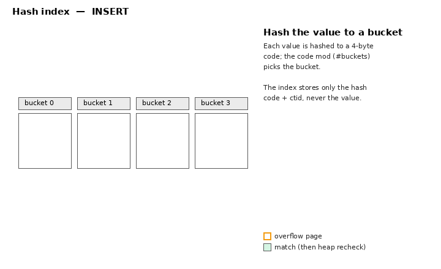
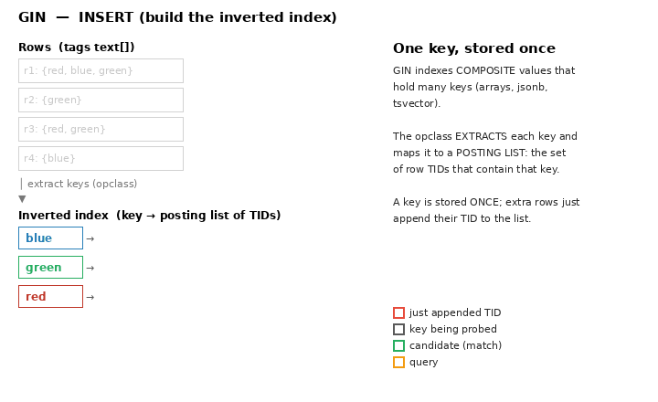

# Index animations

Animated GIFs that visualize how PostgreSQL's index access methods — **B-tree**,
**Hash**, **BRIN**, **GiST**, **GIN**, and **SP-GiST** — insert and query data,
plus the pure-Python (Pillow only) scripts that generate them.

| Animation | What it shows |
|-----------|---------------|
|  | B-tree: keys fill sorted leaf pages; an overflowing leaf splits and pushes a separator up; search descends root→leaf, and a range scan walks the right-linked leaf level. |
|  | Hash index: values hashed to buckets; a full bucket chains an overflow page; a search hashes the value, jumps to its bucket, and rechecks the heap. |
|  | BRIN: each heap page range gets one `(min,max)` summary; a range query scans only overlapping ranges and skips the rest. |
|  | GiST R-tree over boxes: entries grouped into nodes with **overlapping** bounding boxes (MBRs — Minimum Bounding Rectangles); a query descends **every** node whose MBR is consistent with it. |
|  | GIN inverted index over an array column: each row's keys are extracted and mapped to a **posting list** of TIDs (a key stored once); a `@>` query looks up each query key and **intersects** the posting lists via `consistent(AND)`. |
|  | SP-GiST quadtree over points: the plane recursively splits into **non-overlapping** quadrants; a query descends only the quadrants it overlaps and prunes the rest. |

The two side by side are the clearest statement of the core difference:

- **GiST** — bounding predicates **may overlap**, so a search can follow
  **several** paths.
- **SP-GiST** — partitions are **disjoint**, so a search usually follows **one**
  path.

See the detailed docs: [../btree.md](../btree.md) · [../hash.md](../hash.md) ·
[../brin.md](../brin.md) · [../gin.md](../gin.md) · [../gist.md](../gist.md) ·
[../spgist.md](../spgist.md) ·
[../index-comparison.md](../index-comparison.md)

## Regenerating

Requires only Python 3 with Pillow (no matplotlib / ffmpeg):

```sh
python3 make_btree_gif.py     # writes btree.gif
python3 make_hash_gif.py      # writes hash.gif
python3 make_brin_gif.py      # writes brin.gif
python3 make_gist_gif.py      # writes gist.gif
python3 make_gin_gif.py       # writes gin.gif
python3 make_spgist_gif.py    # writes spgist.gif
```

Each script contains a small, real implementation of the structure (a quadtree
for SP-GiST; node MBRs via Union for GiST; an inverted key→posting-list map for
GIN; sorted leaves + splits for B-tree; bucketing for Hash; page-range summaries
for BRIN) that drives the frames, so
the pictures reflect the actual algorithm, not hand-drawn mock-ups. Edit the
data constants at the top of each script to change the example.
