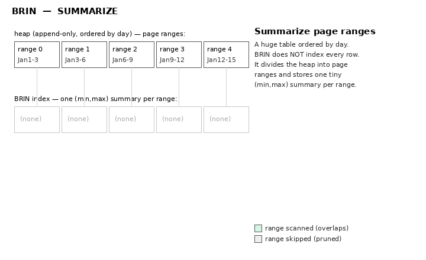

# BRIN — Block Range Index

BRIN (Block Range INdex) is a **tiny, lossy** index for **very large tables**
whose rows are physically **correlated** with the indexed column — most often an
append-only `timestamp` or an auto-increment id. Instead of indexing every row,
BRIN stores a small **summary per block range** (e.g. the min/max value over
every 128 consecutive heap pages). Source: `src/backend/access/brin/`.

## When to use it

- Huge tables (hundreds of millions / billions of rows) where a B-tree would be
  large and expensive.
- The indexed column's values **track physical row order**: time-series inserts,
  log tables, append-only fact tables, monotonically increasing keys.
- Range / equality queries that select large, physically-contiguous slices:
  `WHERE created_at BETWEEN … AND …`.

```sql
CREATE INDEX idx_ts ON events USING brin (created_at);
CREATE INDEX idx_ts ON events USING brin (created_at) WITH (pages_per_range = 32);
```

Measured on 50k rows (PostgreSQL 18): a BRIN index on a correlated timestamp was
**24 kB**, versus **1112 kB** for a B-tree and **2064 kB** for a Hash index on
the same table — ~45× smaller than the B-tree. The gap widens on large tables.

## Core idea: summarize page ranges, don't index rows

The heap is divided into **page ranges** of `pages_per_range` blocks (default
128). For each range, BRIN keeps one summary tuple — for the common minmax
opclass, the **minimum and maximum** value of the indexed column in that range.

```
Heap (physically ordered by created_at, append-only):

 pages 0–127     pages 128–255    pages 256–383    pages 384–511
┌──────────────┐┌──────────────┐┌──────────────┐┌──────────────┐
│ Jan 1 – Jan 3││ Jan 3 – Jan 6││ Jan 6 – Jan 9││ Jan 9 – Jan 12│  heap rows
└──────────────┘└──────────────┘└──────────────┘└──────────────┘
       │               │               │               │
BRIN summary tuples (min,max) per range, stored in the index:
   [Jan1,Jan3]     [Jan3,Jan6]     [Jan6,Jan9]     [Jan9,Jan12]
```

Query `WHERE created_at BETWEEN Jan 5 AND Jan 7` only needs ranges whose
`[min,max]` overlaps `[Jan 5, Jan 7]` — here just the 2nd and 3rd ranges. The
other ranges are skipped without reading their heap pages.

### Animation: summarize and query



Each heap page range gets one tiny `(min,max)` summary; a range query compares
its bounds to every summary, scanning only overlapping ranges (green) and
skipping the rest (grey), then rechecking rows. (Generated by
[`animations/make_brin_gif.py`](animations/make_brin_gif.py).)

## Lossy by design: scan + recheck

BRIN stores **no heap TIDs**, so it cannot return individual rows. It supports
only the bitmap interface: a scan returns a **lossy bitmap of all pages in the
matching ranges**, and the `Bitmap Heap Scan` node then **rechecks** each tuple
against the query. Verified plan:

```
WHERE ts BETWEEN now()+'100 min' AND now()+'200 min'

Bitmap Heap Scan on events
  Recheck Cond: (ts >= … AND ts <= …)
  ->  Bitmap Index Scan on idx_ts
        Index Cond: (ts >= … AND ts <= …)
```

So BRIN narrows a billion-row scan down to the few page ranges that *could*
match; the recheck throws away the false positives within those ranges.

## The range map (revmap) and index layout

```
Index main fork:
┌──────────┐┌───────────────────────────┐┌───────────────────────────┐
│ METAPAGE ││ REVMAP (range map)         ││ regular pages (summary     │
│          ││ one TID per page range  ───┼┼─▶ tuples: min/max + nulls) │
└──────────┘└───────────────────────────┘└───────────────────────────┘
```

- The **revmap** holds one pointer (TID) per page range → the summary tuple for
  that range. Because entries are fixed-size, the revmap slot for any heap page
  is found by simple arithmetic.
- Each **summary tuple** stores the opclass values (min, max) plus NULL flags
  (`hasnulls`, `allnulls`) per column.
- A scan walks the revmap sequentially (ascending page-range order), testing each
  summary with the opclass `consistent` function; matching ranges contribute all
  their pages to the output bitmap. A revmap entry pointing to an invalid TID
  means the range is **not summarized** and is always included (to be safe).

## Maintenance: updates and summarization

- **Insert into a summarized range:** if the new value falls outside the range's
  `[min,max]`, the summary is widened (updated in place when it fits, else a new
  summary tuple is written and the revmap repointed). Values already inside the
  range need no index change — this is why BRIN updates are cheap.
- **New rows past the end:** inserts beyond the last summarized range leave those
  pages **unsummarized** (and thus always scanned) until summarization runs.
- **Summarization** happens at index build (whole table), during `VACUUM`, or on
  demand via `brin_summarize_new_values()` / `brin_summarize_range()`.
- **VACUUM / deletes:** no heap TIDs are stored, so deletes require no index
  scan. A deleted min/max value just leaves the summary looser than necessary —
  a correctness-safe over-estimate, fixed only by re-summarizing.

## Correlation is everything

BRIN's power depends on **physical correlation**. If the indexed column is well
correlated with heap order, each range's `[min,max]` is narrow and selective. If
the column is randomly distributed, every range's `[min,max]` spans nearly the
whole domain, so almost no ranges can be pruned and BRIN degenerates toward a
full scan. (`pg_stats.correlation` shows how correlated a column is.) Smaller
`pages_per_range` gives finer, more selective summaries at the cost of a larger
index.

## Trade-offs

| Strength | Weakness |
|----------|----------|
| Tiny index (orders of magnitude smaller than B-tree) | Only useful when values correlate with physical order |
| Very cheap to build and maintain | Lossy: always a bitmap scan + heap recheck |
| Ideal for append-only / time-series huge tables | No single-row fetch, no ordering, no unique constraints |
| Deletes need no index work | New rows stay unsummarized until VACUUM / manual summarize |

## Key source files

| File | Responsibility |
|------|----------------|
| `brin.c` | access-method entry points, scan |
| `brin_revmap.c` | the range map |
| `brin_minmax.c` | minmax opclass (min/max summaries) |
| `brin_inclusion.c` | inclusion opclass (bounding box for geometry/inet) |
| `brin_tuple.c`, `brin_pageops.c` | summary tuple format, page ops |
| `brin_xlog.c` | WAL replay |

See also: [btree.md](btree.md), [hash.md](hash.md), [gin.md](gin.md),
[gist.md](gist.md), [spgist.md](spgist.md),
[index-comparison.md](index-comparison.md).
