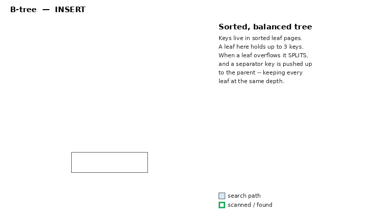

# B-tree — the default balanced index

B-tree is PostgreSQL's default and most-used index. It is a **balanced,
ordered tree of a single comparable key**, implementing Lehman & Yao's
high-concurrency B-tree. It is the right choice for almost any column you query
by equality, range, or sorted order. Source: `src/backend/access/nbtree/`.

## When to use it

- Equality: `col = x`
- Ranges: `col < x`, `col BETWEEN a AND b`, `>=`, `<=`
- Sorted retrieval: `ORDER BY col [ASC|DESC]`, `MIN(col)`, `MAX(col)`
- Prefix match: `col LIKE 'abc%'` (with the right opclass / collation)
- Uniqueness and primary keys (`UNIQUE`, `PRIMARY KEY` build B-trees)
- Multicolumn keys, `INCLUDE` columns, partial indexes

```sql
CREATE INDEX idx_id   ON accounts (account_id);
CREATE INDEX idx_name ON customers (last_name, first_name);
CREATE UNIQUE INDEX idx_email ON users (email);
```

If a column is a single orderable scalar, reach for a B-tree first. The
specialized methods (GIN, GiST, SP-GiST, BRIN, Hash) exist only for cases a
B-tree cannot serve.

## Structure

A B-tree is a balanced tree: all leaf pages are at the same depth, and each page
holds many keys, so the tree stays shallow (typically 3–4 levels for millions of
rows). Leaf entries are **sorted by key** and point to heap rows by ctid.

```
                       ┌─────────────┐
            root       │  50 | 100    │   separator keys (pivot tuples)
                       └──┬────┬────┬──┘
            ┌─────────────┘    │    └─────────────┐
      ┌─────┴─────┐      ┌─────┴─────┐      ┌──────┴────┐
int.  │ 20 | 35   │      │ 65 | 80   │      │ 130 | 170 │
      └─┬───┬───┬─┘      └─┬───┬───┬─┘      └─┬────┬────┬┘
        ▼  ...              ▼  ...             ▼   ...
   ┌────────┐ high key  ┌────────┐          ┌────────┐
   │ leaf   │──────────▶│ leaf   │─────────▶│ leaf   │ ...   right-links
   │ 10→tid │◀──────────│ 55→tid │◀─────────│ 110→tid│       left-links
   │ 15→tid │           │ 60→tid │          │ 120→tid│
   └────────┘           └────────┘          └────────┘
   entries sorted by key; each points to a heap ctid
```

- **Leaf pages** hold `key → ctid` entries, sorted by key.
- **Internal pages** hold *pivot* tuples: separator keys + downlinks. Pivots only
  guide navigation; their key attributes may be **suffix-truncated** to just
  enough to route searches, keeping internal pages dense.
- **Metapage** (block 0) holds the pointer to the current root.
- Leaf pages are chained with **right-links and left-links**, so an ordered scan
  (forward or backward) walks the leaf level without revisiting upper levels.

### Keys are made unique by heap TID

L&Y requires unique keys per level. PostgreSQL enforces this by using the heap
**TID as a tiebreaker**: logical duplicates are sorted by TID. Modern B-trees
also **deduplicate** — equal keys collapse into one entry holding a posting list
of TIDs, saving space (visible with `pageinspect`).

## Search

### Animation: insert, search, and range scan



Keys fill sorted leaf pages; an overflowing leaf splits and pushes a separator
up (keeping the tree balanced). A search descends root→leaf by separators; a
range scan walks the sorted, right-linked leaf level. (Generated by
[`animations/make_btree_gif.py`](animations/make_btree_gif.py).)

To find a key, descend from the root, binary-searching each page's sorted keys
to pick the child whose key range contains the target, down to a leaf:

```
search(key = 60):
  root     [50|100]        60 ≥ 50, < 100  → middle child
  internal [65|80]         60 < 65         → left child
  leaf     [55,60,...]     binary search   → found 60 → ctid → heap
```

For a range or `ORDER BY`, find the start leaf, then walk right-links reading
sorted entries — no sort step needed. This is why `ORDER BY col LIMIT k` becomes
a cheap index scan (verified: `Index Only Scan`).

## Insert, splits, and the high key / right-link trick

Insertion finds the target leaf and adds the entry in sorted position. If the
page is full, it **splits** into two, and a downlink to the new page is inserted
into the parent — which may cascade splits up to the root (a root split adds a
level). Because keys are variable-length, a split equalizes **bytes**, not item
counts.

The Lehman & Yao design makes this safe without read locks:

- Every page has a **high key** (an upper bound on its keys) and a **right-link**
  to its sibling.
- A split moves the upper half to a new right sibling and sets the right-link
  *before* the parent downlink exists.
- A search that followed a stale downlink detects it: if the search key exceeds a
  page's high key, the page was split concurrently, so it **follows the
  right-link** to the new page. This lets searches proceed while splits happen.

```
Before split:  [ ...many keys... | high=∞ ]──▶ sibling
After split:   [ lower half | high=K ]──▶[ upper half | high=∞ ]──▶ sibling
                      │                         ▲
                      └── a search for key > K follows the right-link ──┘
               (even before the parent's downlink to the new page exists)
```

## Concurrency and VACUUM

- **Reads** take short page-level read locks (Postgres shares buffers, unlike the
  original L&Y assumption), copying matching TIDs out of a leaf, then releasing
  the lock while visiting the heap. A **pin** is kept to interlock with VACUUM.
- **Ascending splits** couple parent/child locks conservatively; moving right or
  up is lock-safe, moving left/down is avoided to prevent deadlock.
- **VACUUM** takes a full cleanup lock on a leaf before deleting entries, which
  interlocks with scans so TIDs aren't recycled while a scan still references
  them. Empty pages are deleted and later recycled.

## Trade-offs

| Strength | Weakness |
|----------|----------|
| General-purpose: `=`, ranges, `ORDER BY`, `MIN`/`MAX` | Only for a single orderable key (no composites, no 2-D) |
| Balanced → shallow → predictable, fast | Larger than Hash for pure-equality on big keys |
| Ordered scans need no sort | Index must store the key value (unlike Hash's hash code) |
| Unique constraints, dedup, `INCLUDE`, partial | — |

## Key source files

| File | Responsibility |
|------|----------------|
| `nbtinsert.c` | insertion, page splits |
| `nbtsearch.c` | descent and binary search |
| `nbtpage.c` | page/metapage management, deletion |
| `nbtsort.c` | bottom-up sorted index build |
| `nbtdedup.c` | duplicate posting-list deduplication |
| `nbtxlog.c` | WAL replay |

See also: [hash.md](hash.md), [brin.md](brin.md), [gin.md](gin.md),
[gist.md](gist.md), [spgist.md](spgist.md),
[index-comparison.md](index-comparison.md).
