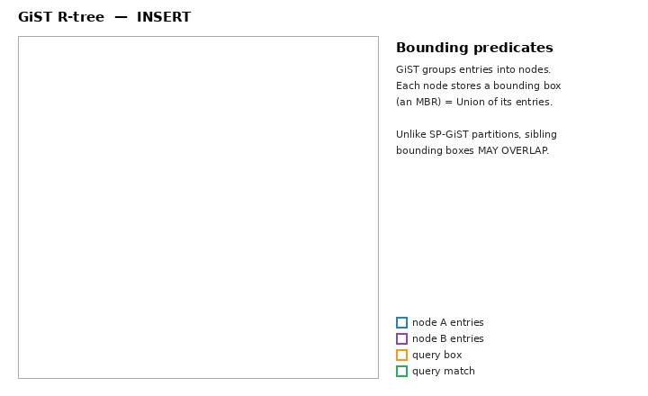

# GiST — Generalized Search Tree

GiST (Generalized Search Tree) is an **indexing framework**, not a single index.
It provides a balanced, tree-structured access method — essentially a
height-balanced tree like a B-tree or R-tree — whose behavior is entirely
defined by a handful of user-supplied functions. By plugging in those functions,
the same machinery becomes an R-tree for geometry, an interval tree for ranges,
a trigram index for text, and more.

GiST was introduced in Hellerstein, Naughton & Pfeffer, *"Generalized Search
Trees for Database Systems"* (1995). Source: `src/backend/access/gist/`.

## When to use it

- Geometric types: `point`, `box`, `polygon`, `circle` (overlap, containment, `<->` distance)
- Range types: `int4range`, `tsrange`, etc. (`&&`, `@>`, `<@`)
- `pg_trgm` text search (`LIKE`/`ILIKE`/similarity)
- `tsvector`/`tsquery` full-text (alternative to GIN; faster to update, slower to search)
- Exclusion constraints (`EXCLUDE USING gist (room WITH =, during WITH &&)`)
- **Nearest-neighbor (KNN)** searches: `ORDER BY geom <-> point LIMIT k`

```sql
CREATE INDEX idx_loc  ON places USING gist (location);
CREATE INDEX idx_when ON bookings USING gist (during);
ALTER TABLE bookings ADD EXCLUDE USING gist (room WITH =, during WITH &&);
```

## The core idea: hierarchical bounding predicates

Every entry in a GiST tree carries a **predicate** (a "key") that is true for
everything in the subtree below it. An internal downlink's key is a *summary*
that covers all its children — for an R-tree that summary is a bounding box.
Searching means descending only into subtrees whose predicate is *consistent*
with the query.

```
                     ┌─────────────────────────────┐
          internal   │  BBox covering everything    │
                     └───────┬──────────────┬───────┘
                 ┌───────────┘              └───────────┐
          ┌──────┴───────┐              ┌───────────────┴──┐
 internal │ BBox A..D    │              │ BBox M..Z         │
          └──┬────────┬──┘              └──┬─────────────┬──┘
       ┌─────┘        └────┐          ┌────┘             └────┐
    ┌──┴──┐           ┌────┴┐      ┌──┴──┐              ┌─────┴┐
leaf│ box │           │ box │      │ box │              │ box  │  → heap TIDs
    └─────┘           └─────┘      └─────┘              └──────┘

Query box Q: descend a child only if Q overlaps that child's BBox
(the `consistent` function decides). Non-overlapping subtrees are pruned.
```

Because the predicates can overlap and are user-defined, GiST is **lossy**: a
downlink says "a match *might* be below here." Matches are confirmed at the leaf,
and leaves point to heap TIDs that are rechecked by the executor.

### Animation: insert and query



Entries are grouped into nodes whose bounding boxes — **MBRs** (Minimum Bounding
Rectangles, the smallest axis-aligned box covering a node's entries) — may
**overlap**; the query box is consistent with **both** MBRs, so the search
descends **both** subtrees before rechecking individual entries. (Generated by
[`animations/make_gist_gif.py`](animations/make_gist_gif.py).)

### GiST vs. a B-tree — the real difference

A B-tree key is a **single point on a total order line**; it supports `=`, `<`,
`>` by binary-searching that line. That works for scalars, but many values have
**no single total order** — a time range, a 2-D box, a polygon. You cannot ask a
B-tree "which ranges *overlap* this one?" because overlap isn't a position on an
ordered line.

GiST replaces the "point on a line" key with a **bounding predicate** (a region)
and asks a yes/no `consistent` question at each node instead of a `<`/`>`
comparison:

```
Range column `during tsrange`:
  r1 = [09:00, 10:00)
  r2 = [10:00, 11:00)
  r3 = [09:30, 10:30)

B-tree on `during`                    GiST on `during`
──────────────────                    ────────────────
sorts ranges by (lower, upper) on     stores a bounding predicate per subtree;
ONE ordered line:                     `consistent(node, query)` tells whether
  [09:00,10:00) < [09:30,10:30) < …    the query could overlap anything below

Query: "which rows OVERLAP [09:45, 09:50) ?"   (during && '[09:45,09:50)')
  B-tree: CAN'T seek it. Overlap is not a point on the sort line, so the
          planner can only read every entry and filter → full scan.
  GiST:   `&&` is answered by the index via `consistent` → probes only the
          overlapping subtrees.
```

Verified on PostgreSQL 18 (`EXPLAIN`): with a B-tree, `during && …` appears as a
**`Filter`** on a full `Index Only Scan`; with a GiST index it becomes an
**`Index Cond`** (a real index probe):

```
B-tree:  Index Only Scan ... Filter:     (during && '[09:45,09:50)')   ← not seeking
GiST:    Index Only Scan ... Index Cond: (during && '[09:45,09:50)')   ← index probe
```

The same holds for geometric overlap/containment (`&&`, `@>`) and for
nearest-neighbor ordering (`<->`), none of which map onto a B-tree's single
ordered line.

## The opclass support functions

The whole behavior of a GiST index is defined by these functions (the framework
calls them; it has no built-in notion of geometry, ranges, etc.):

| Function | Role |
|----------|------|
| `consistent` | Could the query match anything in this subtree? (drives search) |
| `union` | Compute a predicate (key) covering a set of entries — makes a parent's downlink key |
| `penalty` | Cost of inserting a new entry under a given subtree — drives insert routing |
| `picksplit` | How to divide entries when a page overflows and must split |
| `same` | Are two keys equal? |
| `compress`/`decompress` | Optional: store a compact leaf representation |
| `distance` | Optional: distance to query, enables KNN `ORDER BY key <-> q` |

`union`, `penalty`, and `picksplit` are what keep the tree balanced and the
bounding predicates tight. `consistent` and `distance` are what searches use.

## Insert algorithm (single-pass, self-consistent)

GiST keeps the tree balanced. To insert, it walks down from the root choosing,
at each level, the child with the smallest **`penalty`** (e.g. the child whose
bounding box needs the least enlargement to include the new key):

```
insert(key):
  descend from root, at each inner page:
    1. did this page split since we saw the parent? → go back to parent
    2. leaf page?  → this is the target
    3. else pick child with smallest penalty()
    4. does that child's downlink key already cover the new key?
         if not, replace it with union(old_downlink, key)   ← widen on the way DOWN
    5. if widening overflowed the page → split, propagate upward, restart
       from the first parent that didn't need to split
    6. walk into the chosen child; goto 1
  at the leaf: if room → insert; else → split (picksplit), insert downlinks in parent
```

A key design choice (differs from the 1995 paper): GiST **adjusts the downlink
keys while descending**, not on the way back up. So once a key is placed on the
leaf, the tree is immediately self-consistent — no deferred parent updates. This
makes crash recovery simpler.

Page splits use `picksplit` to divide entries between the old and a new page,
then insert the new downlink into the parent (which may cascade splits up to the
root). A split may produce more than two pages when keys have variable length.
`gistplacetopage` performs one such step; `gistFindCorrectParent` re-finds the
parent, which may have moved right due to concurrent splits.

## Search algorithm and KNN

Search maintains a **priority queue** of unvisited items — either a heap tuple
known to match, or an index page consistent with the query:

```
queue (ordered): [ heap tuples first ] [ then index pages, newest first ]

pop item:
   heap tuple → return it immediately
   index page → lock, scan entries, push consistent children, unlock
```

For plain searches the ordering yields depth-first traversal, so the first
matching heap tuples come out quickly (good for `LIMIT`). For
**nearest-neighbor** search, each queue entry is tagged with a distance:

```
ORDER BY location <-> :p LIMIT 5

  heap tuple    → exact distance( entry, :p )
  index page    → MINIMUM possible distance of any child (lower bound)

  pop smallest-distance-first  →  guarantees correct KNN order,
  pages whose lower-bound distance exceeds the k-th result are pruned.
```

This is what makes `ORDER BY geom <-> point LIMIT k` an index-ordered scan
instead of a sort of the whole table.

## Concurrency: the NSN / right-link protocol

GiST searches lock only **one page at a time**, so a page can split between the
moment a scan queues its downlink and the moment it visits the page. GiST avoids
missing moved entries with a **two-phase split + NSN** scheme:

```
Split of a child page happens in two steps:
  (1) split the page, set F_FOLLOW_RIGHT on the left half, add a right-link
  (2) insert the downlink for the new right half into the parent,
      clear F_FOLLOW_RIGHT, set child NSN = LSN of that parent insertion

A scan at a child page decides whether to also follow the right-link:
  • F_FOLLOW_RIGHT set        → downlink not in parent yet → follow right-link
  • child NSN > parent LSN     → scan saw the parent BEFORE the downlink existed
                                 → follow right-link (the new half isn't reachable
                                   via a downlink the scan has seen)
  • otherwise                  → scan already saw the downlink → don't double-visit
```

Lock-ordering rule to avoid deadlock: when holding multiple page locks, take
**child before parent**, and **left-to-right** within a level. A crash between
the two split phases leaves an `F_FOLLOW_RIGHT` page with a missing parent
downlink; scans cope, and the next insertion that lands there finishes the split.

## Build strategies

GiST can be built three ways:

1. **Sorted build** — if every column's opclass provides `sortsupport`, GiST
   sorts all tuples and packs leaf pages bottom-up (like a B-tree build). Fastest.
2. **Buffering build** — attaches buffers to some internal levels so insertions
   proceed breadth-first, drastically cutting random I/O on large builds:

   ```
   Level 2        *(b)            *(b)        ← buffered internal nodes
                /  |  \          /  |  \
   Level 1    *    *    *      *    *    *
             /\   /\   /\     /\   /\   /\
   Level 0  o  o o  o o  o   o  o o  o o  o    ← leaf pages

   A tuple descends only until it hits a buffer, where it waits. When a buffer
   fills, its tuples are flushed down together → mostly sequential I/O.
   ```
   `level_step` controls which levels get buffers; buffers are backed by a temp
   file with the last page kept in memory.
3. **One-by-one insertion** — the fallback when neither applies.

## VACUUM

Two stages: (1) scan the whole index in physical order, removing dead leaf TIDs
and noting completely empty leaf pages (using `F_FOLLOW_RIGHT`/NSN to detect and
re-scan concurrently split pages — "jump backwards"). (2) Unlink empty leaf pages
by removing their downlinks from the memorized internal pages. The last child of
an internal page is never deleted (the insert algorithm cannot cope with an
empty internal page). Deleted pages are stamped with the next-XID value and not
recycled until that XID is invisible to everyone, so in-flight scans that saw the
old downlink safely ignore the page.

## Trade-offs

| Strength | Weakness |
|----------|----------|
| One framework fits many data types (geometry, ranges, text, custom) | Lossy — leaves/heap recheck required |
| Native nearest-neighbor (KNN) via `distance` | Search can be slower than GIN for full-text |
| Cheaper, more balanced updates than GIN | Overlapping predicates can degrade selectivity (bad `picksplit`) |
| Supports exclusion constraints | Quality depends heavily on opclass `penalty`/`picksplit` |

## Key source files

| File | Responsibility |
|------|----------------|
| `gist.c` | insert driver, `gistplacetopage`, parent re-finding |
| `gistget.c` | search + KNN priority-queue scan |
| `gistsplit.c` | page-split logic calling `picksplit` |
| `gistproc.c` | built-in opclass support (geometry etc.) |
| `gistbuild.c`, `gistbuildbuffers.c` | sorted / buffering build |
| `gistvacuum.c` | two-stage VACUUM, empty-page unlinking |
| `gistxlog.c` | WAL replay |

See also: [btree.md](btree.md), [hash.md](hash.md), [brin.md](brin.md),
[gin.md](gin.md), [spgist.md](spgist.md),
[index-comparison.md](index-comparison.md).
