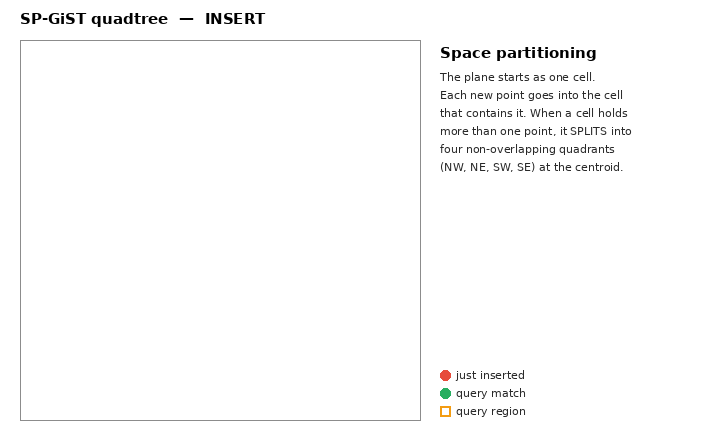

# SP-GiST — Space-Partitioned Generalized Search Tree

SP-GiST (Space-Partitioned GiST) is an indexing framework for **non-balanced,
space-partitioning** data structures: quadtrees, k-d trees, and radix trees
(tries). These structures repeatedly divide the search space into
**non-overlapping** partitions — the opposite of GiST, whose bounding predicates
may overlap. SP-GiST's job is to map such pointer-chasing in-memory trees onto
disk pages so a search touches only a few pages even while traversing many nodes.

Source: `src/backend/access/spgist/`.

## When to use it

- Points / spatial data where partitions should not overlap: `point` (quadtree, k-d tree)
- Text with shared prefixes: `text` radix tree (`~<~`, prefix matching)
- `inet`/`cidr` network addresses (prefix hierarchy)
- Range types (quadtree over range space)
- Generally: **hierarchical or naturally partitionable** data, and point data
  where GiST's overlapping boxes hurt selectivity

```sql
CREATE INDEX idx_pt   ON places USING spgist (location);        -- quadtree
CREATE INDEX idx_name ON users  USING spgist (name text_ops);   -- radix tree
CREATE INDEX idx_net  ON hosts  USING spgist (addr inet_ops);
```

## The core idea: partition, don't bound

Where GiST stores a *bounding predicate* that covers (and may overlap) its
children, SP-GiST stores a **partitioning rule** that sends each value to exactly
one child. A quadtree splits a plane at a centroid into 4 non-overlapping
quadrants; a radix tree splits strings by their next character.

```
QUADTREE (point data)                 RADIX TREE (strings)

        centroid C                     prefix "www.go"
     ┌──────┬──────┐                   ├─ 'o' → "ogle.com/"  → leaves
     │  NW  │  NE   │                  └─ 'g' → "o.com"       → leaves
     ├──────┼──────┤                   (each inner node = common prefix,
     │  SW  │  SE   │                    each node label = next character)
     └──────┴──────┘
  a point belongs to exactly ONE quadrant → no overlap → tighter pruning
```

Because partitions don't overlap, a search usually descends **one** path (or a
small number of nodes), which can make SP-GiST both faster and smaller than GiST
for the right data. The price is that the tree is **non-balanced** — there is no
rebalancing code, so skewed data can create deep branches.

### Animation: insert and query



As points are inserted, each cell splits into four **non-overlapping** quadrants;
a range query descends only the quadrants it overlaps (blue) and prunes the rest
(grey). (Generated by
[`animations/make_spgist_gif.py`](animations/make_spgist_gif.py).)

> Note: the animation splits each cell at its geometric midpoint, so the four
> quadrants look equal. Real SP-GiST `quad_point_ops` splits at the **data
> point** stored in the inner node (the centroid/pivot), so the four regions are
> generally **unequal** — the partition only has to be non-overlapping and
> covering, not equal-area.

### SP-GiST vs. a B-tree — the real difference

A B-tree needs a **single total order**: every key must be comparable with `<`.
A 2-D point has no such order — is `(1, 9)` less than `(9, 1)`? There's no
meaningful answer, so PostgreSQL ships **no B-tree opclass for `point` at all**
(verified: zero `btree` opclasses with `opcintype = point`). You simply cannot
build a B-tree on a 2-D point.

SP-GiST sidesteps the "one ordered line" requirement by **partitioning the space
itself**. A quadtree splits the plane at a centroid into 4 disjoint quadrants; a
search for a point, or the nearest points, descends into just the relevant
quadrant(s):

```
Point column `g point`:               B-tree          SP-GiST (quadtree)
  (1,9) (9,1) (50,50) …               ──────          ──────────────────
                                      no total order  split plane at centroids
  "5 nearest points to (50,50)?"      → NO opclass    into NW/NE/SW/SE quadrants,
  ORDER BY g <-> point(50,50) LIMIT 5   can't index   descend closest-first
```

Verified on PostgreSQL 18 (`EXPLAIN`):

```
No spatial index:  Limit → Sort (Sort Key: g <-> point) → Seq Scan   ← reads ALL rows, sorts
SP-GiST index:     Limit → Index Only Scan ... Order By: (g <-> point(50,50))   ← ranked from index
```

Without a spatial index, "nearest neighbours" degrades to a full scan plus a sort
of the whole table. SP-GiST (and GiST) turn it into a distance-ordered index scan
that stops after `LIMIT` rows. The same partitioning idea powers text **radix
tries** (prefix search) and IP-hierarchy indexes — data that is naturally
hierarchical rather than linearly ordered.

## Logical structure: inner tuples and leaf tuples

An SP-GiST tree is a set of **inner tuples** and **leaf tuples**:

```
INNER TUPLE
  ┌───────────────────────────────────────────────┐
  │ optional PREFIX value                           │  radix: common prefix string
  │   (all descendants are consistent with it)      │  quad : centroid
  │ NODES: [ (label, pointer), (label, pointer), …] │  k-d  : one coordinate
  └───────────────┬─────────────────┬───────────────┘
          pointer │                 │ pointer
                  ▼                 ▼
          another INNER        a chain of LEAF TUPLES
          tuple                (all on the SAME page)

LEAF TUPLE
  ┌──────────────────────────────────────────┐
  │ leaf value   (radix: postfix; quad: point)│
  │ heap ItemPointer (TID)                     │
  │ nextOffset  → next leaf in the chain       │
  │ optional nulls bitmask / INCLUDE columns   │
  └────────────────────────────────────────────┘
```

Each **node** of an inner tuple is a `(label, pointer)` pair. The label is
type-specific — a single character for a radix tree, nothing meaningful for a
quadtree. The pointer leads either to another inner tuple or to the head of a
chain of leaf tuples.

### Disk-mapping rules (what makes it page-efficient)

- Inner tuples live only on **inner pages**; leaf tuples only on **leaf pages**.
- A whole chain of leaf tuples reachable from one node must sit on **one page**,
  so chain links are just 2-byte `OffsetNumber`s and following a chain needs no
  extra seeks.
- An inner tuple (prefix + all its nodes) must fit on one page, so opclasses must
  keep prefixes small and node counts bounded.
- The **root** is special: while the index is tiny it is an unorganized bag of
  leaf tuples; after the first split it holds exactly **one** inner tuple (to keep
  the top-level partitioning as good as possible and maximize root free space).

## Insertion algorithm

Insertion descends choosing **one** node per inner tuple, and may reshape the
inner tuple to make room for the new value. The opclass's `choose` function
returns one of three actions:

```
insert(value):
  start at root
  loop:
    if leaf page:
        if room → add leaf tuple to the chain, done
        else    → PickSplit(): turn the leaf chain into a new inner tuple
                  and redistribute the leaves (possibly across pages)
    else inner tuple → choose():
        MatchNode   → descend through the matching node
        AddNode     → add a new node (label) to this inner tuple, retry choose
        SplitTuple  → break the inner tuple into prefix + postfix, retry choose
```

**`SplitTuple`** is the radix-tree trick for a partially-matching prefix. Insert
`www.gogo.com` into inner tuple `(www.google.com/)[a,i]`:

```
  mismatch at "go…"  → split prefix into matching + remainder

  {2}(www.go)[o]            prefix tuple (matches the new value)
         │
         {3}(gle.com/)[a,i] postfix tuple (old nodes move here unchanged)

  then AddNode [g] under {2}, descend, and insert leaf <o.com>:

  {2}(www.go)[o, g]
      │         │
      │         {4}<o.com>
      {3}(gle.com/)[a,i]
```

The core guarantees the prefix tuple is **no larger** than the old inner tuple,
so it can overwrite it in place; the postfix tuple goes on the same page if it
fits, else another inner page. Quadtrees and k-d trees never use `SplitTuple`
(their prefixes can't be "inconsistent"); they grow depth only via `PickSplit`,
which creates all child nodes at once.

### Placeholders

When an inner tuple grows too big and must move to another page, SP-GiST cannot
renumber the other tuples on the old page (downlinks are `OffsetNumber`s). It
leaves a **placeholder** tuple in the vacated slot to preserve offsets; the slot
can be reused later.

## Nulls handling

SP-GiST assumes indexable operators are strict (never match NULL), and it keeps
the opclass free of null-handling. Null entries are stored in a **separate tree
on its own set of pages** (its own root), using hardwired logic rather than
opclass functions — so `IS NULL` and whole-index scans still work.

## Concurrency and redirect tuples

Searches lock **one page at a time** and release the parent before locking the
child. A concurrent insertion could move the target inner tuple or leaf chain
elsewhere in between. SP-GiST solves this with **redirect tuples**:

```
A scan released the parent lock and is "in flight" to child page N …
   … meanwhile an insertion moved that tuple to page M.

   page N, old slot:  [ REDIRECT → (M, offset) ]
                             │
   the in-flight scan arrives, sees REDIRECT, and follows it to M.
```

Only a scan that already passed the parent could reach a redirect, so redirects
are needed only until all older transactions drain out; VACUUM then converts
them to placeholders.

Insertion holds exclusive locks on **two levels at once** (parent + child), which
risks deadlock if two branches cross-reference pages. Two mechanisms reduce this:

- **Conditional locking:** if a child buffer lock can't be taken, release both and
  restart the descent.
- **Triple parity:** a child of a tuple on block `N` is placed on block `M` with
  `(N+1) mod 3 == M mod 3`. This makes it unlikely that page `M` has children back
  on page `N`, cutting the chance of a two-process deadlock (three-way deadlocks
  are still possible, hence the conditional-lock fallback).

## Leaf-tuple states and VACUUM

Leaf tuples can be in four states; inner tuples in three (no `DEAD`):

| State | Meaning |
|-------|---------|
| `LIVE` | normal pointer to a heap tuple |
| `REDIRECT` | temporary forward pointer after a move (for in-flight scans) |
| `DEAD` | dead, but an inner-tuple downlink still points at it — can't move |
| `PLACEHOLDER` | dead, no links to it — preserves offsets, freely reusable |

`spgbulkdelete` does **one sequential scan**:

- Convert expired `REDIRECT` → `PLACEHOLDER`; drop trailing placeholders.
- On leaf pages, delete tuples whose heap TID is a vacuum target. If the deleted
  tuple heads a chain with survivors, move a live tuple into the head offset
  (keeping the parent downlink valid) and placeholder the rest; if the whole
  chain dies, the head becomes `DEAD` and the rest placeholders.
- VACUUM finds chain heads by building a predecessor array (reverse of the
  `nextOffset` links): a head is a tuple with no predecessor.
- A **pending list** handles tuples that insertions moved from unscanned to
  already-scanned pages mid-VACUUM (detected via a `REDIRECT` with a recent XID),
  so no target TID is ever missed.

The index metapage keeps a cache of the last-used leaf page and one inner page
per triple-parity group, for better space reuse; these updates are intentionally
**not WAL-logged** (incorrect cache data is harmless — a new page can be
allocated anytime).

## Trade-offs

| Strength | Weakness |
|----------|----------|
| Non-overlapping partitions → tight pruning for points, tries | Non-balanced: skewed data → deep, slow branches |
| Often smaller & faster than GiST for point/prefix data | Inner tuple + leaf chain must each fit one page (bounded fanout) |
| Natural fit for hierarchical / prefix data | Fewer built-in opclasses than GiST |
| Supports KNN ordered search; INCLUDE columns | More intricate concurrency (redirects, triple parity) |

## Key source files

| File | Responsibility |
|------|----------------|
| `spgdoinsert.c` | the insert state machine (choose / AddNode / SplitTuple / PickSplit) |
| `spginsert.c` | index build driver |
| `spgscan.c` | search, KNN priority queue |
| `spgquadtreeproc.c`, `spgkdtreeproc.c`, `spgtextproc.c` | built-in quadtree / k-d tree / radix opclasses |
| `spgvacuum.c` | sequential VACUUM, redirect/placeholder/dead handling, pending list |
| `spgutils.c` | tuple formatting, page/placeholder management |
| `spgxlog.c` | WAL replay |

See also: [btree.md](btree.md), [hash.md](hash.md), [brin.md](brin.md),
[gin.md](gin.md), [gist.md](gist.md),
[index-comparison.md](index-comparison.md).
