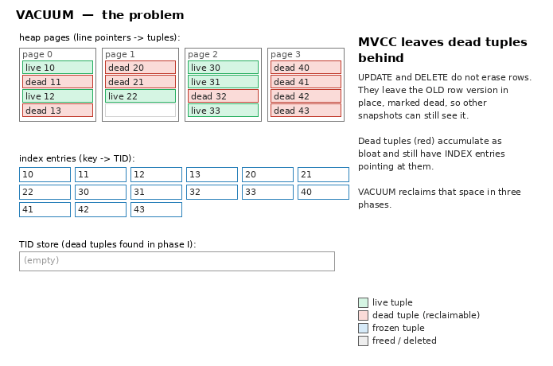
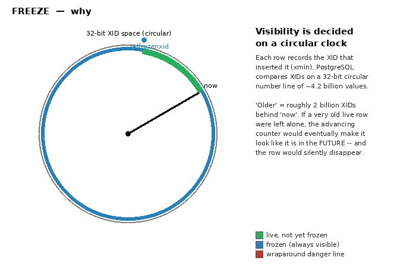
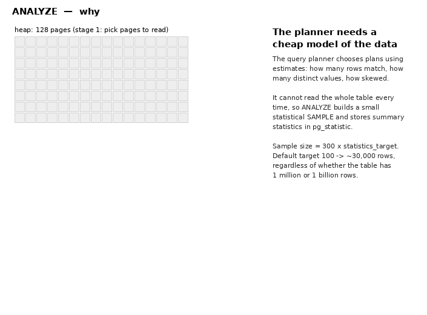
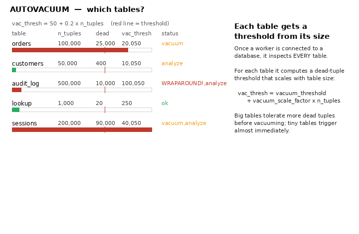
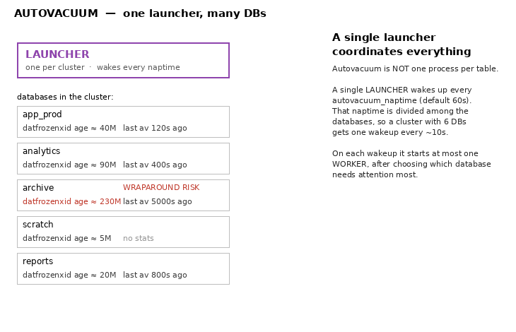

# Maintenance

How PostgreSQL keeps tables healthy: reclaiming dead tuples, keeping the
planner's statistics fresh, protecting against transaction-ID wraparound, and
doing all of it automatically in the background. Each topic is explained from
the source code and illustrated with an animation (in the style of
[Development/Indexes](../Development/Indexes)).

The source references are to the PostgreSQL **master branch (20devel)** checked
out alongside this repository; mechanisms are stable across supported versions
except where a **version note** calls out something new.

## Contents

- [vacuum.md](vacuum.md) — **VACUUM**: MVCC dead tuples, HOT pruning, the
  visibility map, the three phases (heap scan → index vacuum → heap reap), the
  TID store, truncation, and `VACUUM FULL`. Includes **freezing and XID
  wraparound** (`relfrozenxid`, anti-wraparound vacuum, the failsafe).
- [analyze.md](analyze.md) — **ANALYZE**: why the sample is a fixed size
  (`300 × statistics_target`), two-stage sampling (block sampler + Vitter
  reservoir), and the statistics produced (`n_distinct`, MCV list, histogram,
  correlation) and how the planner uses them. Extended statistics too.
- [autovacuum.md](autovacuum.md) — **autovacuum**: the launcher/worker process
  model, **how a database is chosen** across the cluster, **how tables are
  chosen** (the `threshold + scale_factor × reltuples` formula) and
  **prioritized** (scores), per-table overrides, and monitoring.
- [parameters.md](parameters.md) — every vacuum/analyze/autovacuum **setting**,
  grouped by role, and **how they relate** (scale factor vs. table size, freeze
  age ordering, cost-delay balancing across workers, memory vs. index passes),
  with worked tuning recipes.
- [animations/](animations/) — the GIFs and the pure-Pillow scripts that
  generate them ([details](animations/README.md)).

## The animations

| | |
|---|---|
|  |  |
| **VACUUM** — three phases ([vacuum.md](vacuum.md)) | **Freeze** — XID wraparound ([vacuum.md](vacuum.md#freezing-and-xid-wraparound)) |
|  |  |
| **ANALYZE** — sampling & stats ([analyze.md](analyze.md)) | **Autovacuum** — table selection ([autovacuum.md](autovacuum.md#picking-tables-the-worker)) |
|  | |
| **Autovacuum** — database selection ([autovacuum.md](autovacuum.md#picking-a-database-the-launcher)) | |

## Related operational docs

These explain the *internals*; for day-to-day operation and monitoring see:

- [`postgresql-maintenance.md`](postgresql-maintenance.md)
  — routine maintenance commands, bloat, `pg_repack`
- [`monitor-autovacuum.md`](monitor-autovacuum.md)
  — tracking autovacuum behavior and XID wraparound in production
