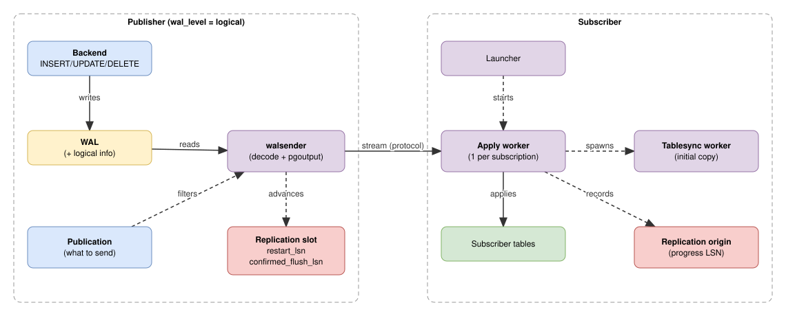

# 01 — Logical vs Physical Replication, and the Architecture

Level: L200. Tested on PostgreSQL 18.6.

## The one-sentence difference

- **Physical (streaming) replication** ships the *WAL bytes*. The standby is a
  block-for-block copy of the whole cluster.
- **Logical replication** ships *row changes* ("insert this row into
  `public.orders`"), decoded from WAL. The subscriber is an independent,
  writable database that happens to receive those changes.

| | Physical | Logical |
|---|---|---|
| Unit | Whole cluster (every database, every table) | Chosen tables / schemas of one database |
| Wire content | WAL records (page-level redo) | Row-level INSERT/UPDATE/DELETE/TRUNCATE |
| Target | Read-only standby (hot standby) | Normal read-write database |
| Major versions | Must be identical | Can differ (publisher 14 → subscriber 18 works) |
| OS / architecture | Must match | Can differ |
| Target can have extra tables, indexes, other writers | No | Yes |
| DDL | Replicated (it is just WAL) | **Not replicated** |
| Sequences | Replicated (WAL) | Not replicated on GA releases (see [limitations](13-limitations.md)) |
| Large objects | Yes | No |
| Typical use | HA, read scaling, PITR | Upgrades, migration, CDC, consolidation, selective copy |
| Needs `wal_level` | `replica` | `logical` (⚠️ 19 can enable it dynamically — see below) |

Choose physical for "an identical hot spare". Choose logical for "some of my
data, somewhere else, possibly on another version, possibly writable".

## Architecture at a glance



Editable source: [diagrams/architecture.drawio](diagrams/architecture.drawio).

Data path for a single committed row change:

1. A **backend** on the publisher changes a row. Because `wal_level = logical`,
   the WAL record carries extra information: the old-row key for UPDATE/DELETE
   (per [replica identity](09-replica-identity.md)) and catalog-change markers.
2. A **walsender** process, started when the subscriber connects, reads WAL
   *from the slot's position* and **decodes** it: WAL records →
   per-transaction row changes ([topic 06](06-logical-decoding.md)).
3. Changes of one transaction are buffered (the *reorder buffer*) and released
   in **commit order** once the transaction commits
   ([topic 07](07-reorderbuffer-and-large-transactions.md)).
4. The **output plugin** (`pgoutput`) filters them through the
   *publication* (tables, row filter, column list) and encodes them in the
   logical replication protocol ([topic 08](08-pgoutput-protocol.md)).
5. On the subscriber, the **apply worker** receives the stream, locates each
   target row (by replica identity) and executes the change as a normal local
   write, then reports progress back so the publisher can advance the slot and
   recycle WAL.
6. The **slot** on the publisher remembers how far the subscriber confirmed
   ([topic 05](05-replication-slots.md)).

## The processes you will actually see

Captured from `pg_stat_activity` while one subscription was active:

```
PUB  walsender                       application_name = s      (one per subscription connection)
PUB  logical replication launcher    (always present when max_logical_replication_workers > 0)
SUB  logical replication apply worker                          (one per enabled subscription)
SUB  logical replication launcher
```

During the initial copy you additionally see `logical replication tablesync worker`
(one per table being copied, up to `max_sync_workers_per_subscription`), and
with `streaming = parallel` you can see `logical replication parallel apply worker`
([topic 11](11-apply-workers-and-parallel-apply.md)).

Roles:

- **Launcher** (subscriber): polls `pg_subscription` and starts a worker for
  each enabled subscription. Bounded by `max_logical_replication_workers`
  (default 4), which in turn draws from `max_worker_processes` (default 8).
- **Apply worker** (subscriber): the single process that applies the
  subscription's changes in commit order.
- **Tablesync worker** (subscriber): copies one table's existing rows using a
  temporary slot, then hands over to the apply worker.
- **Walsender** (publisher): decodes and sends. Counts against
  `max_wal_senders` (default 10) *and* each logical slot counts against
  `max_replication_slots` (default 10).

## State that lives in each place

| Where | Object | Purpose | Catalog / view |
|---|---|---|---|
| Publisher | Publication | What to publish | `pg_publication`, `pg_publication_rel`, `pg_publication_namespace`, view `pg_publication_tables` |
| Publisher | Replication slot | Pins WAL + catalog rows; remembers confirmed position | `pg_replication_slots` |
| Publisher | walsender | Live connection and lag | `pg_stat_replication` |
| Subscriber | Subscription | Connection string, options, publication names | `pg_subscription` |
| Subscriber | Per-table sync state | `i`nit, `d`ata copy, `f`inish copy, `s`ynchronized, `r`eady | `pg_subscription_rel` |
| Subscriber | Replication origin | How far the remote LSN has been applied (survives restart) | `pg_replication_origin`, `pg_replication_origin_status` |
| Subscriber | Worker status | Per-worker LSN / time | `pg_stat_subscription`, `pg_stat_subscription_stats` |

Captured on the subscriber (origin name is `pg_<subscription oid>`):

```
 roident |  roname
---------+----------
       1 | pg_16392
```

## Transaction semantics you can rely on

- **Commit order is preserved** per subscription: the subscriber sees
  transactions in the order they committed on the publisher.
- Only **committed** transactions are applied (rolled-back work is dropped
  during decoding; with `streaming` it may be sent early but is discarded on
  abort).
- Transactions are **not** applied atomically across *different* subscriptions
  or across initial-sync tables. Two subscriptions are two independent streams.
- By default the subscriber's commit is **asynchronous** (`synchronous_commit = off`
  is the subscription default shown in `pg_subscription.subsynccommit`). That
  is safe: after a crash the apply worker restarts from the origin's last
  durable position and re-receives anything lost.
- Delivery is **at-least-once with origin-based deduplication**: after a
  reconnect the publisher resends from the slot's `confirmed_flush_lsn`; the
  subscriber skips what its origin says it already applied.

## `wal_level` and the dynamic behaviour in 19

On GA releases, the publisher must run with `wal_level = logical` **set in
`postgresql.conf` and the server restarted**; the cost is somewhat larger WAL
(extra key/old-tuple data). 

⚠️ **Non-GA (19 source, `logicalctl.c`, not run by me):** the tree contains a
read-only `effective_wal_level`. With `wal_level = replica`, creating the first
logical slot turns logical decoding on without a restart, and it is switched
off lazily (via the checkpointer) after the last logical slot is gone. With
`wal_level = logical` it is always on. Treat this as subject to change.

## Where to go next

Publications → [02](02-publications.md); Subscriptions → [03](03-subscriptions.md);
hands-on → [04](04-step-by-step-setup-guide.md).
