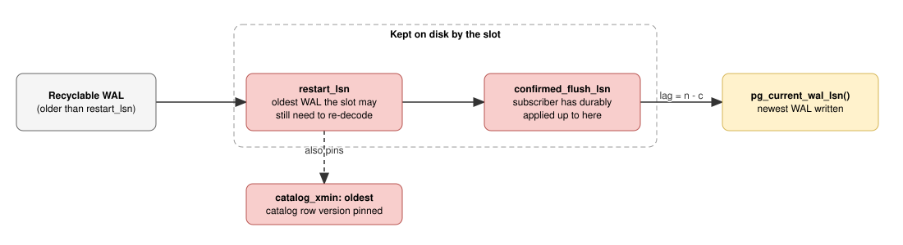

# 05 — Replication Slots

Level: L300. Tested on PostgreSQL 18.6 (`max_slot_wal_keep_size`, invalidation,
peek/get, advance and copy were executed). Source cross-check:
`src/backend/replication/slot.c`, `slotfuncs.c`, `include/replication/slot.h`.

## Why slots exist

Without a slot the publisher recycles WAL on its own schedule, so a consumer
that disconnects for an hour may come back to find WAL gone. A **slot is a
server-side promise: "keep everything this consumer might still need."** It
holds two kinds of resources:

1. **WAL** from `restart_lsn` onward (disk).
2. **Catalog row versions** from `catalog_xmin` onward — logical decoding must
   read old system-catalog rows to interpret old WAL (the table may have been
   altered since), so vacuum is not allowed to remove them.

That second item is why a stuck *logical* slot hurts more than a stuck
physical one: besides WAL growth it causes **catalog bloat** (`pg_class`,
`pg_attribute`, …), visible as `tuples: … are dead but not yet removable` in
`VACUUM VERBOSE pg_class`.



Editable: [diagrams/slot-lsns.drawio](diagrams/slot-lsns.drawio).

## Anatomy: every column of `pg_replication_slots`

Real row for an unused logical slot on 18.6:

```
slot_name           | idle
plugin              | pgoutput
slot_type           | logical
database            | postgres
temporary           | f
active              | f
xmin                |                  -- physical: hot_standby_feedback horizon
catalog_xmin        | 754              -- logical: catalog rows pinned from here
restart_lsn         | 0/17A01E0
confirmed_flush_lsn | 0/17A0218
wal_status          | reserved
safe_wal_size       | 42335720         -- bytes of WAL that may still be written before this slot is endangered
two_phase           | f
conflicting         | f                -- logical slot invalidated by recovery conflict (on standby)
failover            | f
synced              | f                -- this slot was synchronised from a primary
invalidation_reason |
```

| Column | Meaning |
|---|---|
| `restart_lsn` | Oldest WAL the slot may need. The decoder restarts from here after a reconnect, because it must re-read the start of any transaction that was open at the last confirm point. **WAL older than this is deletable.** |
| `confirmed_flush_lsn` | Logical only. The subscriber has durably applied everything committed before this. On reconnect, the walsender starts sending from here (the subscriber also reports its own origin position). |
| `catalog_xmin` | Oldest xid whose catalog changes vacuum must keep. |
| `active` / `active_pid` | Another process is using it. A slot can be used by **one** process at a time. |
| `wal_status` | `reserved` (within `max_wal_size`), `extended` (beyond it but protected, e.g. by `wal_keep_size`/slot), `unreserved` (will be lost at next checkpoint), `lost` (gone). |
| `safe_wal_size` | Headroom before the slot goes `lost` when `max_slot_wal_keep_size` is set. |
| `invalidation_reason` | `wal_removed`, `rows_removed` (catalog rows removed, standby conflict), `wal_level_insufficient`, `idle_timeout`. |

`restart_lsn` ≤ `confirmed_flush_lsn` ≤ current WAL position, always.

## The three states of danger

| `wal_status` | What it means | What to do |
|---|---|---|
| `reserved` | Normal | — |
| `extended` | Slot needs more than `max_wal_size` of WAL | Watch; find the lagging consumer |
| `unreserved` | `max_slot_wal_keep_size` is about to be breached | Fix NOW; next checkpoint can invalidate it |
| `lost` | WAL gone; slot permanently unusable | Rebuild the subscription (re-copy) |

### Tested: a stuck slot with a cap

Publisher with `max_slot_wal_keep_size = 32MB`, `checkpoint_timeout = 30s`, and
a logical slot `idle` that nobody consumes. After ~4 × 20 MB of inserts and
checkpoints:

```
 slot_name | restart_lsn | wal_status | safe_wal_size | invalidation_reason
-----------+-------------+------------+---------------+---------------------
 idle      |             | lost       |               | wal_removed
```

Server log:

```
LOG:  invalidating obsolete replication slot "idle"
DETAIL:  The slot's restart_lsn 0/17A01E0 exceeds the limit by 8781344 bytes.
HINT:  You might need to increase "max_slot_wal_keep_size".
```

This is the trade-off in one example:

- `max_slot_wal_keep_size = -1` (default): the publisher **never** drops WAL a
  slot needs → a dead subscriber eventually **fills the disk and takes the
  primary down**.
- A finite cap: the primary is protected, but the slot (and the subscription
  that owned it) is sacrificed; recovery requires re-initialisation.

Choose a cap larger than your longest tolerable subscriber outage × WAL rate,
and alert well before it.

### `idle_replication_slot_timeout` (GA in 18)

Invalidates slots inactive longer than the timeout (checked at checkpoints).
Default `0` = never. Reason shows as `idle_timeout`. Does not apply to slots
used for sync on standbys. Complements `max_slot_wal_keep_size`, which
measures bytes rather than time.

## Slot types

| Type | Created by | Notes |
|---|---|---|
| Logical, persistent | `CREATE SUBSCRIPTION`, `pg_create_logical_replication_slot`, `pg_recvlogical --create-slot` | Survives restart; bound to **one database** and one output plugin |
| Logical, temporary | `pg_create_logical_replication_slot(…, temporary => true)`; tablesync workers | Dropped at session end or on error. My test: `temporary = t, active = t` |
| Physical | `pg_create_physical_replication_slot`, `pg_basebackup -C` | For standbys / WAL archivers; `xmin` only with `hot_standby_feedback` |

Slot names: lowercase letters, digits, underscore, ≤ 63 bytes.

### Which slots does a subscription create?

- One **permanent** slot named after the subscription (or `slot_name`).
- One **temporary** slot per table during its initial copy, named
  `pg_<subid>_sync_<relid>_<systemid>`; dropped when the table reaches `r`
  ([topic 10](10-initial-sync-tablesync.md)). So during a big first sync with
  `max_sync_workers_per_subscription = 2` you need 3 slots and 3 walsenders per
  subscription. This is the usual reason for
  `ERROR: all replication slots are in use` when adding a subscription.

## Peek, get, advance, copy — slot control functions

Using the `test_decoding` plugin (ships with PG) to inspect a slot from SQL:

```sql
SELECT pg_create_logical_replication_slot('s1','test_decoding');
INSERT INTO t(v) VALUES ('a'),('b');

SELECT lsn,xid,left(data,70) FROM pg_logical_slot_peek_changes('s1',NULL,NULL);
    lsn    | xid |                       left
-----------+-----+---------------------------------------------------
 0/17A0218 | 754 | BEGIN 754
 0/17A0280 | 754 | table public.t: INSERT: id[integer]:1 v[text]:'a'
 0/17A0360 | 754 | table public.t: INSERT: id[integer]:2 v[text]:'b'
 0/17A0410 | 754 | COMMIT 754
```

| Function | Effect on the slot |
|---|---|
| `pg_logical_slot_peek_changes` | Read without consuming — calling it again returns the same 4 rows. |
| `pg_logical_slot_get_changes` | Read **and consume**: `confirmed_flush_lsn` moved `0/17A0218 → 0/17A0410`; a second call returned 0 rows. |
| `pg_replication_slot_advance(slot, lsn)` | Skip forward without decoding (tested: `(s1,0/17AC000)`). **Data loss for the consumer** if it hasn't seen the skipped changes. Useful to unstick a slot you decided to abandon. |
| `pg_copy_logical_replication_slot(src, dst)` | Clone a slot at its current position (tested) — lets two consumers start from the same point. |
| `pg_drop_replication_slot(name)` | Drops; fails if `active`. |

Note `restart_lsn` stayed at `0/17A01E0` after `get_changes` consumed
everything — it only advances when the decoder next sees a safe
"running transactions" point, which is why `restart_lsn` can lag
`confirmed_flush_lsn` for a while on a quiet system.

## Slots and the subscription lifecycle

| Event | Slot effect |
|---|---|
| `CREATE SUBSCRIPTION` | Creates it (unless `create_slot=false`) |
| `ALTER SUBSCRIPTION … DISABLE` | Slot stays, `active=f`, **WAL keeps accumulating** |
| Subscriber crashes / network lost | Slot stays; walsender notices after `wal_sender_timeout` (60 s) |
| `DROP SUBSCRIPTION` | Drops the slot (if reachable and still attached) |
| Subscriber database dropped without dropping the subscription | **Orphaned slot** — you must drop it manually |
| `pg_dump`/restore of the subscriber | Restored subscription tries to create the slot again — use `--no-subscriptions` or `WITH (connect=false)` |
| `pg_upgrade` on the publisher | GA 17+ preserves logical slots |
| Failover to a physical standby | Slots **are not** on the standby unless `failover=true` slot sync is configured (17+) → [topic 16](16-failover-and-ha.md) |

## Monitoring queries

```sql
-- retained WAL per slot
SELECT slot_name, slot_type, active, wal_status,
       pg_size_pretty(pg_wal_lsn_diff(pg_current_wal_lsn(), restart_lsn)) AS retained_wal,
       pg_size_pretty(pg_wal_lsn_diff(pg_current_wal_lsn(), confirmed_flush_lsn)) AS unconfirmed,
       safe_wal_size
FROM pg_replication_slots
ORDER BY pg_wal_lsn_diff(pg_current_wal_lsn(), restart_lsn) DESC NULLS LAST;

-- inactive slots
SELECT slot_name FROM pg_replication_slots WHERE NOT active;

-- catalog horizon pinned by logical slots (compare against txid_current())
SELECT slot_name, catalog_xmin, age(catalog_xmin) AS catalog_xmin_age
FROM pg_replication_slots WHERE catalog_xmin IS NOT NULL;
```

Alert on: `NOT active` for > N minutes; `retained_wal` > X% of disk;
`wal_status IN ('unreserved','lost')`; `age(catalog_xmin)` growing.
More in [topic 14](14-monitoring-and-troubleshooting.md).

## Persistence details (for the curious)

- Slot state is saved under `$PGDATA/pg_replslot/<name>/` and survives a
  crash. The on-disk `confirmed_flush_lsn` may lag the in-memory value
  slightly; this is harmless because the subscriber's replication origin
  position tells the publisher where to resume, so nothing is applied twice.
  (Source-level reading, not separately tested.)
- WAL freed by dropping or advancing a slot is physically removed at a later
  checkpoint, not instantly.
- Slots count against `max_replication_slots`; changing it needs a restart.

## Common mistakes

1. Leaving a slot behind after decommissioning a subscriber.
2. Not setting `max_slot_wal_keep_size` on a disk-constrained primary.
3. Using one slot for two consumers — impossible, a slot has a single active user.
4. Treating a `lost` slot as recoverable. It is not; rebuild.
5. Creating a slot on a standby before you understand `conflicting` /
   `rows_removed` ([topic 16](16-failover-and-ha.md)).
