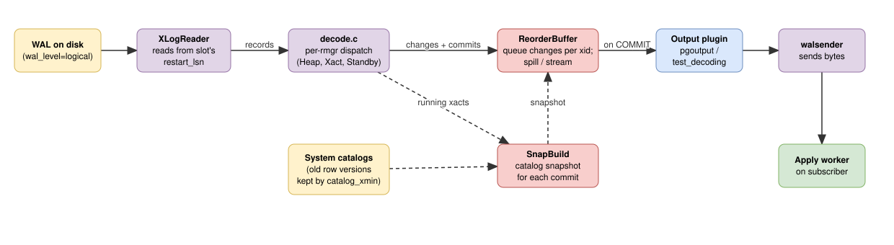

# 06 — Logical Decoding: from WAL to Row Changes

Level: L300. Tested on PostgreSQL 18.6 with `test_decoding`, `pgoutput`,
`pg_recvlogical` and `pg_waldump`. Source cross-check:
`replication/logical/{decode.c,logical.c,reorderbuffer.c,snapbuild.c}`.

WAL describes **physical** changes ("tuple at block 3 offset 7 of relfilenode
16384 now looks like these bytes"). **Logical decoding** turns that back into
**logical** changes ("INSERT into `public.t` the row id=1, v='a'"). It is a
server facility independent of publications and subscriptions: SQL functions,
`pg_recvlogical`, Debezium and the built-in replication are all just
consumers of it.



Editable: [diagrams/decoding-pipeline.drawio](diagrams/decoding-pipeline.drawio).

## What `wal_level = logical` changes in WAL

Same WAL, with additional payload so a record can be interpreted without the
heap page:

- UPDATE/DELETE records include the **old key** (or the whole old row for
  `REPLICA IDENTITY FULL`) — [topic 09](09-replica-identity.md).
- Catalog changes are tagged so the decoder can rebuild snapshots (command
  ids, "new cid" records) — `XLOG_HEAP2_NEW_CID`.
- Some changes are logged that physical replication doesn't need (e.g. full
  tuples for toasted values of catalog tables).

Consequence: with logical, WAL volume grows (typically a few percent to
tens of percent for update-heavy tables). Decoding refuses to start without it:

```
sub> SELECT pg_create_logical_replication_slot('x','test_decoding');
ERROR:  logical decoding requires "wal_level" >= "logical"
```

⚠️ Non-GA: 19 can enable logical decoding dynamically once a logical slot
exists even with `wal_level = replica` ([topic 01](01-logical-vs-physical-and-architecture.md#wal_level-and-the-dynamic-behaviour-in-19)).

## The pipeline, stage by stage

### 1. Start position

A decoding session starts at the slot's `restart_lsn`, **not** at
`confirmed_flush_lsn`. It must re-read from there because transactions that
were in flight at `confirmed_flush_lsn` began earlier in WAL. Changes of
transactions already confirmed are decoded again and then *discarded* when
their commit LSN is ≤ `confirmed_flush_lsn`. That's why `restart_lsn` can trail
`confirmed_flush_lsn` by a long-running transaction's length.

### 2. Reading and dispatching (`decode.c`)

`XLogReader` returns records; `LogicalDecodingProcessRecord` dispatches by
resource manager:

| rmgr | Examples | Decoder action |
|---|---|---|
| Heap / Heap2 | INSERT, UPDATE, HOT_UPDATE, DELETE, TRUNCATE, MULTI_INSERT | Build a change; queue it in the ReorderBuffer under its xid |
| Heap2 | NEW_CID | Record catalog command id for snapshots |
| Xact | COMMIT, ABORT, PREPARE, COMMIT_PREPARED | Finish a transaction: release (commit) or discard (abort) |
| Standby | RUNNING_XACTS | Used by SnapBuild to find consistent points |
| LogicalMsg | `pg_logical_emit_message` | Pass an application message through |
| others (Btree, Gin, Sequence…) | | Mostly ignored (index changes are not logical changes) |

Real WAL for the same operations (`pg_waldump -r Heap`), just to see the
physical side:

```
rmgr: Heap len 132 tx: 753 desc: INSERT+INIT off: 1 ...
rmgr: Heap len 143 tx: 754 desc: HOT_UPDATE old_xmax: 754 ...
rmgr: Heap len  64 tx: 758 desc: DELETE xmax: 758, off: 4 infobits: [KEYS_UPDATED] ...
rmgr: Heap len  42 tx: 759 desc: TRUNCATE flags: [] nrelids: 1 relids: [16384]
```

The decoder maps `relfilenode 1663/5/16384` to table `public.t`, which needs a
**catalog snapshot as of that moment** — stage 4.

### 3. ReorderBuffer (`reorderbuffer.c`)

WAL interleaves transactions; consumers want each transaction contiguous and in
**commit order**. The ReorderBuffer keeps a per-xid list of changes, merges
subtransactions into their parent, and when it sees the COMMIT, replays the
list to the output plugin. Aborted transactions are simply dropped. Memory
over `logical_decoding_work_mem` spills to disk or streams
([topic 07](07-reorderbuffer-and-large-transactions.md)).

### 4. SnapBuild — the catalog snapshot (`snapbuild.c`)

To turn a heap tuple into text, the decoder needs the table's *then-current*
column definitions, types and output functions. If you `ALTER TABLE` between the
change and its decoding, the *current* catalog is wrong for old WAL. SnapBuild
builds a historic MVCC snapshot per transaction so catalog lookups see the
world as of that transaction's commit. This is the whole reason for
`catalog_xmin`: vacuum must not delete the catalog row versions SnapBuild may
need ([topic 05](05-replication-slots.md)).

**Tested effect:** after `ALTER TABLE t ADD COLUMN c`, the earlier `UPDATE` still
decodes with the 3-column layout and the later one with 4:

```
table public.t: UPDATE: id[integer]:1 v[text]:'b' big[text]:'q'
table public.t: UPDATE: id[integer]:1 v[text]:'b' big[text]:'q' c[integer]:5
```

And **the `ALTER TABLE` itself is not in the stream at all** — which is the
mechanical reason DDL is not replicated.

#### The consistent point: why `CREATE SLOT` can block

A new slot cannot start emitting immediately: SnapBuild must reach
`SNAPBUILD_CONSISTENT` — a point where no transaction that started earlier is
still running (states `START → BUILDING_SNAPSHOT → FULL_SNAPSHOT → CONSISTENT`).
So creating a slot **waits for every open transaction** to end.

Tested: one session held `BEGIN; INSERT; pg_sleep(6); COMMIT;` and creating a
logical slot took **5.06 s** — it returned the moment the transaction
committed. Practical impact: `CREATE SUBSCRIPTION` (and each tablesync worker's
slot) hangs behind long-running transactions on the publisher. If a new
subscription "hangs", look for old rows in `pg_stat_activity` with
`state = 'idle in transaction'` or a long `xact_start`. The slot's exported
snapshot is what the initial table copy reads, so copy and stream join without
gap or overlap.

### 5. Output plugin

A plugin is a shared library exporting `_PG_output_plugin_init`, filling a
callback table. Mandatory: `begin`, `change`, `commit`. Optional groups:

| Group | Callbacks |
|---|---|
| Core | `startup`, `begin_cb`, `change_cb`, `truncate_cb`, `commit_cb`, `message_cb`, `filter_by_origin_cb`, `shutdown` |
| Two-phase | `filter_prepare`, `begin_prepare`, `prepare`, `commit_prepared`, `rollback_prepared` |
| Streaming | `stream_start`, `stream_stop`, `stream_abort`, `stream_prepare`, `stream_commit`, `stream_change`, `stream_message`, `stream_truncate` |

Plugins you will meet:

| Plugin | Ships with PG | Output | Use |
|---|---|---|---|
| `pgoutput` | yes | Binary logical replication protocol | Built-in pub/sub, Debezium (default), `pg_createsubscriber` |
| `test_decoding` | yes (contrib) | Human text | Learning/debugging |
| `wal2json` | no (package) | JSON | CDC pipelines (not on all managed services) |
| `decoderbufs` | no | Protobuf | Older Debezium setups |

## Consuming from SQL (the learning tool)

```sql
SELECT pg_create_logical_replication_slot('d','test_decoding');
-- do some DML …
SELECT data FROM pg_logical_slot_peek_changes('d', NULL, NULL,
       'include-xids','0','skip-empty-xacts','1');
```

Real output of one session (INSERT, two UPDATEs, DDL, UPDATE, DELETE, TRUNCATE,
logical message):

```
BEGIN
table public.t: INSERT: id[integer]:1 v[text]:'a' big[text]:'zzzz…'
COMMIT
BEGIN
table public.t: UPDATE: id[integer]:1 v[text]:'b' big[text]:'zzzz…'
COMMIT
…
BEGIN
table public.t: DELETE: id[integer]:1
COMMIT
BEGIN
table public.t: TRUNCATE: (no-flags)
COMMIT
BEGIN
message: transactional: 1 prefix: myprefix, sz: 5 content:hello
COMMIT
```

Things visible here:

- Each statement was its own transaction → its own BEGIN/COMMIT.
- UPDATE shows the **new** row; the old key is shown only when it changed or
  when identity is FULL.
- DELETE shows only the identity columns (`id`).
- A **transactional logical message** (`pg_logical_emit_message(true, prefix, content)`)
  rides in the stream at its position — useful to put application markers
  ("batch 42 done") into a CDC feed.

## Consuming from the shell: `pg_recvlogical`

```bash
pg_recvlogical -h 127.0.0.1 -p 5433 -d postgres --slot rl --create-slot -P test_decoding
pg_recvlogical -h 127.0.0.1 -p 5433 -d postgres --slot rl --start -f - -o include-xids=0
#   BEGIN
#   table public.t: INSERT: id[integer]:1 v[text]:'x'
#   COMMIT
#   BEGIN
#   table public.t: UPDATE: id[integer]:1 v[text]:'y'
#   COMMIT
pg_recvlogical … --slot rl --drop-slot
```

After this run the slot showed `active = f, confirmed_flush_lsn = 0/1797C48`:
`pg_recvlogical` reports flush positions as it goes, exactly as the apply
worker does.

## What the decoder does *not* give you

- **DDL** — never. (Event triggers + `pg_logical_emit_message` are the DIY route.)
- **Sequence increments** (GA releases) — `nextval` isn't a row change.
- **Large objects**, **unlogged tables**, **temp tables** — not WAL-logged for logical, or not at all.
- **Changes from before the slot was created** — hence the initial copy.
- **Old values** of unchanged columns — unless `REPLICA IDENTITY FULL`.
- **Rolled-back changes** — dropped at ABORT (except in streamed mode: sent
  early, then aborted explicitly).
- **Unchanged TOASTed values** — an UPDATE that doesn't touch a large column
  does not carry its value (pgoutput sends an "unchanged toast" marker, the
  subscriber keeps its own copy). This is why a subscriber row that was
  diverged in a TOASTed column *stays* diverged.

## Performance model

- Decoding runs in the **walsender on the publisher** (CPU-bound, single
  process per slot). One slot cannot use more than one CPU for decode;
  a hot workload fans out via multiple publications/slots.
- Cost scales with *WAL volume read*, not rows published: the walsender must
  read and decode every record, even for tables not in the publication, to
  determine they are irrelevant (relation filtering happens in the plugin,
  after decode of the change header).
- Long transactions delay delivery (commit order) and consume ReorderBuffer
  memory or disk.

## Practical diagnosis

| Symptom | Likely stage | Check |
|---|---|---|
| New slot/subscription hangs | 4 (consistent point) | Old open transactions on publisher |
| Walsender at 100 % CPU, lag grows | 2–3 | `pg_stat_replication_slots`, big transactions, huge WAL volume of unpublished tables |
| `pg_replication_slots.catalog_xmin` old | 4 | Slot not advancing |
| Slot shows `invalidation_reason = rows_removed` | 4 | Catalog rows the slot needed were removed (typically a standby conflict); rebuild the slot |
