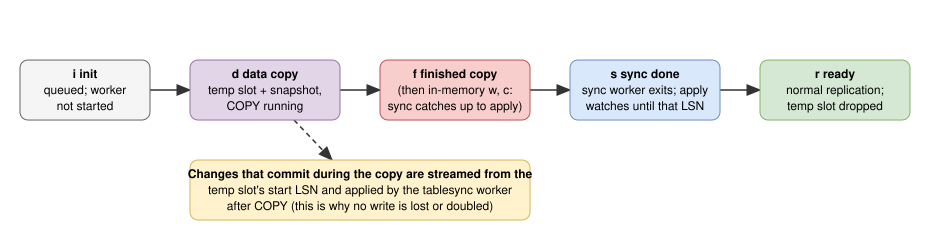

# 10 — Initial Synchronization (Tablesync)

Level: L300. Tested on PostgreSQL 18.6. Source: header comment of
`replication/logical/tablesync.c` (the exact state machine below is quoted from
it), plus observed behaviour.

## The problem it solves

A new subscriber needs the table's **existing** rows *and* every change made
**after** the copy point, with no gap and no duplicate, while the publisher
keeps taking writes. PostgreSQL does it per table, in parallel, with one
temporary slot per table.

## The procedure for one table

1. The apply worker records the table in `pg_subscription_rel` as `i` and asks
   for a **tablesync worker** (limit: `max_sync_workers_per_subscription`,
   default 2; each also counts against `max_logical_replication_workers`).
2. The tablesync worker connects to the publisher and creates a **temporary
   logical slot** `pg_<subid>_sync_<relid>_<system-id>`. Creating a logical slot
   gives it a consistent point and an **exported snapshot** (state `d`).
3. Inside a transaction using that snapshot it runs `COPY (SELECT … ) TO STDOUT`
   (honouring column lists and row filters) and loads the rows locally with
   `COPY FROM` — a bulk path, not row-by-row INSERTs.
4. State becomes `f` (copy finished, durable in the catalog: a crash now
   will not re-copy).
5. It then **replays the temp slot** from its start LSN, applying changes
   committed during the copy, until it has caught up with the main apply
   worker's position. (The in-memory states `w`=SYNCWAIT and `c`=CATCHUP
   coordinate the hand-off; they never appear in the catalog.)
6. State `s` (sync done, `srsublsn` set); the sync worker exits and its temp slot
   disappears. The apply worker keeps tracking the table until it passes
   `srsublsn`, then marks it `r`. From then on only the main slot carries the
   table.



Editable: [diagrams/tablesync-states.drawio](diagrams/tablesync-states.drawio).

No gap and no overlap come from using **one snapshot for the copy and the
slot's start LSN for the stream**: everything visible in the snapshot is
copied, everything committed after it is replayed.

## Observed run (18.6)

Four tables × 400 000 rows (~100 MB each), then `CREATE SUBSCRIPTION`. A monitor
sampled `pg_subscription_rel`, sync workers and slots on the publisher; at ~4 s
I also wrote to the publisher (`INSERT` into `t4`, `UPDATE` on `t1`):

```
t+0s   t1=i t2=i t3=i t4=i   syncworkers=2 slots=3
t+1s   t1=i t2=i t3=d t4=d   syncworkers=2 slots=3
t+6s   t1=d t2=d t3=r t4=r   syncworkers=2 slots=3
t+10s  t1=r t2=r t3=r t4=r   syncworkers=0 slots=1
```

Final check: `t1.pad` for the updated row = `changed`, `count(t4)` = 400 001 — the
concurrent writes landed exactly once. `f` and `s` are too short to catch
at this sampling rate.

What to read from it:

- Only **two** tables copy at a time (`max_sync_workers_per_subscription = 2`);
  the other two wait in `i`.
- Peak slots on the publisher = **1 + 2** (the permanent slot + one temp slot
  per active sync worker), then back to 1. Size `max_replication_slots` and
  `max_wal_senders` for this peak, per subscription.
- Log lines (subscriber):

  ```
  LOG:  logical replication table synchronization worker for subscription "s", table "t3" has started
  LOG:  logical replication table synchronization worker for subscription "s", table "t3" has finished
  ```

During the copy the **main slot keeps accumulating WAL** and its
`catalog_xmin` holds back catalog vacuum on the publisher; for a multi-hour copy
that is real WAL volume.

## Options that change the procedure

| Option | Effect |
|---|---|
| `copy_data = false` | Skip steps 2–3: table goes `i → r` immediately. Use when you pre-loaded the data (e.g. from a backup / `pg_dump` taken at the slot's snapshot, or `pg_createsubscriber`). You are responsible for exact consistency. |
| `ALTER SUBSCRIPTION … REFRESH PUBLICATION` | Starts the procedure for newly added tables only. |
| `ALTER SUBSCRIPTION … REFRESH PUBLICATION WITH (copy_data=false)` | Adds the tables without copying. |
| `binary = true` | Binary `COPY` (PG16+). Faster; same type-compatibility caveat as in topic 08. |
| `origin = none` | In PG16–18, a copy with `copy_data = true` can copy rows that themselves were replicated from elsewhere; a warning is raised when this might create loops. Use `copy_data=false` for bidirectional bring-up. |
| `two_phase = true` | `REFRESH` with copy is forbidden (tested: error in [topic 03](03-subscriptions.md)). |

## Speeding it up

| Lever | Notes |
|---|---|
| `max_sync_workers_per_subscription` | Increase (and `max_logical_replication_workers`, `max_worker_processes`) on the **subscriber**. Bound by publisher slot / sender capacity too. |
| Drop indexes and FKs on the subscriber before, rebuild after | The copy uses `COPY`, but every index is maintained row by row. Constraints are *not* checked by FKs during copy (triggers are off), but unique checks are. |
| Disable subscriber triggers | They don't fire by default during replication anyway (`ENABLE ALWAYS` changes that). |
| `synchronous_commit` | The subscription default is `off`, already best. |
| Network | Row text format by default; `binary=true` shrinks it for numerics/timestamps. |
| Multiple subscriptions | Split tables into several publications+subscriptions to parallelise more than one worker per subscription, at the cost of losing cross-subscription transaction consistency. |
| Logical copy vs physical clone | For TB-scale tables, restore a physical clone and use `pg_createsubscriber` (PG17+; [topic 17](17-upgrades-and-migrations.md)) instead of tablesync. |

## What goes wrong

| Symptom | Cause | Fix |
|---|---|---|
| Table stuck at `i` | No free sync worker (limits) or launcher waits `wal_retrieve_retry_interval` (5 s) after an error | Check `max_logical_replication_workers`, `max_worker_processes` |
| Table stuck at `d` | Copy in progress (big) or blocked on locks on the subscriber table; or the slot creation on the publisher is waiting for an old open transaction | `pg_stat_activity` on both sides; look at `xact_start` of old publisher transactions (topic 06) |
| Repeating `table synchronization worker … has started` | Copy failing (constraint, missing column/table, permission denied on the publisher `SELECT`) | Read the subscriber log; fix; it retries |
| `ERROR: could not create replication slot "pg_…_sync_…": all replication slots are in use` | Peak slots exceeded | Raise `max_replication_slots`, lower sync workers |
| Subscriber has the table but `COPY` ran into **existing rows** | You created the subscriber table with data and left `copy_data = true` | Verified 18.6: with a matching row in a table with a PK the sync worker loops on `ERROR: duplicate key value violates unique constraint "pre_pkey"` and the table stays in `d`; with a **no-key** table the copy silently **duplicated** the row (`nokey` ended with 2 rows). Truncate first, or `copy_data = false` after verifying equality. PostgreSQL never merges. |
| Initial copy finishes, then apply errors on one table | Data type / constraint differences between sides | Fix, then it resumes from the same slot |

## Diagnostics

```sql
-- subscriber: overall progress
SELECT srrelid::regclass AS tbl, srsubstate, srsublsn FROM pg_subscription_rel ORDER BY 1;

-- subscriber: who is working
SELECT pid, backend_type, state, wait_event_type, wait_event
FROM pg_stat_activity WHERE backend_type LIKE 'logical replication%';

-- subscriber: running COPY progress (PG14+)
SELECT * FROM pg_stat_progress_copy;

-- publisher: temp slots in play
SELECT slot_name, temporary, active FROM pg_replication_slots
WHERE slot_name LIKE 'pg\_%\_sync\_%';
```

`pg_stat_progress_copy` shows `bytes_processed` for the table currently
loading — the best way to estimate the remaining time. Observed on 18.6 for a
1.5 M-row table (one sample per second):

```
big | COPY FROM | CALLBACK | 11455695 | 106510
big | COPY FROM | CALLBACK | 26367255 | 245048
big | COPY FROM | CALLBACK | 41382387 | 383586
big | COPY FROM | CALLBACK | 56749815 | 526415     (relid, command, type, bytes_processed, tuples_processed)
```

## Failure and restart behaviour

- Crash during `d`: the tablesync worker restarts and **starts the table over**
  (truncating the partial copy).
- Crash after `f`: the copy is **not** redone; only the catch-up replays.
- Dropping the subscription mid-copy cleans the temp slots (if reachable). If it
  can't reach the publisher, orphaned `pg_…_sync_…` slots may remain — drop them
  by hand ([topic 05](05-replication-slots.md)).
