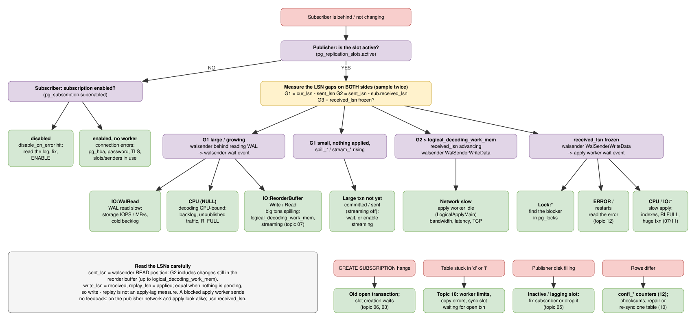

# 14 — Monitoring and Troubleshooting

Level: L400. Tested on PostgreSQL 18.6. The "stalled apply" captures are from a real
induced stall (subscriber table locked `ACCESS EXCLUSIVE` while the publisher wrote 50 000 rows).

## What to watch (the short list)

| # | Signal | Where | Why |
|---|---|---|---|
| 1 | Retained WAL per slot (bytes) | publisher `pg_replication_slots` | Disk-full risk; the #1 outage cause |
| 2 | Slot `active` / `wal_status` / `invalidation_reason` | publisher | Dead or lost slots |
| 3 | Apply lag in **bytes** (`sent_lsn - replay_lsn`) | publisher `pg_stat_replication` | Reliable lag measure |
| 4 | Apply/conflict error counters | subscriber `pg_stat_subscription_stats` | Stalls and divergence |
| 5 | Per-table sync state | subscriber `pg_subscription_rel` | Initial-sync progress |
| 6 | Worker presence and age | subscriber `pg_stat_subscription` | Worker crash-looping |
| 7 | `catalog_xmin` age | publisher | Catalog bloat |
| 8 | Spill/stream counters | publisher `pg_stat_replication_slots` | Big-transaction pressure |
| 9 | Log lines | both | Root cause text |

## Publisher side

### `pg_stat_replication` — one row per connected walsender

Healthy sample (18.6):

```
application_name | s
state            | streaming
sent_lsn         | 0/17C46D8
write_lsn        | 0/17C46D8
flush_lsn        | 0/17C46D8
replay_lsn       | 0/17C46D8
write_lag        | 00:00:00.032152
flush_lag        | 00:00:00.433438
replay_lag       | 00:00:00.032152
```

For a logical subscriber `application_name` = the subscription name (or
`pg_<oid>_sync_…` for a tablesync worker). The LSNs are **what the subscriber
reported**: `write`/`flush` = received, `replay` = applied
and committed. `state` is `startup`, `catchup`, `streaming`, `backup`, `stopping`.

> **Lag *times* can lie.** `write_lag`/`flush_lag`/`replay_lag` are measured
> when the subscriber acknowledges a recent LSN. While the apply worker was
> blocked on a lock, the view still showed `replay_lag = 00:00:00.032152`,
> a stale value from before the stall, even though the subscriber was
> 3.2 MB behind. When idle or stalled the columns can be stale or NULL.
> **Alert on bytes**, use times as a secondary, informational metric.

Stalled capture (publisher):

```
sent_lsn     | 0/231EE08
flush_lsn    | 0/1FEBFC8
replay_lsn   | 0/1FEBFC8
bytes_behind | 3276 kB
```

### `pg_replication_slots`

```sql
SELECT slot_name, plugin, slot_type, database, active, active_pid,
       wal_status, safe_wal_size, invalidation_reason,
       pg_size_pretty(pg_wal_lsn_diff(pg_current_wal_lsn(), restart_lsn))          AS retained_wal,
       pg_size_pretty(pg_wal_lsn_diff(pg_current_wal_lsn(), confirmed_flush_lsn))  AS unconfirmed,
       age(catalog_xmin) AS catalog_xmin_age
FROM pg_replication_slots
ORDER BY pg_wal_lsn_diff(pg_current_wal_lsn(), restart_lsn) DESC NULLS LAST;
```

Distinguish the two lags:

- `retained_wal` (to `restart_lsn`) = **disk consumed** on the publisher.
- `unconfirmed` (to `confirmed_flush_lsn`) = **how far the subscriber is behind**.

`retained_wal ≥ unconfirmed`; a large gap = a long open transaction pins
`restart_lsn` ([topic 05](05-replication-slots.md)).

### `pg_stat_replication_slots` — decoding workload

```sql
SELECT slot_name, spill_txns, spill_count, spill_bytes, stream_txns, stream_bytes,
       total_txns, total_bytes, stats_reset
FROM pg_stat_replication_slots;
```

Rising `spill_*` = `logical_decoding_work_mem` too small for the traffic
([topic 07](07-reorderbuffer-and-large-transactions.md)).

### Disk and WAL

```sql
SELECT pg_size_pretty(sum(size)) AS wal_dir FROM pg_ls_waldir();
SHOW max_slot_wal_keep_size;  SHOW idle_replication_slot_timeout;  -- the latter is 18+
```

## Subscriber side

### `pg_stat_subscription` (one row per worker)

Stalled capture (apply worker idle in a lock wait; no new message for 3 s):

```
 subname | pid | received_lsn | latest_end_lsn | since_last_msg  | since_last_report
 s       |  71 | 0/1FEBFC8    | 0/1FEBFC8      | 00:00:03.061678 | 00:00:03.243137
```

Interpretation:

| Pattern | Meaning |
|---|---|
| No row at all for a subscription | Worker not running: disabled, crash-looping, or out of worker slots |
| `pid` changing every few seconds | Crash/retry loop (errors) |
| `received_lsn` ≫ `latest_end_lsn` | Receiving but not applying fast enough |
| `received_lsn` and `latest_end_lsn` frozen, `since_last_msg` growing | Nothing arriving: publisher idle or connection stuck |
| Rows with `worker_type = 'table synchronization'` | Initial copy in progress |

### What is the apply worker doing right now?

```sql
SELECT pid, wait_event_type, wait_event, state
FROM pg_stat_activity WHERE backend_type = 'logical replication apply worker';
 pid | wait_event_type | wait_event | state
  71 | Lock            | relation   | active          <- blocked on a table lock
```

and who blocks it:

```sql
SELECT l.pid, l.mode, l.granted, a.backend_type
FROM pg_locks l JOIN pg_stat_activity a USING (pid)
WHERE l.relation = 't'::regclass;
```

(here the apply worker's `RowExclusiveLock` showed `granted = f`; the holder was
the session with `ACCESS EXCLUSIVE`). Typical culprits on the subscriber:
a long `ALTER TABLE`, `VACUUM FULL`, `CREATE INDEX` (non-concurrent), `LOCK TABLE`, a
reporting query inside a transaction that takes strong locks, or
`REINDEX`. Idle wait is `wait_event = LogicalApplyMain` (waiting for data).

After the lock was released the worker caught up on its own (`caught_up = t`).

### Errors and conflicts

```sql
SELECT subname, apply_error_count, sync_error_count,
       confl_insert_exists, confl_update_exists, confl_update_missing,
       confl_delete_missing, confl_update_origin_differs, confl_delete_origin_differs,
       confl_multiple_unique_conflicts, stats_reset
FROM pg_stat_subscription_stats;
```

Counters only go up (until `pg_stat_reset_subscription_stats`). Alert on **rate of
change**.

### Table-level state

```sql
SELECT srrelid::regclass, srsubstate, srsublsn FROM pg_subscription_rel
WHERE srsubstate <> 'r';        -- anything not ready, for a long time, is stuck
```

## Ready-to-use alert thresholds

| Alert | Query / condition | Suggested threshold |
|---|---|---|
| Slot inactive | `NOT active` for > 5 min | warn; page at 30 min or when `retained_wal` > 10 % of WAL disk |
| Retained WAL | `pg_wal_lsn_diff(pg_current_wal_lsn(), restart_lsn)` | warn 10 %, page 25 % of free space (or of `max_slot_wal_keep_size`) |
| Slot at risk | `wal_status IN ('unreserved','lost')` | page |
| Apply lag bytes | `sent_lsn - replay_lsn` | depends on SLA; trend not absolute |
| Walsender missing | slot active=f while subscription enabled | page |
| Errors rising | `apply_error_count` delta > 0 over 5 min | page |
| Any conflict counter rising | delta > 0 | warn (data divergence) |
| Table not ready | `srsubstate <> 'r'` > expected sync time | warn |
| Catalog bloat | `age(catalog_xmin)` growing; `pg_class` n_dead_tup | warn |
| Free disk on publisher | | standard |

Also watch the **subscriber**: a logical subscriber's own autovacuum health,
bloat, and replication slot for *its* standbys.

## Where is the lag? Split it by LSN, then read the wait events

A logical stream has three stages, and each has its own LSN gap. Measure the gaps
**first**, then use the wait event of the process that owns the growing gap.

| Gap | Formula | Where | Owner |
|---|---|---|---|
| **G1 read/decode** | `pg_current_wal_lsn() - sent_lsn` | publisher `pg_stat_replication` | walsender: reading WAL, decoding, reorder buffer |
| **G2 in flight** | publisher `sent_lsn` − subscriber `received_lsn` | both sides (`pg_stat_subscription`, leader row) | network / TCP buffers, *plus* changes buffered in the reorder buffer (see below) |
| **G3 apply** | subscriber `received_lsn` frozen while data waits | subscriber `pg_stat_subscription` + apply worker wait event | apply worker |

Rules that matter when reading these numbers (checked in `walsender.c` / `worker.c`, 18):

- For a logical walsender, **`sent_lsn` is the WAL *read* position**
  (`sentPtr = reader->EndRecPtr`), not "bytes put on the wire". So G1 is purely read/decode
  lag. G2 also contains decoded changes not yet sent, up to `logical_decoding_work_mem`,
  so don't read a G2 of that size as a network problem.
- The apply worker reports **`write_lsn` = received, `flush_lsn` = applied and locally
  flushed, `replay_lsn` = applied**. With no transaction in progress, all three are set to
  the received position, so on the publisher `write_lsn − replay_lsn` is ~0 most of the time.
  It is **not** an apply-lag measure.
- A blocked apply worker **stops sending feedback**, so on the publisher every column freezes.
  The walsender's socket then fills, and it waits in `WalSenderWriteData`, just as it does on
  a slow network. The publisher alone **can't tell network from apply**. The subscriber's
  `received_lsn` and its apply worker's wait event can.
- Sample both sides together, several times. Readings taken on two servers a moment apart
  can make G2 slightly negative.

### Signatures of each bottleneck

Sample several times and look at the **dominant** wait event (`CPU` means `wait_event`
is NULL, i.e. running).

| Cause | G1 `cur − sent` | G2 `sent − received` | Walsender | Apply worker |
|---|---|---|---|---|
| **WAL read slow** (storage I/O, cold backlog) | large; drains at the storage read rate | ≤ `logical_decoding_work_mem` | mostly `IO:WalRead` | idle (`LogicalApplyMain`) |
| **Decoding slow** (CPU-bound) | large | ≤ `logical_decoding_work_mem` | mostly `CPU` | idle |
| **Large transaction spilling** | small (reading keeps up) | small; nothing applied until commit unless streaming | `IO:ReorderBufferWrite` / `ReorderBufferRead`; `spill_*` rising | idle |
| **Network slow** | grows | larger than `logical_decoding_work_mem`, **`received_lsn` advancing** | mostly `Client:WalSenderWriteData` | **idle** (`LogicalApplyMain`) |
| **Apply slow / blocked** | grows (the walsender stops reading once its socket is full) | **`received_lsn` frozen** | mostly `Client:WalSenderWriteData` | `Lock:*`, `CPU` or `IO:*` |
| Heavy writes to **unpublished** tables | grows only if decoding can't keep up | ~0 | `CPU` | idle |

Commands to sample both sides:

```sql
-- publisher
SELECT application_name, sent_lsn,
       pg_size_pretty(pg_wal_lsn_diff(pg_current_wal_lsn(), sent_lsn)) AS g1_read_decode,
       pg_size_pretty(pg_wal_lsn_diff(sent_lsn, write_lsn))           AS sent_minus_acked
FROM pg_stat_replication;
SELECT pid, wait_event_type, wait_event, state FROM pg_stat_activity
WHERE backend_type = 'walsender';
SELECT slot_name, spill_txns, spill_bytes, stream_txns FROM pg_stat_replication_slots;

-- subscriber (leader apply worker row: relid IS NULL AND leader_pid IS NULL)
SELECT subname, received_lsn, latest_end_lsn, last_msg_receipt_time
FROM pg_stat_subscription WHERE relid IS NULL AND leader_pid IS NULL;
-- G2 = pg_wal_lsn_diff('<publisher sent_lsn>', received_lsn)
SELECT pid, wait_event_type, wait_event FROM pg_stat_activity
WHERE backend_type = 'logical replication apply worker';
```

## Troubleshooting decision tree



Editable: [diagrams/troubleshooting-tree.drawio](diagrams/troubleshooting-tree.drawio)
(regenerate with `python3 diagrams/gen.py`). The same tree as text:

```
Subscriber is behind / not changing
│
├─ publisher: is the slot active?  (pg_replication_slots.active)
│   ├─ NO ─ subscriber: is the subscription enabled?  (pg_subscription.subenabled)
│   │        ├─ disabled ─ disable_on_error hit?  read the subscriber log; fix; ENABLE
│   │        └─ enabled  ─ worker not running: check log for connection errors
│   │                       (pg_hba, password, network, max_wal_senders, "all replication slots in use")
│   └─ YES ─ measure the gaps on BOTH sides (sample twice)
│       │
│       ├─ G1 = cur_lsn − sent_lsn large/growing → walsender is behind reading → its wait event:
│       │    ├─ IO:WalRead dominant          → WAL read slow: storage I/O, cold backlog (check IOPS/throughput)
│       │    ├─ CPU (NULL) dominant          → decoding CPU-bound: big backlog, heavy unpublished
│       │    │                                 traffic, REPLICA IDENTITY FULL; split publications / slots
│       │    ├─ IO:ReorderBufferWrite/Read   → big transactions spilling: spill_* counters;
│       │    │                                 raise logical_decoding_work_mem, streaming = parallel (topic 07)
│       │    └─ Client:WalSenderWriteData    → it can't send: continue with G2/G3 below
│       │
│       ├─ G1 small, subscriber gets nothing, spill_*/stream_* rising
│       │    → one large transaction not committed yet (no streaming): wait, or enable streaming
│       │
│       ├─ G2 = sent_lsn − sub.received_lsn > logical_decoding_work_mem, received_lsn advancing,
│       │  walsender WalSenderWriteData, apply worker idle (LogicalApplyMain)
│       │    → network slow: bandwidth/latency/TCP windows, cross-region link
│       │
│       └─ received_lsn frozen, walsender WalSenderWriteData → apply worker wait event:
│            ├─ Lock:*          → find the blocker (pg_locks) and resolve it
│            ├─ restarting / ERROR in log → read the error (topic 12 table)
│            ├─ CPU / IO:*      → slow apply: indexes, REPLICA IDENTITY FULL w/o index,
│            │                    one huge transaction (topic 07/11)
│            └─ LogicalApplyMain (idle) but nothing arrives → connection stuck;
│                 wal_sender_timeout / wal_receiver_timeout; walsender log
│
New subscription hangs at CREATE SUBSCRIPTION
└─ publisher has an old open transaction (slot creation waits)  → topic 06

Table stuck in 'd' or 'i'
└─ topic 10 ("What goes wrong")

Publisher disk filling
└─ retained_wal per slot → find the inactive/lagging slot → fix subscriber, or
   if abandoned: pg_drop_replication_slot; then CHECKPOINT; set max_slot_wal_keep_size

Rows differ between sides
└─ confl_* counters / log lines → topic 12; reconcile with a checksum compare, then repair
```

### Seeing what is inside a slot

To see *which* transactions, tables and keys a slot is holding (a huge transaction, a hot
table, changes the subscriber never applied), use
[`peek_pgoutput_simple.sql`](tools/slot-peek/sql/peek_pgoutput_simple.sql) (psql) or
[`peek_pgoutput_ide.sql`](tools/slot-peek/sql/peek_pgoutput_ide.sql) (pgAdmin, DBeaver and other
SQL IDEs): a single read-only query that creates no objects (pgoutput slot, subscription paused). The
[slot-peek tools](tools/slot-peek/README.md) go further: row values, in-use slots, other plugins,
and replay SQL for reconciliation after a promotion (Python or psql).

## Log messages you should recognise

| Message | Meaning |
|---|---|
| `logical replication apply worker for subscription "s" has started` | Worker start (normal; frequent = crash loop) |
| `logical replication table synchronization worker … has started/finished` | Initial copy |
| `ERROR: conflict detected on relation … conflict=…` | Topic 12 |
| `ERROR: logical replication target relation "…" is missing replicated column: "…"` | Schema drift |
| `ERROR: logical replication target relation "…" does not exist` | Missing table (also partitions) |
| `WARNING: out of logical replication worker slots` | Raise `max_logical_replication_workers` |
| `ERROR: all replication slots are in use` | Raise `max_replication_slots` (publisher) |
| `LOG: invalidating obsolete replication slot "…"` | Topic 05; slot lost |
| `LOG: terminating logical replication worker due to timeout` | Network stall / `wal_receiver_timeout` |
| `LOG: logical replication starts skipping transaction at LSN …` | `SKIP` in action |
| `ERROR: could not connect to the publisher: … ` | pg_hba / password / SSL / DNS |
| `WARNING: skipped loading publication "p"` | Publication didn't exist at that WAL position |

## Safe manual checks for divergence

1. Quiesce writes or compare at a known LSN.
2. Cheap check: counts + `sum(hashtext(row::text))` per table ranges.
3. Deep check: `pg_comparator`-style chunked checksums (external tool).
4. Repair by `INSERT … ON CONFLICT` from a `postgres_fdw` view of the publisher,
   or re-sync the one table. Drop it from the publication and `REFRESH`, `TRUNCATE` it on
   the subscriber, re-add it, then `REFRESH` again. The full procedure (tested with writers
   running) is in [topic 10, "Re-syncing one table"](10-initial-sync-tablesync.md#re-syncing-one-table-of-a-subscription).

**If the subscription was created with `copy_data = false`**, every table goes straight to
`r` and the publisher's existing rows never arrive; only later changes do. Nothing reports
this. Later `UPDATE`/`DELETE`s of the missing rows surface only as
`update_missing`/`delete_missing` conflicts. Repair each table with the re-sync procedure,
which copies regardless of how the subscription was created.

## A one-shot health query (publisher)

```sql
SELECT s.slot_name,
       s.active,
       s.wal_status,
       pg_size_pretty(pg_wal_lsn_diff(pg_current_wal_lsn(), s.restart_lsn))         AS retained_wal,
       pg_size_pretty(pg_wal_lsn_diff(pg_current_wal_lsn(), s.confirmed_flush_lsn)) AS subscriber_behind,
       r.state, r.replay_lag
FROM pg_replication_slots s
LEFT JOIN pg_stat_replication r ON r.pid = s.active_pid
WHERE s.slot_type = 'logical';
```
