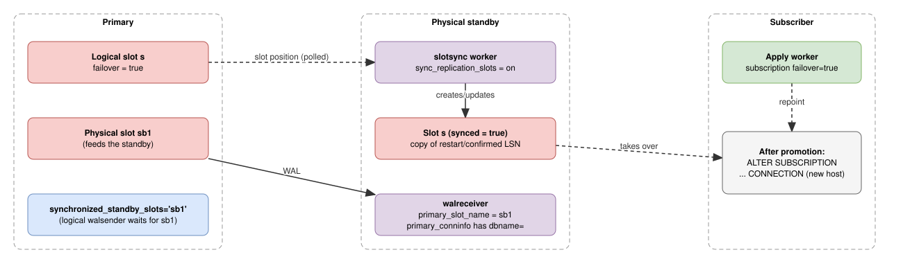

# 16 — Failover and High Availability

Level: L400. **Tested on PostgreSQL 18.6**: a real publisher + physical standby +
subscriber, failover, promote and re-point (script reproduced in
"Runbook" below). Features older than 17 are described from documentation/source and
marked "not tested".

## The core problem

A logical slot lives **only on the server that created it** and is not part of
WAL that a physical standby replays. So with plain physical HA under a
publisher:

1. Primary dies, standby is promoted.
2. The new primary has **no logical slot**. The subscriber's slot is gone.
3. You must re-create the subscription (re-copy) or hand-build a slot at the
   exact right LSN. If data was written on the new primary between the failure
   and the new slot, it is **lost** to the subscriber, or duplicated.

Before PG17 people used extensions (`pg_failover_slots`) or Patroni's
permanent-slot feature. From **PG17** it is built in.



Editable: [diagrams/failover-slot-sync.drawio](diagrams/failover-slot-sync.drawio).

## The three pieces (PG17+)

| Piece | Where | Setting |
|---|---|---|
| 1. Mark the slot as failover-capable | Subscriber → publisher | `CREATE SUBSCRIPTION … WITH (failover = true)` (or `pg_create_logical_replication_slot(…, failover => true)`) |
| 2. Synchronise it to the standby | Standby | `sync_replication_slots = on`, `hot_standby_feedback = on`, `primary_slot_name = '<phys slot>'`, and a `dbname=` in `primary_conninfo` |
| 3. Do not let the subscriber run ahead of the standby | Primary | `synchronized_standby_slots = '<phys slot>[, …]'` |

### Why piece 3 exists

Without it, the logical walsender may send the subscriber changes the standby
has **not yet received**. Failover then promotes a standby that is *behind* the
subscriber: the subscriber already has transactions the new primary doesn't.
`synchronized_standby_slots` makes logical decoding wait until the listed physical
slots have confirmed the WAL — the same guarantee as synchronous replication,
but only for the logical consumers' benefit.

Cost: a **stalled standby stalls logical replication** (and the subscriber's
lag). Include only standbys you'd actually promote.

### Observed: slot synchronisation (18.6)

Primary `synchronized_standby_slots = 'sb1'`; standby created with
`pg_basebackup -R -C -S sb1`; subscription created with `failover = true`.

Primary:

```
 slot_name | slot_type | failover | synced | active
 s         | logical   | t        | f      | t
 sb1       | physical  | f        | f      | t
```

Standby, ~8 seconds later:

```
 slot_name | failover | synced | active | wal_status | temporary | invalidation_reason
 s         | t        | t      | f      | reserved   | f         |
```

and identical `confirmed_flush_lsn` on both (`0/3003080`). On the standby the
slot is `synced = t`, `active = f`: it is a passive copy, and you **cannot
decode from it while it is a standby** (it is "synced" for takeover, not for use).
The slotsync worker updates it periodically (`sync_replication_slots`,
interval adapts ~200 ms–30 s; `pg_sync_replication_slots()` does it once on demand).

### Observed: failover (18.6)

1. Primary killed (`pg_ctl stop -m immediate`), standby promoted.
2. `INSERT` on the new primary.
3. On the subscriber: `ALTER SUBSCRIPTION s DISABLE; ALTER SUBSCRIPTION s CONNECTION '…new host…'; ALTER SUBSCRIPTION s ENABLE;`

Result on the subscriber (all data intact, **no re-copy**, no duplicate):

```
 id |       v
  1 | before-failover
 34 | on-new-primary
```

and a further insert after that arrived too. The slot on the new primary showed
`active = t, synced = t, failover = t`. (`id = 34` rather than 2 is ordinary
sequence behaviour: sequences pre-log 32 values, so a promoted standby resumes
after the logged range; it is not data loss.)

In production put the **connection through a VIP / DNS name / PgBouncer /
RDS endpoint** that follows the primary so step 3 is not needed at all.

## Gotchas found while testing

1. **`pg_basebackup -R` writes `dbname=` from `PGDATABASE`.** In PG17+ the
   generated `primary_conninfo` contains `dbname=<your PGDATABASE>`. If that
   database doesn't exist on the primary the slotsync worker loops with
   `FATAL: database "donghua" does not exist` and **no slot ever syncs**.
   Run it with `PGDATABASE=postgres` (or any real database) or fix
   `primary_conninfo`. Editing in an earlier `dbname=` isn't enough: libpq uses
   the **last** `dbname=` in the string.
2. **The standby inherits `synchronized_standby_slots` from the primary's
   configuration** (a base backup copies `postgresql.conf`). After promotion the
   new primary logged, for every logical walsender:

   ```
   WARNING:  replication slot "sb1" specified in parameter "synchronized_standby_slots" does not exist
   DETAIL:  Logical replication is waiting on the standby associated with replication slot "sb1".
   HINT:  Create the replication slot "sb1" or amend parameter "synchronized_standby_slots".
   ```

   and the subscriber **received nothing** — silently stuck. Fix: set it to `''`
   in the standby's config before it can be promoted (or create a physical slot
   of that name on the new primary for your next standby). Put this in the
   failover runbook.
3. The replication user needs `SELECT` on published tables for any resync on
   the new primary (initial copy of new tables).
4. A synced slot can be **invalidated on the standby** (`invalidation_reason`
   `wal_removed` / `rows_removed`) if the standby falls behind or vacuum on the
   primary removes needed catalog rows without `hot_standby_feedback = on`.
   Then failover loses the slot. Monitor `synced` slots on the standby:

   ```sql
   SELECT slot_name, synced, invalidation_reason FROM pg_replication_slots WHERE failover;
   ```

## Runbook (what I ran)

```bash
# primary: wal_level=logical, synchronized_standby_slots='sb1', hba for repl (replication + db)
PGDATABASE=postgres pg_basebackup -h primary -U repl -D standby -R -C -S sb1 -X stream
cat >> standby/postgresql.conf <<'EOF'
hot_standby_feedback = on
sync_replication_slots = on
primary_slot_name = 'sb1'
synchronized_standby_slots = ''          # IMPORTANT: do not inherit the primary's value
EOF
pg_ctl -D standby start

# subscriber
CREATE SUBSCRIPTION s CONNECTION 'host=primary dbname=postgres user=repl' PUBLICATION p
       WITH (failover = true);

# failover
pg_ctl -D standby promote
ALTER SUBSCRIPTION s DISABLE;
ALTER SUBSCRIPTION s CONNECTION 'host=new-primary dbname=postgres user=repl';
ALTER SUBSCRIPTION s ENABLE;
```

Post-failover checklist: slot `active` on the new primary; `pg_stat_subscription`
shows a row; counts compare; rebuild a new standby and re-enable
`synchronized_standby_slots`.

## Subscriber-side HA

The subscriber is an ordinary writable database; protect it with physical
replication. Subscription state (`pg_subscription`, `pg_replication_origin`,
`pg_subscription_rel`) is in the catalogs/WAL, so a **promoted subscriber standby
keeps its subscriptions** — but they will not start until the node is not in
recovery; after promotion the apply worker reconnects and resumes from the
origin LSN. The publisher keeps the slot meanwhile (WAL retention risk during
the switch; topic 05). I did not test this direction.

## Logical decoding on a standby (PG16+, not tested here)

PG16 allows creating and using logical slots on a **standby**, which offloads
decoding from the primary. Caveats from the docs/source:

- The primary must run `wal_level = logical` (⚠️ in 19, `effective_wal_level`
  must be ≥ logical on the primary: `logicalctl.c`).
- `hot_standby_feedback` on, and a **physical slot** between standby and primary
  to protect catalog rows; otherwise slots are invalidated (`rows_removed`,
  shown in `conflicting`).
- Creating the slot waits for a running-xacts record from the primary
  (call `pg_log_standby_snapshot()` on the primary to speed it up).
- A promoted standby's logical slots survive as ordinary slots — but only the
  ones created on it, not ones synced from the primary unless `failover = true`.

## HA decision matrix

| Need | Recommended |
|---|---|
| Publisher HA (PG ≥ 17) | Physical standby + `failover=true` + `sync_replication_slots` + `synchronized_standby_slots` + stable endpoint |
| Publisher HA (PG ≤ 16) | Patroni permanent logical slots, or `pg_failover_slots`; otherwise plan to re-create the subscription |
| Zero data-loss on cut-over | Fence old primary; verify `confirmed_flush_lsn` ≤ new primary's replay; `synchronized_standby_slots` |
| Managed (RDS/Aurora) | Measured results: [topic 20 §5](20-amazon-rds-and-aurora.md#5-what-happens-to-slots-and-subscriptions-on-failover-tested-on-aws). Aurora keeps logical slots through switchover and failover; RDS cross-region replica promotion does not |
| Subscriber HA | Physical standby for the subscriber |

## ⚠️ Non-GA notes

- 19's dynamic `effective_wal_level` changes *when* a promoted standby can use
  logical slots (source `logicalctl.c`); behaviour on promotion is "updated
  from local `wal_level` and the presence of logical slots". Not tested.
- Slot-sync option names and behaviour (worker interval, `pg_sync_replication_slots()`)
  have evolved between 17 and 18; re-check on your version.
