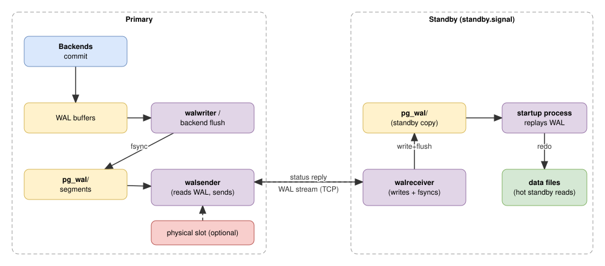
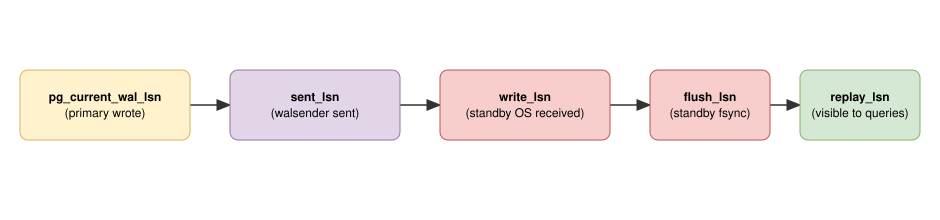

# 01 — Streaming (Physical) Replication: Architecture

Level: L200 → L300. Tested on PostgreSQL 18.6 with [`lab.sh`](lab.sh) (primary `:5433`,
standby `:5435`). For the contrast with logical replication see
[the logical notes, topic 01](../LogicalReplication/01-logical-vs-physical-and-architecture.md).

## What physical replication is

The primary's **WAL bytes** are streamed to a standby, which **replays** them
(redo) exactly as crash recovery would. The standby is therefore a block-for-block
copy of the whole cluster: same major version, same architecture, same
data directory layout, all databases. It is read-only (hot standby) until promoted.

Because WAL is the single source of truth for every change (including DDL,
sequences, large objects, vacuum, hint-free page images), nothing needs to be
"decoded" and nothing is excluded.

## The pieces



Editable: [diagrams/streaming-architecture.drawio](diagrams/streaming-architecture.drawio).

| Piece | Where | Job |
|---|---|---|
| WAL buffers → `pg_wal/` | primary | Changes are written to WAL before data pages; commit waits for the WAL flush (`fsync`) |
| **walsender** | primary | One per standby connection; reads WAL and sends it over the replication protocol |
| **walreceiver** | standby | Connects to the primary (`primary_conninfo`), writes received WAL into the standby's own `pg_wal/`, fsyncs it, reports progress |
| **startup process** | standby | Replays WAL records into data files (redo). Also applies recovery conflicts |
| Hot standby backends | standby | Read-only queries over the replayed state |
| Physical replication **slot** (optional) | primary | Pins WAL until the standby has it ([03](03-replication-slots-and-wal-retention.md)) |
| `standby.signal` | standby data dir | Presence file: "start in standby mode and keep recovering" |
| `primary_conninfo`, `primary_slot_name` | standby config | Where to stream from, which slot to use |

Real process list (18.6):

```
PRIMARY:  walsender | application_name = walreceiver     (one per standby)
STANDBY:  startup, walreceiver, checkpointer, background writer
```

Notice the standby has **no walwriter and no autovacuum**: it doesn't generate WAL.
It still runs a checkpointer (called a *restartpoint* in recovery).

## What a standby looks like on disk

After `pg_basebackup -R`:

```
standby/standby.signal           <- empty file, switches on standby mode
standby/postgresql.auto.conf     <- primary_conninfo = 'user=repl … host=127.0.0.1 port=5433 …'
standby/backup_label.old         <- the backup started at a checkpoint; renamed once recovery passed it
```

`pg_controldata` on the running standby:

```
Database cluster state:           in archive recovery
Latest checkpoint location:       0/2000080
Minimum recovery ending location: 0/2000120
```

"in archive recovery" is the normal state of a streaming standby: it is in recovery
that never ends until promotion. **Minimum recovery ending location** is the earliest
LSN at which the standby is consistent and may accept read-only connections.

Writes are rejected:

```
standby> CREATE TABLE x(i int);
ERROR:  cannot execute CREATE TABLE in a read-only transaction
```

## The life of a commit

1. A backend writes WAL records into WAL buffers and, at `COMMIT`, **flushes** them (`fsync`);
   `synchronous_commit` decides whether the client also waits for standbys ([04](04-synchronous-replication.md)).
2. The walsender wakes up (latch), reads the newly flushed WAL and sends it as `XLogData` messages.
3. The walreceiver **writes** the data to the standby's `pg_wal/`, **flushes** it, and replies with
   its three positions: *write*, *flush*, *replay*.
4. The startup process **replays** the records; once replayed, new queries on the standby
   see the transaction.
5. Replies feed `pg_stat_replication` on the primary, release synchronous committers,
   and advance the slot's `restart_lsn`.



Four LSNs, four meanings — memorise them:

| LSN (as shown in `pg_stat_replication`) | Meaning | If it is far behind the previous one |
|---|---|---|
| `pg_current_wal_lsn()` | Primary has written WAL here | — |
| `sent_lsn` | Walsender sent up to here | Network/walsender slow |
| `write_lsn` | Standby received and `write()`d | Network latency/bandwidth |
| `flush_lsn` | Standby `fsync`ed | Standby disk slow |
| `replay_lsn` | Startup process replayed | Standby CPU/I/O bound redo, **recovery conflicts**, `recovery_min_apply_delay` |

Data is **durable on the standby at `flush_lsn`** (survives a standby crash) but only
**visible** at `replay_lsn`. A promotion replays everything flushed first.

Observed on 18.6 right after setup (idle system):

```
state        | streaming
sent_lsn     | 0/3000000     write_lsn  | 0/3000000
flush_lsn    | 0/3000000     replay_lsn | 0/3000000
sync_state   | async         sync_priority | 0
```

and on the standby `pg_stat_wal_receiver`:

```
status | streaming   receive_start_lsn | 0/3000000   receive_start_tli | 1
flushed_lsn | 0/3000000   received_tli | 1   sender_host | 127.0.0.1   sender_port | 5433
slot_name |      (empty: no slot used)
```

## Timelines

Each promotion starts a new **timeline** (an integer in WAL file names:
`000000020000000000000005` = timeline 2). A standby follows the primary's timeline;
after a failover the old primary's timeline diverges and it can no longer simply
follow the new primary — it needs `pg_rewind` or a re-clone ([07](07-failover-switchover-promotion.md)).
`received_tli` in `pg_stat_wal_receiver` shows which timeline the standby is on.

## What gets replicated (and what doesn't)

| Replicated | Not replicated |
|---|---|
| Everything in WAL: all databases, DDL, sequences, large objects, roles, extensions' data | Anything not WAL-logged: **unlogged tables** (contents are not shipped; on the standby `SELECT` fails with `ERROR: cannot access temporary or unlogged relations during recovery`, tested), temp tables |
| Index builds, vacuum, and every other page-level change | Server configuration files (`postgresql.conf`, `pg_hba.conf`) — per-server |
| Planner statistics (`pg_statistic` is ordinary table data) | Activity statistics (`pg_stat_*` counters, `pg_stat_statements` contents) — local to each server |

Because configuration is not replicated, several settings **must be ≥ on the standby**
than on the primary or the standby refuses to start / pauses replay:
`max_connections`, `max_worker_processes`, `max_wal_senders`,
`max_prepared_transactions`, `max_locks_per_transaction`. Tested on 18.6 (standby `max_connections = 50`, primary 100): the standby **refused to start replay**:

```
FATAL:  recovery aborted because of insufficient parameter settings
DETAIL:  max_connections = 50 is a lower setting than on the primary server, where its value was 100.
HINT:  You can restart the server after making the necessary configuration changes.
```

Raise on the standbys first, then the primary.

## Asynchronous by default

With the default `synchronous_commit = on` and an empty `synchronous_standby_names`,
commits wait only for the **local** flush. A primary crash can lose the last
transactions not yet shipped. Synchronous replication closes that gap at a latency cost
([04](04-synchronous-replication.md)).

## Physical vs. logical (one-liner)

| | Physical | Logical |
|---|---|---|
| Granularity | Whole cluster | Selected tables of one database |
| Standby writable | No (until promoted) | Yes |
| Cross-version | No | Yes |
| DDL/sequences | Automatic | Manual |
| Best for | HA, read scale-out, PITR base | Upgrades, migration, CDC, selective copy |

## Next

Set one up: [02-standby-setup-guide.md](02-standby-setup-guide.md).
