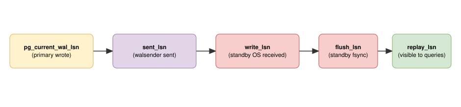

# 06 — Monitoring and Measuring Lag

Level: L300 → L400. Tested on PostgreSQL 18.6 with a deliberately paused replay
(`pg_wal_replay_pause()`) to create a known lag. Companion to
[logical topic 14](../LogicalReplication/14-monitoring-and-troubleshooting.md).

## Where to look



| What | View / function | Run on |
|---|---|---|
| Per-standby progress and lag | `pg_stat_replication` | primary |
| Slot retention | `pg_replication_slots` | primary |
| Receiver state | `pg_stat_wal_receiver` | standby |
| Positions | `pg_last_wal_receive_lsn()`, `pg_last_wal_replay_lsn()`, `pg_current_wal_lsn()` | standby / primary |
| Replay state | `pg_is_wal_replay_paused()`, `pg_get_wal_replay_pause_state()` | standby |
| Query-cancel counters | `pg_stat_database_conflicts` | standby |
| Recovery progress | `pg_stat_recovery_prefetch`, `pg_stat_wal_receiver`, startup process in `ps` | standby |
| Archive status | `pg_stat_archiver` | primary |
| Disk | `pg_ls_waldir()` | both |

## Lag in bytes — always correct

```sql
-- primary: per standby, split by stage
SELECT application_name, state, sync_state,
       pg_size_pretty(pg_wal_lsn_diff(pg_current_wal_lsn(), sent_lsn))  AS not_yet_sent,
       pg_size_pretty(pg_wal_lsn_diff(sent_lsn,  write_lsn))            AS sent_not_written,
       pg_size_pretty(pg_wal_lsn_diff(write_lsn, flush_lsn))            AS written_not_flushed,
       pg_size_pretty(pg_wal_lsn_diff(flush_lsn, replay_lsn))           AS flushed_not_replayed,
       pg_size_pretty(pg_wal_lsn_diff(pg_current_wal_lsn(), replay_lsn)) AS total_behind
FROM pg_stat_replication;
```

Which stage is big tells you the bottleneck:

| Large gap | Likely cause |
|---|---|
| `not_yet_sent` | Walsender slow/blocked, `wal_sender_timeout`, CPU; standby just connected (catching up) |
| `sent_not_written` | Network bandwidth/latency |
| `written_not_flushed` | Standby disk fsync latency |
| `flushed_not_replayed` | Redo is slower than the primary's generation rate (single-threaded replay, I/O-bound random page reads), **recovery conflicts**, `recovery_min_apply_delay`, paused replay |

### Real capture — replay paused, 30 000 rows written on the primary

```
sent_lsn    | 0/409E0A8     send_gap          | 0 bytes
write_lsn   | 0/409E0A8     write_flush_gap   | 0 bytes
flush_lsn   | 0/409E0A8     replay_gap        | 16 MB      <- everything received & fsynced, nothing replayed
replay_lsn  | 0/30387A8
```

Standby side:

```
paused      | t           pause_state | paused
recv        | 0/409E0A8   replay      | 0/30387A8     backlog | 16 MB
primary rows: 30010   standby rows: 10          <- queries on the standby see the old state
```

Note what is *protected*: the 16 MB is on the standby's disk (durable), so a failover would not
lose it — but it would have to be replayed before the standby accepts connections as a primary.

## Lag in time — three sources, three different traps

### 1. `pg_stat_replication.write_lag / flush_lag / replay_lag`

Measured by the primary: time between flushing a WAL position locally and the standby
confirming that stage. It's an interval measured on actual samples, so:

- **It lags the truth.** While replay was paused and 16 MB behind, `replay_lag` still read
  `00:00:00.102012` — a stale sample from before the pause (same behaviour as I saw for the logical
  case). The value is only updated when the standby acknowledges *new* progress.
- **NULL / 0 on an idle system.** If no WAL is generated, there's nothing to sample.
- After the standby caught up again: `write 0.38 ms / flush 0.59 ms / replay 2.6 ms`.

Good for *trending* under steady load; bad as the only alert.

### 2. `now() - pg_last_xact_replay_timestamp()` on the standby

The commit time of the last **replayed commit**. On an *idle* primary this keeps growing even though the
standby is perfectly in sync:

```
standby> select now() - pg_last_xact_replay_timestamp() as naive_lag,
                pg_last_wal_receive_lsn() = pg_last_wal_replay_lsn() as fully_replayed;
   naive_lag    | fully_replayed
 00:00:09.079083 | t
primary> replay_lag = 00:00:00.035734, bytes behind = 0
```

False alarm. Correct it with "if receive = replay then lag is 0":

```sql
SELECT CASE WHEN pg_last_wal_receive_lsn() = pg_last_wal_replay_lsn() THEN interval '0'
            ELSE now() - pg_last_xact_replay_timestamp() END AS replay_delay;
```

This formula still has an edge: a standby that is **disconnected** (receive = replay, nothing arriving) will look "fine".
Combine with `pg_stat_wal_receiver.status` and the primary's `pg_stat_replication` row count.

### 3. Heartbeat table (end-to-end, application-visible lag)

The only way to measure "how stale is the data I read" is to write a timestamp on the primary
periodically and read it back from the standby:

```sql
-- primary, every 1 s from a scheduler (pg_cron / external)
INSERT INTO heartbeat(id, ts) VALUES (1, clock_timestamp())
  ON CONFLICT (id) DO UPDATE SET ts = EXCLUDED.ts;
-- standby (same clock source needed; NTP/chrony!)
SELECT clock_timestamp() - ts AS true_lag FROM heartbeat WHERE id = 1;
```

Pattern only (not benchmarked here). Clock skew between hosts directly corrupts it.

## What to alert on

| Alert | Condition | Notes |
|---|---|---|
| Standby missing | `count(*) FROM pg_stat_replication` < expected, or `state <> 'streaming'` for > N s | Page |
| Byte lag | `total_behind` > threshold (e.g. > 1 GB or > 30 s of generation) | Use bytes, trend upward |
| Replay stalled | `flush_lsn` advancing but `replay_lsn` not, for > N min; or `pg_is_wal_replay_paused()` | Conflicts / pause / delay / disk |
| Slot at risk | `wal_status` ≠ `reserved`, or `safe_wal_size` near 0, inactive slot | [03](03-replication-slots-and-wal-retention.md) |
| WAL disk | `pg_ls_waldir()` size or filesystem % | Slots/archiving failure |
| Archiver failing | `pg_stat_archiver.failed_count` increasing, `last_archived_time` old | [08](08-cascading-delayed-archive.md) |
| Query cancellations | `pg_stat_database_conflicts` rate | [05](05-hot-standby-and-query-conflicts.md) |
| Sync waiters | `wait_event = 'SyncRep'` | [04](04-synchronous-replication.md) |
| Standby parameters | `max_connections` etc. below primary | startup failure ([02](02-standby-setup-guide.md)) |

## Useful one-offs

```sql
-- On the standby: am I in recovery, where am I, when did I last hear from the primary?
SELECT pg_is_in_recovery(), pg_last_wal_receive_lsn(), pg_last_wal_replay_lsn(),
       pg_last_xact_replay_timestamp();
SELECT status, receive_start_lsn, receive_start_tli, flushed_lsn, received_tli,
       sender_host, sender_port, slot_name, last_msg_send_time, last_msg_receipt_time
FROM pg_stat_wal_receiver;

-- Control file view (standby)
-- $ pg_controldata $PGDATA | egrep 'cluster state|Minimum recovery ending|Latest checkpoint'
```

`pg_stat_wal_receiver` observed values: `status = streaming`, `receive_start_tli = 1`, `received_tli = 1`
(timeline!), `sender_host/port`, `slot_name` empty when no slot is used.

## Causes of persistent lag and what to do

| Observation | Cause | Fix |
|---|---|---|
| Lag only during bulk operations (index build, big UPDATE, `VACUUM FULL`) | Redo can't keep up with the write burst | Standby I/O; `recovery_prefetch`, `maintenance_io_concurrency`; throttle the job |
| Replay slow on a standby with small shared_buffers | Redo needs random page reads | Larger cache, faster storage (redo is largely single-process) |
| `replay_gap` grows only while long queries run | Recovery conflicts with `max_standby_streaming_delay` | [05](05-hot-standby-and-query-conflicts.md) |
| `sent_not_written` grows | Network saturated | Bandwidth, `wal_compression`, compress in transit, different route |
| `not_yet_sent` grows | Walsender busy or blocked | CPU; too many standbys on one primary → cascade |
| Lag appears after standby restart | Normal catch-up | Wait, or check slot/archive |
| Standby falls permanently behind, disk of the primary grows | Slot retention | [03](03-replication-slots-and-wal-retention.md) |
| Many `SAVEPOINT`s or PL/pgSQL `EXCEPTION` blocks per transaction; standby reads slow while replay is also behind | Subtransactions add replay work, and a transaction with more than 64 of them (overflow) makes standby queries look up `pg_subtrans` | [Subtransactions and MultiXacts](#subtransactions-and-multixacts) |
| Hot parent row referenced by many foreign-key inserts; primary slow | MultiXacts: many sessions share a row lock. Mostly slows the **primary**, replay is barely affected | [Subtransactions and MultiXacts](#subtransactions-and-multixacts) |

## Subtransactions and MultiXacts

Both are transaction-ID bookkeeping that the primary writes to WAL and the standby has to replay.
Measured on PostgreSQL 18.7 (primary + async standby on one 4-core machine, `fsync=off`; a pause/resume of
replay to time redo alone). Treat the numbers as relative, not absolute.

**Subtransactions** come from `SAVEPOINT`, PL/pgSQL `BEGIN ... EXCEPTION` blocks, and drivers or ORMs that
wrap statements in savepoints. Each one that writes gets its own transaction ID.

| Workload (4 clients × 1500 transactions × 100 inserts) | Primary time | WAL | Standby replay time |
|---|---|---|---|
| plain inserts | 15.4 – 16.0 s | 81 MB | 3.8 s |
| each insert inside an `EXCEPTION` block (100 subtransactions per transaction) | 17.9 – 19.6 s | 86 MB | 4.3 s |

So heavy subtransaction use costs about 5% more WAL and about 15% more replay time. That is a measurable
but modest lag contribution.

The larger effect is on **standby reads**. A transaction with more than 64 subtransactions (it
"overflows" the per-backend cache) makes every snapshot taken while it is open resolve transaction IDs
through `pg_subtrans` (a disk-backed cache, the `subtransaction` SLRU). Test: one open overflowed
transaction on the primary, then a `count(*)` on the standby over 800k rows, 600k of them newer than that
transaction:

| State | `count(*)` on the standby | `subtransaction` SLRU accesses per scan |
|---|---|---|
| overflowed transaction open on the primary | 242 – 287 ms | 600 008 |
| it ended (after the next standby snapshot record) | 109 – 155 ms | 0 |

Standby queries run about twice as slow while it is open, and recover once it ends. In a busy system
those lookups compete for the same SLRU locks as replay. I did not get a clean measurement of that effect
on replay lag (the test machine ran out of CPU), so treat it as a risk, not a measured result.

**MultiXacts** appear when several transactions lock the same row at once: `SELECT ... FOR SHARE`, or
inserts into a child table whose foreign key points at one hot parent row.

| Workload (8 clients, 64 000 single-row inserts, all into the same parent) | Primary time | WAL | Standby replay time |
|---|---|---|---|
| child table without foreign key | 25.3 s | 54 MB | 5.25 s |
| child table with foreign key to one hot parent row | 55.1 s | 60 MB | 5.52 s |

MultiXacts made the **primary** take more than twice as long (the multixact SLRUs were read about 18 500 times each),
while WAL grew 10% and replay only 5%. The standby is not the bottleneck here. Replication lag from this
cause is usually small, because the primary writes WAL more slowly.

Checks (primary and standby):

```sql
-- SLRU activity: look for growing blks_read on these rows
SELECT name, blks_hit, blks_read FROM pg_stat_slru
WHERE name IN ('subtransaction', 'multixact_offset', 'multixact_member');
```

Wait events `SubtransSLRU`, `MultiXactOffsetSLRU` and `MultiXactMemberSLRU` in `pg_stat_activity` point to the
same problem (names from the documentation, not observed here).

What to do:
- Avoid a savepoint or `EXCEPTION` block per row. Keep a transaction under 64 subtransactions. Check
  the driver: for example JDBC `autosave=always` creates a savepoint per statement.
- End long transactions on the primary. An open overflowed transaction is what slows the standby.
- For hot parent rows, shorten the transactions that touch them or change the key design, so fewer
  sessions share the same row lock.
- PostgreSQL 17+ has `subtransaction_buffers`, `multixact_offset_buffers` and `multixact_member_buffers`
  (defaults in 18.7: 64, 16 and 32 × 8 kB). Raising them is possible, but I did not test it.

## Quick health script (primary)

```sql
SELECT r.application_name, r.state, r.sync_state,
       pg_size_pretty(pg_wal_lsn_diff(pg_current_wal_lsn(), r.replay_lsn)) AS behind,
       r.replay_lag,
       s.slot_name, s.wal_status, pg_size_pretty(s.safe_wal_size) AS slot_headroom
FROM pg_stat_replication r
LEFT JOIN pg_replication_slots s ON s.active_pid = r.pid;
```
