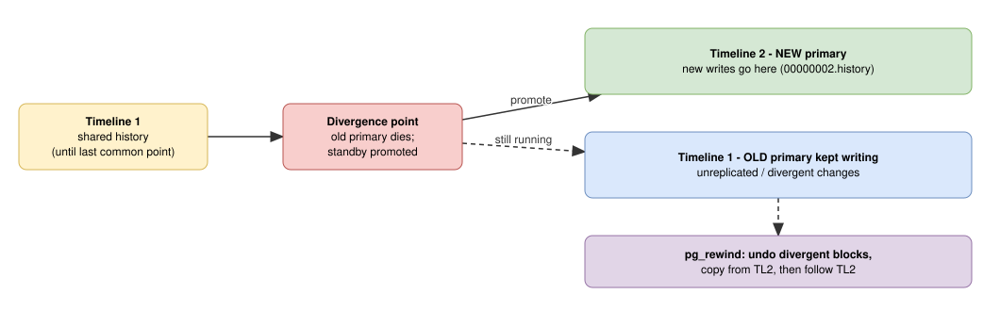
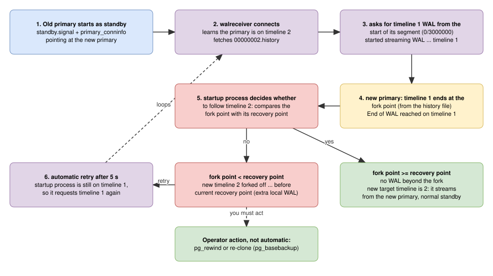
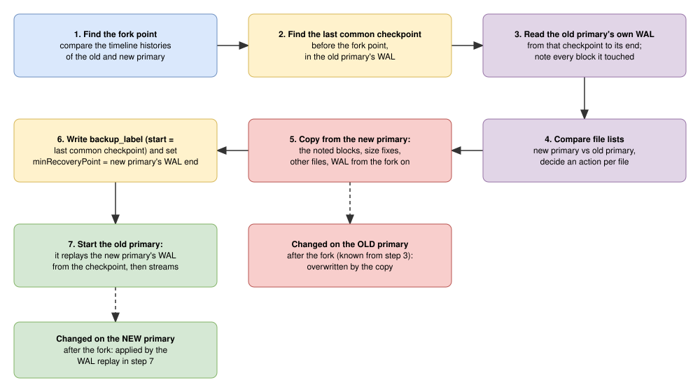

# 07 — Failover, Switchover, Promotion and `pg_rewind`

Level: L300 → L400. **Tested on PostgreSQL 18.6**: promotion, timeline history, rejoining a
diverged old primary (failure + `pg_rewind`), and a clean planned switchover. Orchestration
tools (Patroni, repmgr, pg_auto_failover, cloud HA) automate this; the notes explain what they
must get right.

## Vocabulary

| Term | Meaning |
|---|---|
| **Switchover** | Planned role swap: no data loss, old primary becomes a standby |
| **Failover** | Unplanned: the primary is lost; promote a standby, possibly losing unreplicated commits (async) |
| **Promotion** | Taking a standby out of recovery (`pg_ctl promote` / `pg_promote()`) |
| **Timeline** | A branch of WAL history; each promotion creates a new one |
| **Divergence** | Old primary wrote WAL the new primary never received |
| **Fencing / STONITH** | Making sure the old primary can't accept writes (avoid split brain) |

## Promotion mechanics

```bash
pg_ctl -D standby promote -w          # or: SELECT pg_promote(wait => true);
# server promoted
```

What happens: the startup process finishes replaying all WAL received, the standby leaves
recovery, picks **timeline N+1**, writes a `0000000N+1.history` file and an end-of-recovery
checkpoint, and starts accepting writes. Observed:

```
standby> select pg_is_in_recovery();                 -- f
pg_wal/000000010000000000000003      <- timeline 1 (the old WAL)
pg_wal/000000020000000000000003      <- timeline 2 starts mid-segment: same segment number, new TLI
pg_wal/00000002.history
   1   0/3039F60   no recovery target specified      <- "timeline 1 ended at LSN 0/3039F60 → new timeline 2"
```

`pg_controldata` shows `Latest checkpoint's TimeLineID` only after the end-of-recovery checkpoint
finishes (promotion is "fast promote": it returns before that checkpoint). Anything that reads the TLI
immediately after `promote` should wait (`-w`) and then check `pg_control_checkpoint()`.



Editable: [diagrams/timeline-fork.drawio](diagrams/timeline-fork.drawio).

## Which standby to promote?

The one with the **highest received/replayed LSN** on the same timeline:

```sql
SELECT pg_last_wal_receive_lsn(), pg_last_wal_replay_lsn(), pg_is_wal_replay_paused();
```

- Async replication: acknowledged commits not yet received by the chosen standby are **lost**. The loss window
  = `pg_current_wal_lsn()` at crash − that standby's `receive_lsn`.
- Sync replication (`on`) with a quorum: promote one of the standbys that confirmed — see the quorum arithmetic in
  [04](04-synchronous-replication.md).
- Standbys that are *behind* the promoted one must be re-pointed to it (they will follow the new timeline, as long as they
  hadn't received WAL the new primary lacks).

## Unplanned failover — what really happens to the old primary

Scenario: primary crashed; standby promoted; the old primary is restarted **and takes a write** before you notice
(a classic split-brain minute).

### Attempt 1: just make it a standby

```bash
touch old_primary/standby.signal   # + primary_conninfo pointing at the new primary
```

Log on the old primary:

```
LOG:  fetching timeline history file for timeline 2 from primary server
LOG:  started streaming WAL from primary at 0/3000000 on timeline 1
LOG:  new timeline 2 forked off current database system timeline 1 before current recovery point 0/30437E0
LOG:  restarted WAL streaming at 0/3000000 on timeline 1       <- loops
```

It **cannot join**: its own WAL contains changes after the fork point that the new primary doesn't have.
No amount of retrying helps.



Editable: [diagrams/old-primary-loop.drawio](diagrams/old-primary-loop.drawio).

#### Reading the log line by line

| Log line | What happened |
|---|---|
| `fetching timeline history file for timeline 2 from primary server` | The walreceiver connected and learned the new primary is on timeline 2. It downloads `00000002.history`, which records where timeline 1 ended (the **fork point**). Learning this does not make the standby follow timeline 2; the startup process decides that (below). |
| `started streaming WAL from primary at 0/3000000 on timeline 1` | The walreceiver asks for WAL on the timeline the startup process is on, here the old primary's own timeline 1, starting at the beginning of the WAL segment that holds its position (`0/3000000` is a segment boundary). |
| `replication terminated by primary server` + `DETAIL: End of WAL reached on timeline 1 at <fork point>` | The new primary sends timeline 1 only up to the fork point and then stops. (This pair is in the real log, between the lines above and below.) |
| `new timeline 2 forked off current database system timeline 1 before current recovery point 0/30437E0` | The startup process checks the fork point against its own recovery point, the end of the WAL it already has on timeline 1. Here the fork point is **before** `0/30437E0`, so the old primary has WAL the new timeline does not contain. It cannot switch to timeline 2 without discarding that WAL, so it refuses. |
| `restarted WAL streaming at 0/3000000 on timeline 1` | The walreceiver retries after `wal_retrieve_retry_interval` (5 s default). The startup process refused timeline 2 and is still on timeline 1, so the request is the same and steps 2 to 4 repeat forever. Nothing in the server escalates; breaking the loop is an operator action. A newer log line may also say `waiting for WAL to become available at ...`. |

The loop is a refusal, not a transient failure. Waiting, restarting or reloading does not change
the fork point or the old primary's local WAL.

Reproduced on PostgreSQL 18.7 (stop primary A cleanly, promote B, restart A and insert a row on it,
then start A as a standby of B):

| Item | Value |
|---|---|
| Fork point in `00000002.history` on B | `0/302EB38` |
| Old primary A's recovery point | `0/3033188`, about 18 KB past the fork point |
| Row `3` | exists only on A |
| Row `2` | exists only on B |
| Retry interval seen in the log | every 5 s |

If the old primary had **not** written anything after the fork point (recovery point at or before it), the
same attempt succeeds. Tested on PostgreSQL 18.7 (old primary stopped cleanly, standby promoted, old
primary started as a standby without taking a write). The log:

```
LOG:  fetching timeline history file for timeline 2 from primary server
LOG:  started streaming WAL from primary at 0/3000000 on timeline 1
LOG:  replication terminated by primary server        <- End of WAL reached on timeline 1 at 0/302EB38
LOG:  new target timeline is 2                        <- startup process accepts timeline 2
LOG:  restarted WAL streaming at 0/3000000 on timeline 2
LOG:  redo starts at 0/302EB38                        <- replay continues from the fork point
```

Result: `pg_stat_replication` on the new primary showed the old primary as `streaming` with
`replay_lsn` equal to `sent_lsn`, `pg_stat_wal_receiver.received_tli` was `2`, and a row inserted on the new
primary afterwards appeared on it. No rewind or rebuild was needed. After this you just treat it as a normal
standby: reconfigure `primary_conninfo`/slot as needed and check lag ([06](06-monitoring-and-lag.md)).
In practice a primary that restarts after a crash usually writes at least a checkpoint, so don't count on it.

### Attempt 2: `pg_rewind` (fast re-sync without a full copy)

`pg_rewind` finds the last common checkpoint, then copies from the new primary only the blocks the old primary
changed since then (plus all non-relation files), and discards the divergent changes.

#### How it works

`pg_rewind` does **not** undo the old primary's changes. It never reads the old values back. It answers one
question instead: *which blocks can differ from the new primary?* Everything else is, by construction, identical,
because both servers were the same cluster until the fork point.

The old primary's own WAL answers it. WAL records name every block they change, so the WAL written after the
fork is a complete list of the blocks the old primary modified.



Editable: [diagrams/pg-rewind-flow.drawio](diagrams/pg-rewind-flow.drawio).

1. **Find the fork point.** It compares the timeline history of the old primary with the new primary's
   (`00000002.history`) and gets the LSN where they diverged (`servers diverged at WAL location ...`).
2. **Find the last common checkpoint** before that point in the old primary's WAL
   (`rewinding from last common checkpoint at ...`). Both the WAL scan (step 3) and the final replay (step 6) start there.
3. **Read the old primary's WAL** from there to its end and collect `(file, block number)` for every record. The
   record contents are ignored, only which block was touched. Only the main fork is tracked; other forks are copied whole.
4. **Compare the file lists** of both servers and decide an action per file:

   | File situation | Action |
   |---|---|
   | Relation file, same size on both | Copy **only the blocks collected in step 3** |
   | Relation file, larger on old primary | Truncate to the new primary's size |
   | Relation file, smaller on old primary | Copy the missing tail |
   | Only on the old primary (created after the fork) | Remove |
   | Only on the new primary | Copy whole |
   | Non-relation file (`pg_xact`, config, `_fsm`, `_vm`, ...) | Copy whole |
   | WAL segment before the fork's segment, same size | Leave |
   | WAL segment from the fork's segment on | Copy from the new primary (replaces the divergent WAL) |

5. **Copy** those blocks and files from the new primary (over a normal connection, or from its data directory).
6. **Prepare recovery.** It writes a `backup_label` that starts replay at the last common checkpoint, and edits
   `pg_control` to `in archive recovery` with `minRecoveryPoint` = the new primary's current WAL end. This is the same
   mechanism as restoring a base backup taken from a live server.
7. **Start the old primary.** It replays the new primary's WAL from that checkpoint. This applies every block the
   *new primary* changed after the fork, including blocks `pg_rewind` did not copy. Then it streams normally.

Two sets of blocks are therefore handled in two different ways:

| Blocks changed after the fork | Found by | Fixed by |
|---|---|---|
| on the **old** primary | reading its WAL (step 3) | overwriting them with the new primary's current version (step 5) |
| on the **new** primary | nothing needs to find them | WAL replay (step 7) |

The copied blocks can be newer than the fork point, and that is fine: replay applies a record only when the page's
LSN is older than the record, so it is safe to replay over a page that is already ahead.

**Why the prerequisites exist.**
- **Checksums or `wal_log_hints = on`.** A hint-bit change normally leaves no WAL record, so the old primary could have
  modified a page without any trace and step 3 would miss it. With either setting, the first hint-bit change after a
  checkpoint writes a full-page image. Otherwise `pg_rewind` stops with
  `target server needs to use either data checksums or "wal_log_hints = on"`.
- **`full_page_writes = on`**. Required by the PostgreSQL documentation. Blocks copied from a live new primary can be caught mid-write,
  like in an online base backup; the full-page images in its WAL let replay repair them.
- **WAL since the last common checkpoint must still exist** on the old primary (step 3 reads it). Hence `-c` and `restore_command`.
- **Clean shutdown.** The tool only reads WAL up to the shutdown checkpoint (the source says it would otherwise have to replay
  to the first invalid record like crash recovery). If it wasn't clean, `pg_rewind` runs crash recovery first.

**How much does it copy?** PostgreSQL 18.7: 320 MB database (one 269 MB table plus its index). The old primary
then updated 500 rows and inserted 2000; the new primary updated 1001 other rows.

| Item | Size |
|---|---|
| `pg_rewind` reported | `need to copy 51 MB (total source directory size is 383 MB)` |
| Blocks of the 269 MB table and its index that were copied | 296 KB in 7 chunks |
| All `base/` chunks (including catalog files, `_fsm`, `_vm`) | 3.9 MB |
| The rest | three 16 MB WAL segments from the fork on |

After starting the old primary, the log showed `starting backup recovery with redo LSN 0/1E000028`, `redo starts at 0/1E0000A0`
(the fork point), `completed backup recovery ... end LSN 0/1E067880` and `started streaming WAL from primary at 0/1E000000 on timeline 2`.
Both servers then had 2 000 000 rows, 1001 rows updated on the new primary and **0** divergent rows. The tool
cost scales with how much the old primary changed after the fork, not with the size of the database.

**Compared with other databases.** `pg_rewind` is not unique in goal: Oracle's Flashback Database, which Data Guard
uses to reinstate a failed primary, also rolls an old primary back. The mechanism differs. Flashback needs flashback
logs with block before-images written in advance. `pg_rewind` needs no extra logging: it reuses the WAL the old primary
already has and takes the correct blocks from the new primary. (I did not test Oracle; this is from its documentation.)

Source: `src/bin/pg_rewind` (`pg_rewind.c`, `parsexlog.c`, `filemap.c`), PostgreSQL master (19devel).

#### Requirements and findings from the test

1. **Old primary must be shut down cleanly**; `pg_rewind` can run crash recovery itself in a single-user backend if
   needed (I saw `redo is not required` / `checkpoint … shutdown immediate` lines).
2. **Data checksums or `wal_log_hints = on`** must have been enabled on the old primary (PG18's `initdb` enables
   checksums by default; on older/other clusters set `wal_log_hints`, and note the setting must have been on **before** the divergence).
   `full_page_writes` must be `on`.
3. **A role on the source** (the new primary). Superuser works. For a least-privilege role (tested):

   ```sql
   CREATE ROLE rewind_user LOGIN REPLICATION;   -- REPLICATION so it can also be the streaming user
   GRANT EXECUTE ON function pg_catalog.pg_ls_dir(text, boolean, boolean) TO rewind_user;
   GRANT EXECUTE ON function pg_catalog.pg_stat_file(text, boolean) TO rewind_user;
   GRANT EXECUTE ON function pg_catalog.pg_read_binary_file(text) TO rewind_user;
   GRANT EXECUTE ON function pg_catalog.pg_read_binary_file(text, bigint, bigint, boolean) TO rewind_user;
   ```

   Without them: `pg_rewind: error: could not fetch remote file "global/pg_control": ERROR: permission denied for function pg_read_binary_file`.
4. **The old primary must still have the WAL since the last common checkpoint.** In my first run it didn't (the lab recycled it):

   ```
   pg_rewind: servers diverged at WAL location 0/3041370 on timeline 1
   pg_rewind: error: could not open file ".../pg_wal/000000010000000000000002": No such file or directory
   pg_rewind: error: could not find previous WAL record at 0/2000120
   ```

   With `wal_keep_size = 256MB` it worked. Production fixes: keep enough WAL (`wal_keep_size`/slot) or use `--restore-target-wal`
   (`-c`) with a `restore_command` so `pg_rewind` can fetch archived segments.
5. Run it:

   ```bash
   pg_rewind -D old_primary \
       --source-server="host=new-primary port=5432 user=rewind_user dbname=postgres" \
       --write-recovery-conf -P
   # pg_rewind: servers diverged at WAL location 0/3041370 on timeline 1
   # pg_rewind: rewinding from last common checkpoint at 0/2000080 on timeline 1
   # pg_rewind: need to copy 52 MB (total source directory size is 71 MB)
   # pg_rewind: Done!
   ```

   It writes `standby.signal` and a `primary_conninfo` pointing at the source (`--write-recovery-conf`).
6. **Gotcha: it copies configuration files too.** `pg_rewind` copies everything that isn't a relation
   file from the source — including `postgresql.conf`. In my test the old primary's `port = 5433` was followed by the new
   primary's `port = 5435` and it failed to start:

   ```
   WARNING:  could not create listen socket for "127.0.0.1"
   FATAL:  could not create any TCP/IP sockets
   ```

   (The rewind also left two `primary_conninfo` lines in `postgresql.auto.conf`; the last wins.)
   Fix: restore per-server settings (port, listen addresses, `application_name`, paths, `archive_command` with host-specific
   paths). Keep host-specific settings in an included file outside `PGDATA` (`include_dir`) or re-apply them in your
   automation.
7. Start it. Result (tested): `pg_is_in_recovery() = t`, `pg_stat_replication` on the new primary shows
   `walreceiver | streaming`, rows equal on both sides, and the **divergent row is gone** (`count = 0`).

   The divergent transaction is discarded. If it mattered, extract it before rewinding (e.g. read the old primary with
   `pg_waldump` or logical decoding) — after `pg_rewind` it's lost.

### Attempt 3: re-clone

If `pg_rewind` isn't possible (no WAL, no checksums/hints, big divergence) re-create the old primary with `pg_basebackup`
([02](02-standby-setup-guide.md)).

## Planned switchover (no data loss, no rewind)

Tested on 18.6:

1. Stop writers (app, or `ALTER SYSTEM SET default_transaction_read_only`, or just stop the primary).
2. `pg_ctl -m fast -w stop` on the primary: shutdown writes a **shutdown checkpoint** and the walsender is allowed
   to send everything before exiting.
3. Confirm the standby has everything: the primary's last checkpoint (`pg_controldata … "Latest checkpoint location"` =
   `0/3048C20`) must be ≤ standby `pg_last_wal_receive_lsn()` (`0/3048C98` ✓).
4. Promote the standby: `SELECT pg_promote(wait => true)`.
5. Turn the old primary into a standby: `touch standby.signal`, add `primary_conninfo` for the new primary, start.
   Log: `End of WAL reached on timeline 1 at 0/3048C98` then it follows timeline 2. Rows: 1001 = 1000 + `after-switch`.
   `pg_stat_replication` on the new primary: `walreceiver | streaming`.
6. Repoint clients / VIP / DNS; rebuild other standbys' `primary_conninfo`; fix `synchronous_standby_names` etc.

Because the old primary shut down cleanly **and** the standby had received the shutdown checkpoint, there is no
divergence and no `pg_rewind` is needed. If step 3 shows the standby is *behind*, don't promote yet — start the primary
again or wait.

## Failover safety checklist

- [ ] **Fence the old primary** (kill it, remove it from the VIP, revoke network). Two primaries = divergence.
- [ ] Pick the most advanced standby (`receive_lsn`, same timeline).
- [ ] Ensure remaining standbys can follow (`recovery_target_timeline = latest` is the default since PG12).
- [ ] Have the replication user/hba on the **new** primary too (hba is per server; a standby promoted without the
      `replication` rule can't serve the next standby — I added it manually in the test).
- [ ] Re-create slots on the new primary for standbys/consumers (physical slots are not copied; logical slots only with
      `failover` slot sync, [logical topic 16](../LogicalReplication/16-failover-and-ha.md)).
- [ ] Restore `synchronous_standby_names` appropriate to the new topology (and watch for the
      "no sync standby → writes block" trap, [04](04-synchronous-replication.md)).
- [ ] Archive: switch `archive_command` target consistently; archive the history file ([08](08-cascading-delayed-archive.md)).
- [ ] Update connection routing; check poolers (PgBouncer reconnect), DNS TTL.
- [ ] Rebuild the old primary (`pg_rewind` / re-clone) before reuse.
- [ ] Post-mortem the lost-commit window (async) and compare sequences/application state.

## Promotion triggers and recovery targets

| Option | Meaning |
|---|---|
| `pg_ctl promote`, `pg_promote()` | Immediate promotion after replay of what was received |
| `promote_trigger_file` | **Removed in PG16**; use `pg_promote()` |
| `recovery_target_timeline` | `latest` (default) — follow the newest timeline from the archive/primary |
| `recovery_target_*` (time, lsn, xid, name) + `recovery_target_action = promote` | PITR, not failover ([08](08-cascading-delayed-archive.md)) |

## Split-brain recovery notes

If both nodes took writes you must choose a winner and **throw away** the loser's divergent work (or manually
merge). `pg_rewind` does the discard; it cannot merge. For critical systems, use quorum-based HA tooling and
synchronous replication with fencing.
